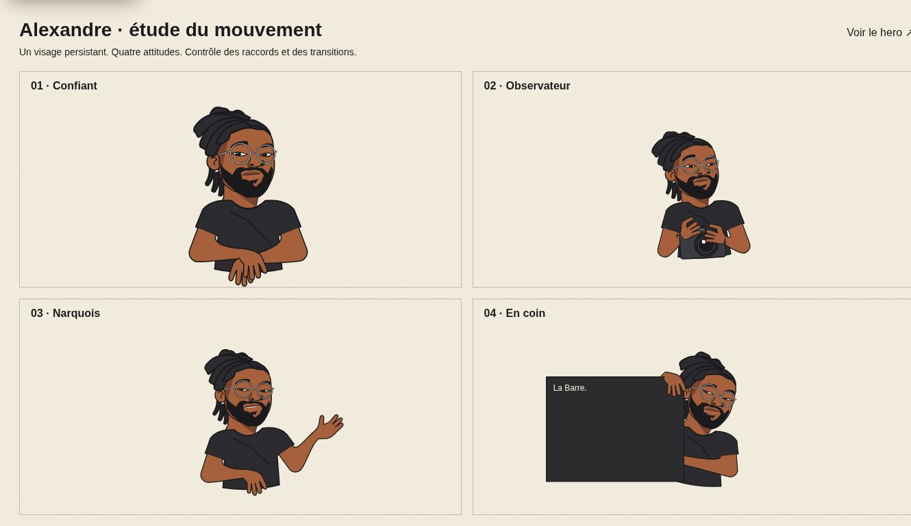

# Hero magazine — correction du personnage

## Pourquoi cette reprise

La première version n'a pas passé la revue visuelle : doubles manches, raccords visibles aux poignets et aux coudes, changement d'expression par fondu entre des têtes complètes. Les validations de compilation et de navigation de cette version ne validaient pas son dessin.

## Source actuelle

Le personnage du hero est maintenant un dessin SVG natif. `MagazineCharacter.tsx` reste monté entre les quatre slides.

- `graphicGeometry.ts` : palette, poses, volumes continus des bras et du vêtement.
- `GraphicHead.tsx` : un seul visage, sa chevelure et sa barbe ; les yeux, les sourcils et la bouche évoluent séparément.
- `handContours.ts` : contours compatibles des mains, pour interpoler leur forme sans remplacer un sprite.
- `poses.ts` : position, échelle et inclinaison dans les compositions desktop/mobile.

La transition interpole les angles des membres, leurs longueurs projetées et l'attitude du visage sur une même progression. Une interpolation directe de la position du poignet raccourcissait trop le bras au milieu du geste : elle a été remplacée. Les contours du bras se terminent sur le même repère et la même tangente que la main. Il n'y a pas de trait de fermeture au poignet. Le coude est un contour arrondi, sans pièce articulée visible. Le vêtement contient ses manches dans un seul contour.

La quatrième pose place une main au premier plan du panneau. Le bras opposé revient derrière ce panneau. Les expressions restent petites : bouche fermée sur les poses 1, 2 et 4 ; fine bande de dents sur le sourire de la pose 3.

Le bouton pause, la réduction des animations, l'arrêt hors écran et le déclencheur du logo à la sortie du hero restent présents.

## Revue reproductible

Ouvrir `/character-lab` : quatre poses, quatre gros plans du même visage et un contrôleur de transition avec les positions 0 / 25 / 50 / 75 / 100 %. Le bouton de lecture montre le mouvement sur trois secondes. Ce contrôleur utilise le composant du hero, avec les mêmes données de pose et le même calcul des articulations. La page est exclue de l'indexation.

`node scripts/export-graphic-rig.mjs` exporte les quatre poses et les quatre expressions actuelles en SVG autonomes dans `public/character/graphic-rig`. Les anciens assets WebP dans `magazine-rig` sont des archives de la version rejetée et ne sont plus chargés par le personnage.

Ce rig s'exécute dans le navigateur. Aucun fichier After Effects ou rig Duik n'est fourni. La ressemblance et le niveau d'exagération restent des critères de revue artistique, distincts des contrôles techniques.

## Épreuves de cette reprise

| Question | Observation | Décision |
| --- | --- | --- |
| Les manches et épaules se doublent-elles ? | Un seul contour de vêtement, sans pièces de manches superposées. | Ancien assemblage retiré. |
| Le bras garde-t-il son volume pendant le geste ? | La première interpolation de points écrasait le bras à 50 %. | Interpolation d'angles et longueurs projetées. |
| Le coude affiche-t-il des lignes internes parasites ? | Une première correction produisait une boucle de contour. | Bord intérieur simplifié et contour externe arrondi. |
| Les expressions changent-elles l'identité ? | Le visage, le nez, les oreilles, la barbe et les locs restent les mêmes éléments. | Plus de fondu entre têtes. |
| La main tient-elle le panneau ? | Position du poignet recalée vers l'intérieur du bord ; doigts devant le panneau. | Pose 4 corrigée. |

La planche de contrôle et les rendus du hero permettent la revue visuelle. Aucune publication sur Coolify n'est attestée par cette modification.

## Validation technique

- `npm run build` : compilation, vérification TypeScript et génération des 68 routes réussies.
- `npm run typecheck` : réussi après le build.
- `git diff --check` : réussi.
- Revue navigateur : quatre poses desktop, transition couverture → direction à 50 % et 75 %, prise du panneau, formats 390 px et 768 px.
- Les coordonnées SVG sont arrondies avant rendu pour éviter une divergence serveur/navigateur due aux flottants trigonométriques.

