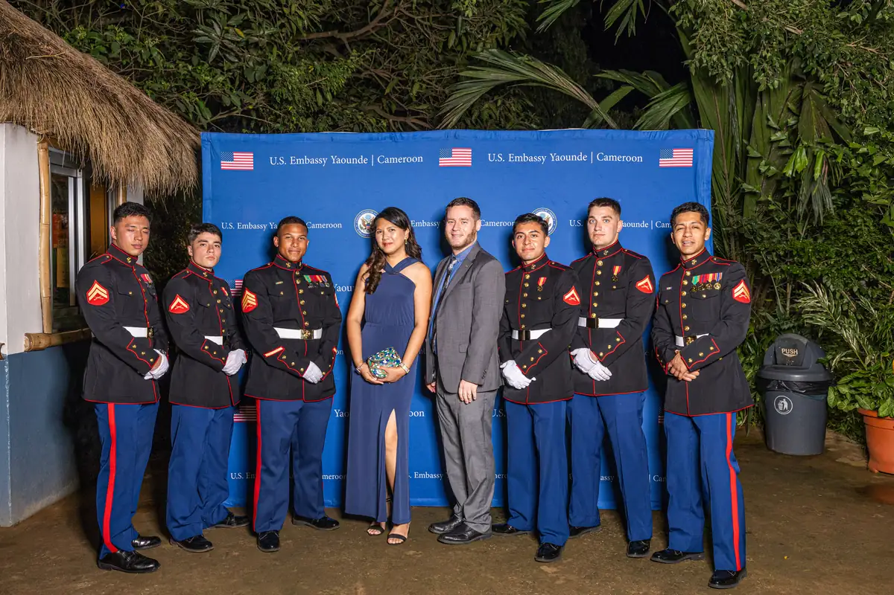

# Ambassade des États-Unis

<!-- wiki:infobox -->

| Ambassade des États-Unis | |
| --- | --- |
| Nature | Institution diplomatique |
| Relation | Client |
| Projets liés | 2 |
| État de la fiche | Ébauche |
<!-- /wiki:infobox -->

**Ambassade des États-Unis** est un client d’Alexandre « Xtincell » Djengue, suivi avec UPgraders.

## Présentation

_À documenter._

## Galerie

<!-- wiki:galerie -->

<!-- /wiki:galerie -->

## Archives de travail

<!-- wiki:archives -->
_Relevé en lecture seule des disques de travail, 2026-11-09. Les pièces administratives et les commandes privées ne sont pas détaillées._

| | |
| --- | --- |
| Structure | UPgraders |
| Disques | C:, P: |
| Fichiers | 2 551 (43 Go) |
| Contenu | 2 544 photos · 7 documents |
| Année | 2023 |

**Dossiers**

- **2023** (2 551 fichiers) : Bal des Marines (2 544)

**Opérations repérées lors du rangement**

- Bal des Marines
<!-- /wiki:archives -->

## Projets

<!-- wiki:projets -->
- **2023** — [Ambassade des États-Unis — travaux](../projets/ambassade-des-etats-unis-travaux.md)
- **2023** — [Bal des Marines de l'ambassade des États-Unis (Marine Corps Ball)](../projets/evt-2023-11-11-bal-des-marines-de-l-ambassade-des-etats-unis-marine-corp.md)
<!-- /wiki:projets -->

<!-- wiki:liens-entrants -->
---
**Pages liées** : [Alexandre « Xtincell » Djengue](../personnes/alexandre-djengue.md) · [Ambassade des États-Unis — travaux](../projets/ambassade-des-etats-unis-travaux.md) · [Bal des Marines de l'ambassade des États-Unis (Marine Corps Ball)](../projets/evt-2023-11-11-bal-des-marines-de-l-ambassade-des-etats-unis-marine-corp.md)
<!-- /wiki:liens-entrants -->
