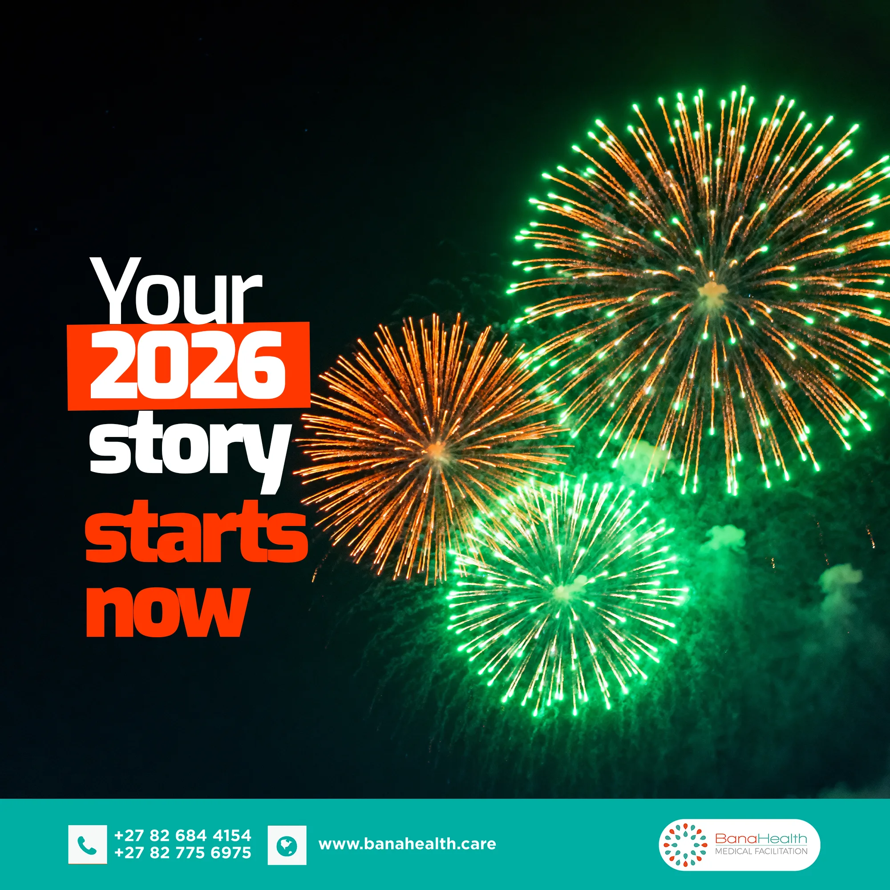

# BanaHealth

<!-- wiki:infobox -->

| BanaHealth | |
| --- | --- |
| Nature | Santé |
| Relation | Client |
| Période | 2017 |
| Projets liés | 1 |
| État de la fiche | Standard |
<!-- /wiki:infobox -->

**BanaHealth** (santé) est un client d’Alexandre « Xtincell » Djengue depuis 2017.

## Présentation

Service de facilitation médicale (voyage de soins). BanaHealth est ajoutée au profil Facebook d’Alexandre en juin 2017. Le CV de novembre 2020 la cite parmi les clients d’UPgraders, pour son identité de marque ; Alexandre la présente comme cliente dans son témoignage de 2018 ; il produit des contenus pour elle en 2022. Dans une lettre de recommandation datée du 28 novembre 2020, Marie Ngameni, fondatrice et CEO de BanaHealth, le décrit comme le consultant en design graphique de l’entreprise depuis trois ans : nouvelle identité de marque (logo, palette), refonte du site et des supports de campagne, modèles marketing (brochures, rapports). Les données du site ne la présentent qu’à travers un projet de 2025 ([confrontation des sources](../sources.md#confrontation-élément-par-élément)). _Sources : [facebook](../sources.md#facebook), [cv-2020](../sources.md#cv-2020), [blog-disrupteur-2018](../sources.md#blog-disrupteur-2018), [lettre-banahealth-2020](../sources.md#lettre-banahealth-2020), [cv-2023-05](../sources.md#cv-2023-05)._

## Site internet (2026)

En 2026, le site `banahealth.care`, jusque-là sous WordPress, est refondu en site statique (Astro) : les pages sont générées à la compilation, sans base de données ni code exécuté côté serveur, et les contenus sont rédigés en Markdown et versionnés. _Source : [imac-2026-11](../sources.md#imac-2026-11)._

## Archives de travail

<!-- wiki:archives -->
_Relevé en lecture seule des disques de travail, 2026-11-09. Les pièces administratives et les commandes privées ne sont pas détaillées._

| | |
| --- | --- |
| Structure | UPgraders |
| Disques | C:, P: |
| Fichiers | 873 (9,8 Go) |
| Contenu | 383 photos · 303 autres · 111 documents · 76 fichiers de création |
| Années | 2023–2026 |

**Dossiers**

- **2023** (6 fichiers)
- **2024** (9 fichiers)
- **2025** (9 fichiers)
- **2026** (5 fichiers)
- **ADmin** (27 fichiers)
- **Archive** (3 fichiers)
- **Assets** (161 fichiers) : CEO PHOTO (7) · Doc (40) · Logo (4) · Photo (44) · Social Media logo (16) · Stock Photo (50)
- **Backstage** (30 fichiers)
- **Brand Banahealth** (284 fichiers) : Livrable (231) · Livrable Part II (7)
- **Old Work** (91 fichiers) : Banahealth MotherDay (2)
- **SERVICE** (37 fichiers) : glory (3)
- **WEB Archive** (112 fichiers) : web archive Banahealth save 01 (112)
- **_Identité** (3 fichiers)

**Opérations repérées lors du rangement**

- Logos BanaHealth trouvés dans le dossier BAMS
- Dossier BanaHealth (structure d'origine conservée)
- BanaHealth : personae et flyer
- Visuels BanaHealth (vœux, cartes)
- BanaHealth : vœux 2026, Noël, « Every year with you »
<!-- /wiki:archives -->

## Projets

<!-- wiki:projets -->
- **2025** — [BanaHealth — Facilitation médicale](../projets/banahealth.md)
<!-- /wiki:projets -->

## Sources

- Export du compte Facebook (2023) — voir [facebook](../sources.md#facebook)
- CV « Creative Consultant », 30 novembre 2020 — voir [cv-2020](../sources.md#cv-2020)
- Alexandre Djengue, « Mon expérience de designer graphique free-lance au Cameroun », *Le blog du disrupteur*, 8 octobre 2018 — voir [blog-disrupteur-2018](../sources.md#blog-disrupteur-2018)
- CV « Dircom », 16 mai 2023 — voir [cv-2023-05](../sources.md#cv-2023-05)
- Lettre de recommandation de BanaHealth, 28 novembre 2020 — voir [lettre-banahealth-2020](../sources.md#lettre-banahealth-2020)

<!-- wiki:liens-entrants -->
---
**Pages liées** : [Alexandre « Xtincell » Djengue](../personnes/alexandre-djengue.md) · [BanaHealth — Facilitation médicale](../projets/banahealth.md)
<!-- /wiki:liens-entrants -->
