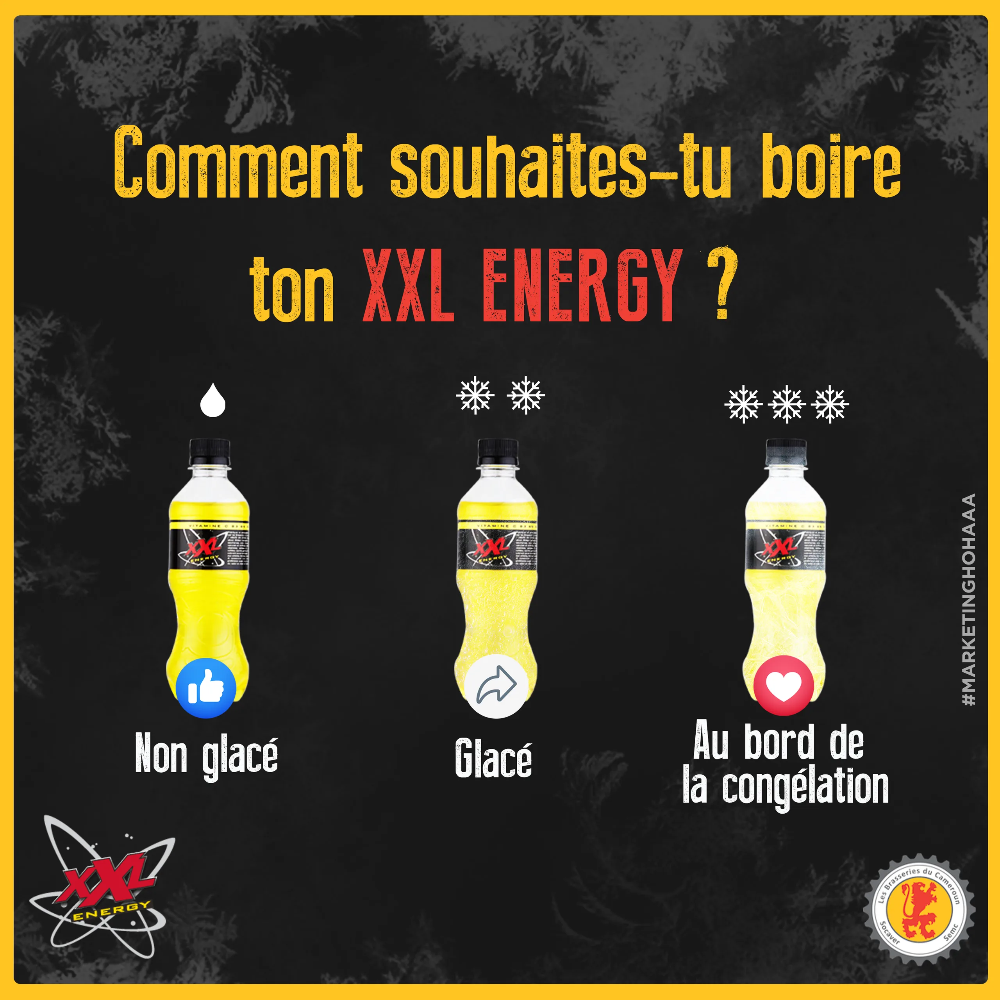
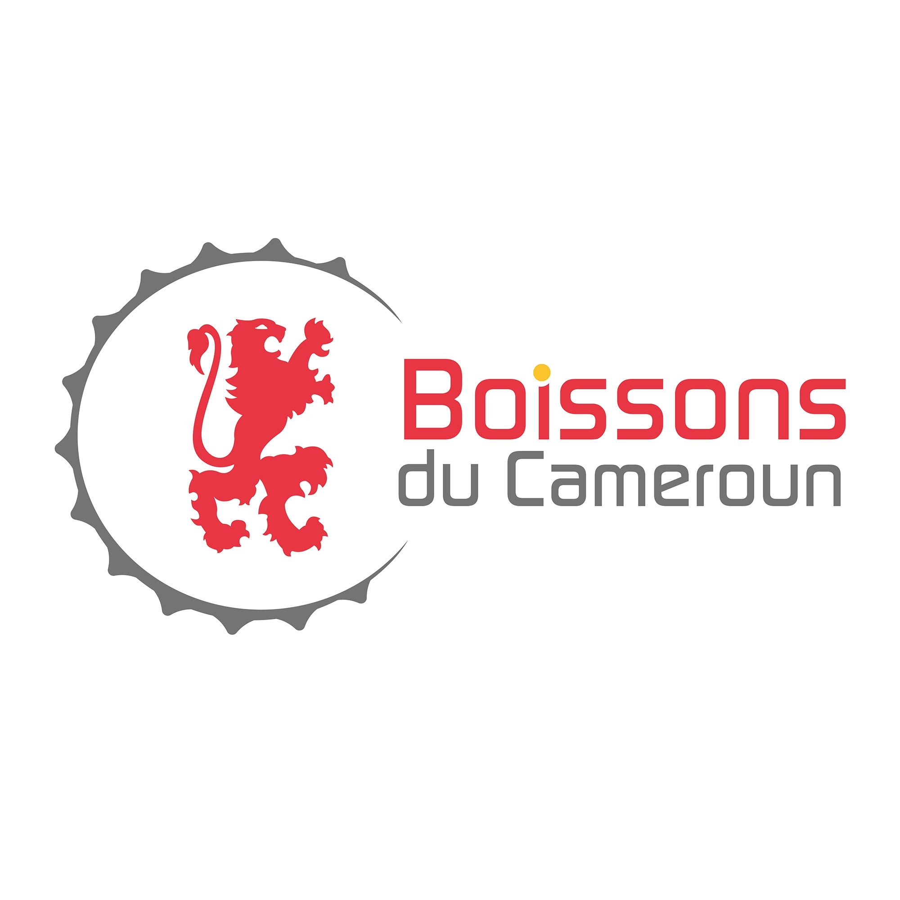

# Les Brasseries du Cameroun (SABC)

<!-- wiki:infobox -->

| Les Brasseries du Cameroun (SABC) | |
| --- | --- |
| Nature | Brasseur / boissons |
| Relation | Client |
| Marques | Top |
| Projets liés | 3 |
| État de la fiche | Ébauche |
<!-- /wiki:infobox -->

**Les Brasseries du Cameroun (SABC)** (brasseur / boissons) est un client d’Alexandre « Xtincell » Djengue.

## Présentation

_À documenter._

## Marques

- Top

## Galerie

<!-- wiki:galerie -->

<!-- /wiki:galerie -->

## Archives de travail

<!-- wiki:archives -->
_Relevé en lecture seule des disques de travail, 2026-11-09. Les pièces administratives et les commandes privées ne sont pas détaillées._

| | |
| --- | --- |
| Structure | UPgraders |
| Disques | P: |
| Fichiers | 142 (0,6 Go) |
| Contenu | 124 photos · 16 documents · 2 autres |
| Année | 2020 |

**Dossiers**

- **2020** (118 fichiers) : Documents (période Bimstr) (14) · Visuels (période Bimstr) (102)
- **Top — packshots (30-09-2020)** (10 fichiers)
- **Top — packshots reçus (2020-2021)** (14 fichiers)

**Opérations repérées lors du rangement**

- Seul client cité, 5 fois — SABC
<!-- /wiki:archives -->

## Projets

<!-- wiki:projets -->
- **2024–2025** — [Brasseries du Cameroun — XXL & Top](../projets/brasseries-du-cameroun.md)
- **2020–2022** — [Top (SABC) — direction artistique & production](../projets/top-sabc.md)
- **2020–2022** — [Top (SABC) — direction artistique & production](../projets/top-sabc.md) _(en tant qu’agence relais)_
<!-- /wiki:projets -->

<!-- wiki:liens-entrants -->
---
**Pages liées** : [Brasseries du Cameroun — XXL & Top](../projets/brasseries-du-cameroun.md) · [Top (SABC) — direction artistique & production](../projets/top-sabc.md)
<!-- /wiki:liens-entrants -->
