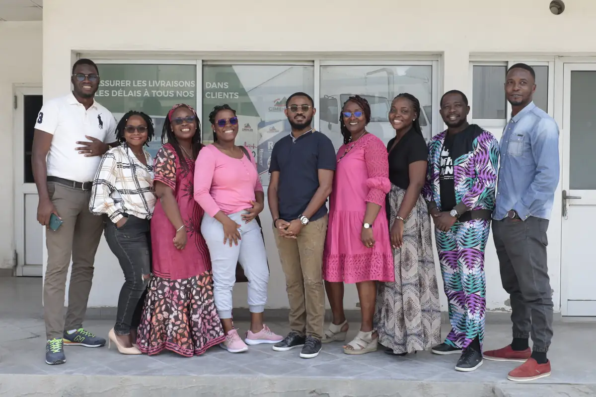

# Cimencam

<!-- wiki:infobox -->

| Cimencam | |
| --- | --- |
| Nature | Cimenterie |
| Relation | Client |
| Projets liés | 2 |
| État de la fiche | Ébauche |
<!-- /wiki:infobox -->

**Cimencam** (cimenterie) est un client d’Alexandre « Xtincell » Djengue.

## Présentation

_À documenter._

## Projets

<!-- wiki:projets -->
- **2023** — [Cimencam — reportage photo d'entreprise (usine de Bonabéri)](../projets/evt-2023-02-27-cimencam-reportage-photo-d-entreprise-usine-de-bonaberi.md)
- **2023–2024** — [Cimencam — vidéo corporate](../projets/cimencam-video-corporate.md)
<!-- /wiki:projets -->

<!-- wiki:liens-entrants -->
---
**Pages liées** : [Cimencam — reportage photo d'entreprise (usine de Bonabéri)](../projets/evt-2023-02-27-cimencam-reportage-photo-d-entreprise-usine-de-bonaberi.md) · [Cimencam — vidéo corporate](../projets/cimencam-video-corporate.md)
<!-- /wiki:liens-entrants -->
