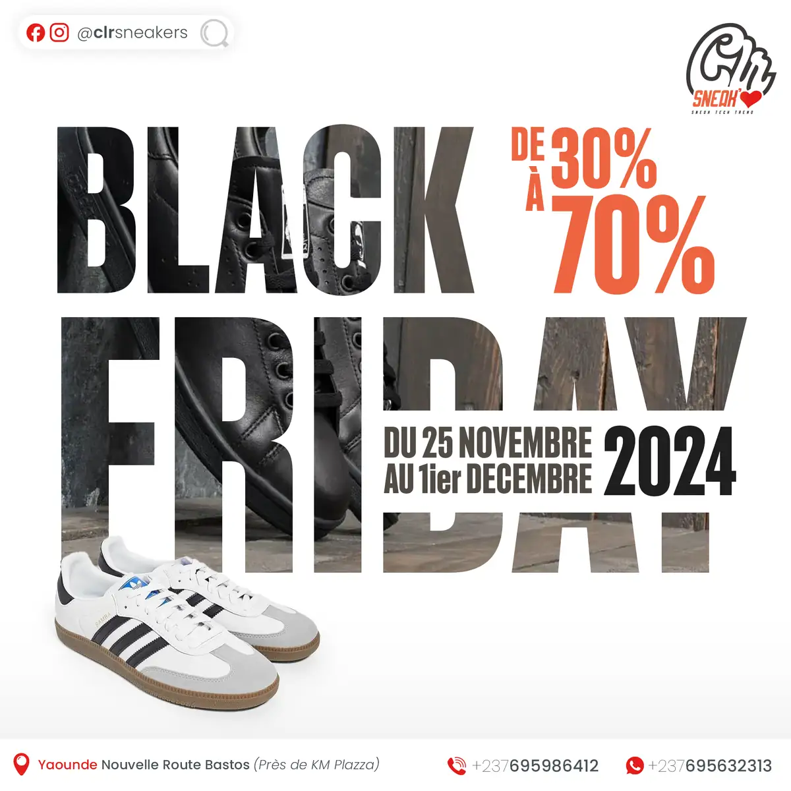

# CLR Sneakers

<!-- wiki:infobox -->

| CLR Sneakers | |
| --- | --- |
| Nature | À préciser |
| Relation | Client |
| Projets liés | 1 |
| État de la fiche | Ébauche |
<!-- /wiki:infobox -->

**CLR Sneakers** est un client d’Alexandre « Xtincell » Djengue, suivi avec UPgraders.

## Présentation

_À documenter._

## Archives de travail

<!-- wiki:archives -->
_Relevé en lecture seule des disques de travail, 2026-11-09. Les pièces administratives et les commandes privées ne sont pas détaillées._

| | |
| --- | --- |
| Structure | UPgraders |
| Disques | P: |
| Fichiers | 21 (0,4 Go) |
| Contenu | 11 photos · 5 documents · 5 fichiers de création |
| Année | 2024 |

**Dossiers**

- **2024** (5 fichiers)
<!-- /wiki:archives -->

## Projets

<!-- wiki:projets -->
- **2024** — [CLR Sneakers — travaux](../projets/clr-sneakers-travaux.md)
<!-- /wiki:projets -->

<!-- wiki:liens-entrants -->
---
**Pages liées** : [CLR Sneakers — travaux](../projets/clr-sneakers-travaux.md)
<!-- /wiki:liens-entrants -->
