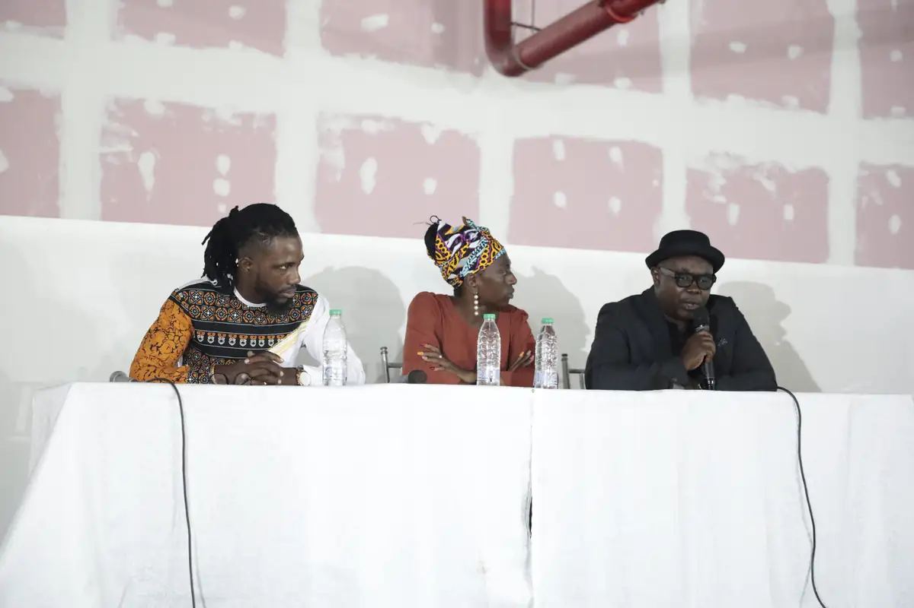

# Douala Art Fair

<!-- wiki:infobox -->

| Douala Art Fair | |
| --- | --- |
| Nature | Foire d'art |
| Relation | Client |
| Projets liés | 2 |
| État de la fiche | Ébauche |
<!-- /wiki:infobox -->

**Douala Art Fair** est un client d’Alexandre « Xtincell » Djengue, suivi avec UPgraders.

## Présentation

_À documenter._

## Galerie

<!-- wiki:galerie -->

<!-- /wiki:galerie -->

## Archives de travail

<!-- wiki:archives -->
_Relevé en lecture seule des disques de travail, 2026-11-09. Les pièces administratives et les commandes privées ne sont pas détaillées._

| | |
| --- | --- |
| Structure | UPgraders |
| Disques | P: |
| Fichiers | 50 (1,8 Go) |
| Contenu | 50 photos |
| Année | 2022 |

**Dossiers**

- **2022** (50 fichiers) : Douala Art Fair (03-06-11-2022) (50)
<!-- /wiki:archives -->

## Projets

<!-- wiki:projets -->
- **2022** — [Douala Art Fair](../projets/evt-2022-11-03-douala-art-fair.md)
- **2022** — [Douala Art Fair — travaux](../projets/douala-art-fair-travaux.md)
<!-- /wiki:projets -->

<!-- wiki:liens-entrants -->
---
**Pages liées** : [Douala Art Fair](../projets/evt-2022-11-03-douala-art-fair.md) · [Douala Art Fair — travaux](../projets/douala-art-fair-travaux.md)
<!-- /wiki:liens-entrants -->
