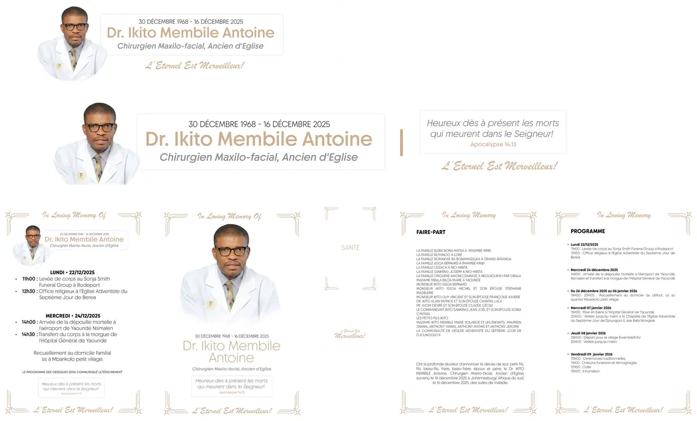

# Drikito

<!-- wiki:infobox -->

| Drikito | |
| --- | --- |
| Nature | À préciser |
| Relation | Client |
| Projets liés | 1 |
| État de la fiche | Ébauche |
<!-- /wiki:infobox -->

**Drikito** est un client d’Alexandre « Xtincell » Djengue, suivi avec UPgraders.

## Présentation

_À documenter._

## Archives de travail

<!-- wiki:archives -->
_Relevé en lecture seule des disques de travail, 2026-11-09. Les pièces administratives et les commandes privées ne sont pas détaillées._

| | |
| --- | --- |
| Structure | UPgraders |
| Disques | C: |
| Fichiers | 48 (1,4 Go) |
| Contenu | 23 photos · 17 documents · 5 autres · 3 fichiers de création |
| Année | 2025 |

**Dossiers**

- **2025** (13 fichiers)
- **output** (9 fichiers) : pdf (9)
- **travail** (25 fichiers) : audit (1) · fidelite (17)

**Opérations repérées lors du rangement**

- Livret et programme « Dr. Ikito Membile Antoine »
<!-- /wiki:archives -->

## Projets

<!-- wiki:projets -->
- **2025** — [Drikito — travaux](../projets/drikito-travaux.md)
<!-- /wiki:projets -->

<!-- wiki:liens-entrants -->
---
**Pages liées** : [Drikito — travaux](../projets/drikito-travaux.md)
<!-- /wiki:liens-entrants -->
