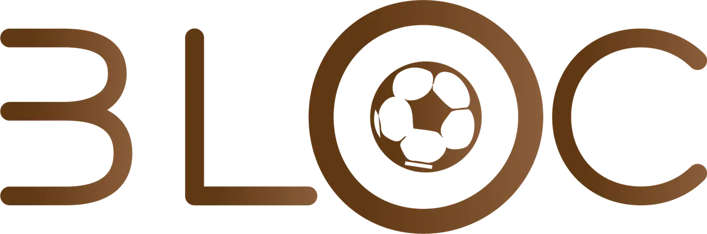

# EasyGroup

<!-- wiki:infobox -->

| EasyGroup | |
| --- | --- |
| Nature | À préciser |
| Relation | Client |
| Projets liés | 1 |
| État de la fiche | Ébauche |
<!-- /wiki:infobox -->

**EasyGroup** est un client d’Alexandre « Xtincell » Djengue, suivi avec UPgraders.

## Présentation

_À documenter._

## Archives de travail

<!-- wiki:archives -->
_Relevé en lecture seule des disques de travail, 2026-11-09. Les pièces administratives et les commandes privées ne sont pas détaillées._

| | |
| --- | --- |
| Structure | UPgraders |
| Disques | P: |
| Fichiers | 19 (99 Mo) |
| Contenu | 9 documents · 9 photos · 1 fichiers de création |
| Année | 2021 |

**Dossiers**

- **2021** (19 fichiers) : Logos partenaires (14)
<!-- /wiki:archives -->

## Projets

<!-- wiki:projets -->
- **2021** — [EasyGroup — travaux](../projets/easygroup-travaux.md)
<!-- /wiki:projets -->

<!-- wiki:liens-entrants -->
---
**Pages liées** : [EasyGroup — travaux](../projets/easygroup-travaux.md)
<!-- /wiki:liens-entrants -->
