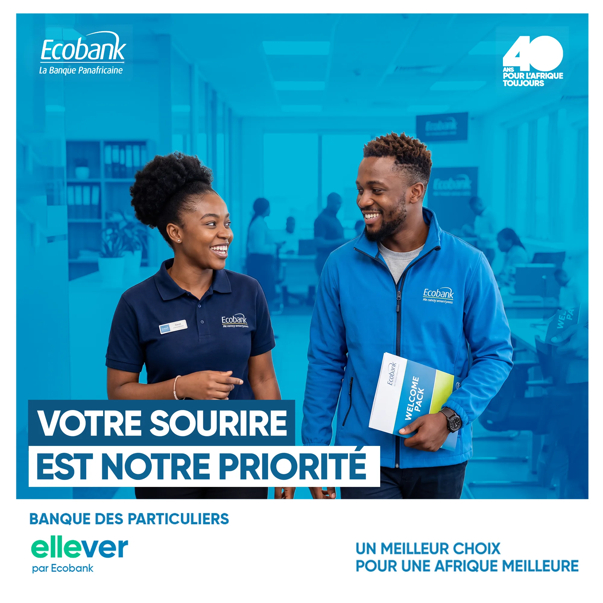

# Ecobank

<!-- wiki:infobox -->

| Ecobank | |
| --- | --- |
| Nature | Banque panafricaine |
| Relation | Client |
| Projets liés | 1 |
| État de la fiche | Ébauche |
<!-- /wiki:infobox -->

**Ecobank** (banque panafricaine) est un client d’Alexandre « Xtincell » Djengue.

## Présentation

_À documenter._

## Archives de travail

<!-- wiki:archives -->
_Relevé en lecture seule des disques de travail, 2026-11-09. Les pièces administratives et les commandes privées ne sont pas détaillées._

| | |
| --- | --- |
| Structure | MATANGA |
| Disques | C: |
| Fichiers | 13 (43 Mo) |
| Contenu | 10 photos · 3 documents |
| Années | 2025–2026 |

**Dossiers**

- **2026** (8 fichiers)
- **Le long de l'année** (4 fichiers) : 2025 (4)
<!-- /wiki:archives -->

## Projets

<!-- wiki:projets -->
- **2026** — [Ecobank — 40 ans & ellever](../projets/ecobank.md)
<!-- /wiki:projets -->

<!-- wiki:liens-entrants -->
---
**Pages liées** : [Ecobank — 40 ans & ellever](../projets/ecobank.md)
<!-- /wiki:liens-entrants -->
