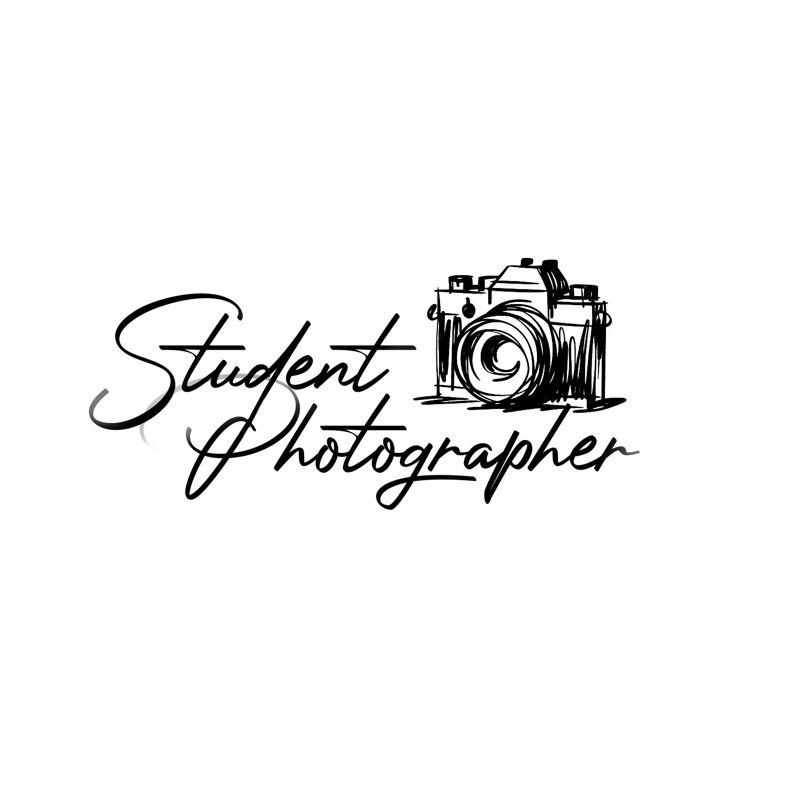
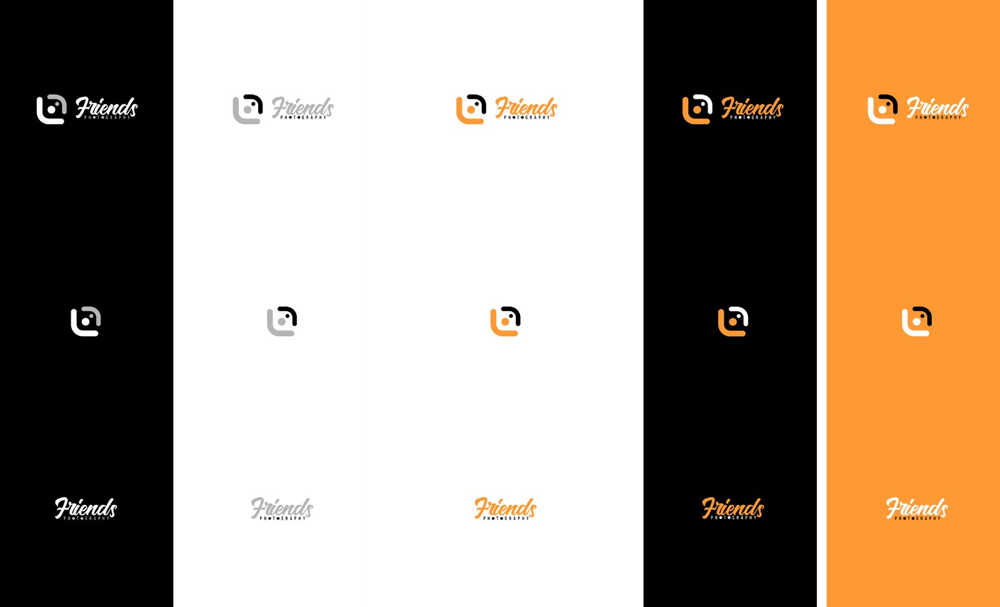
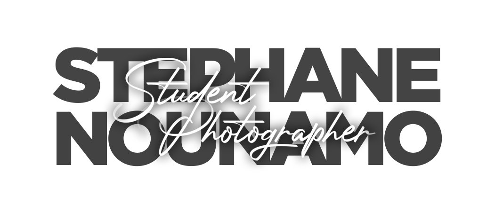
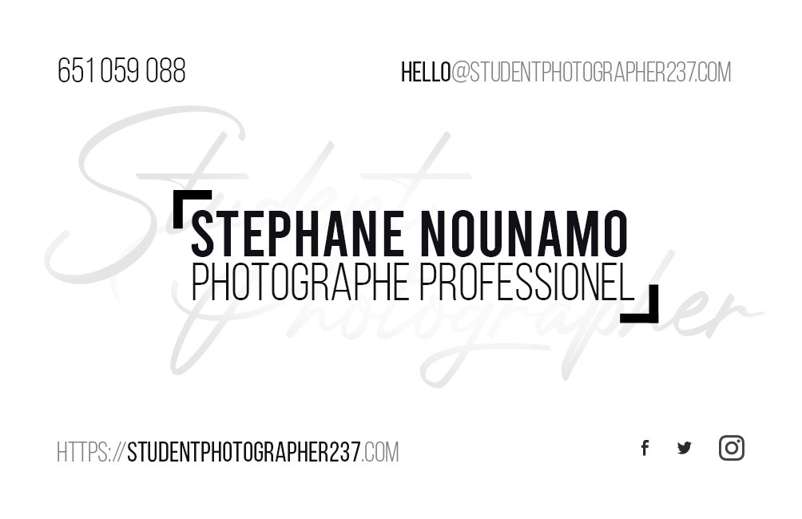
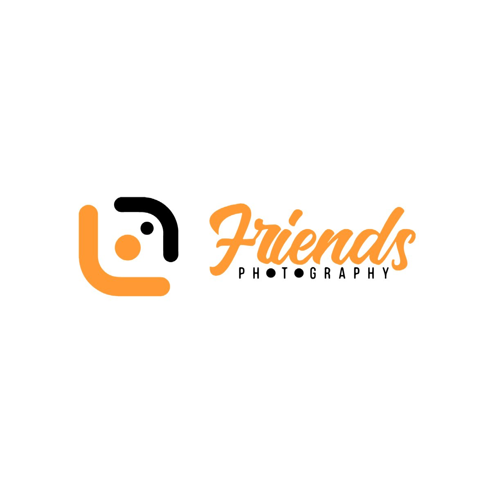
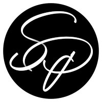
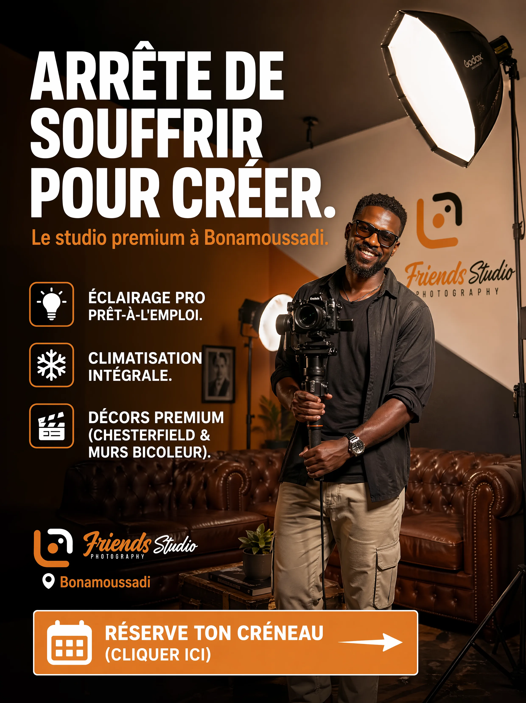
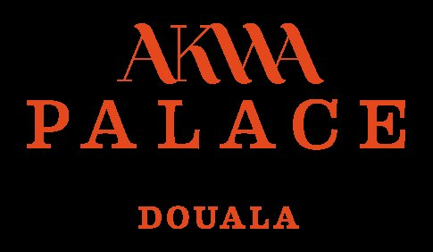
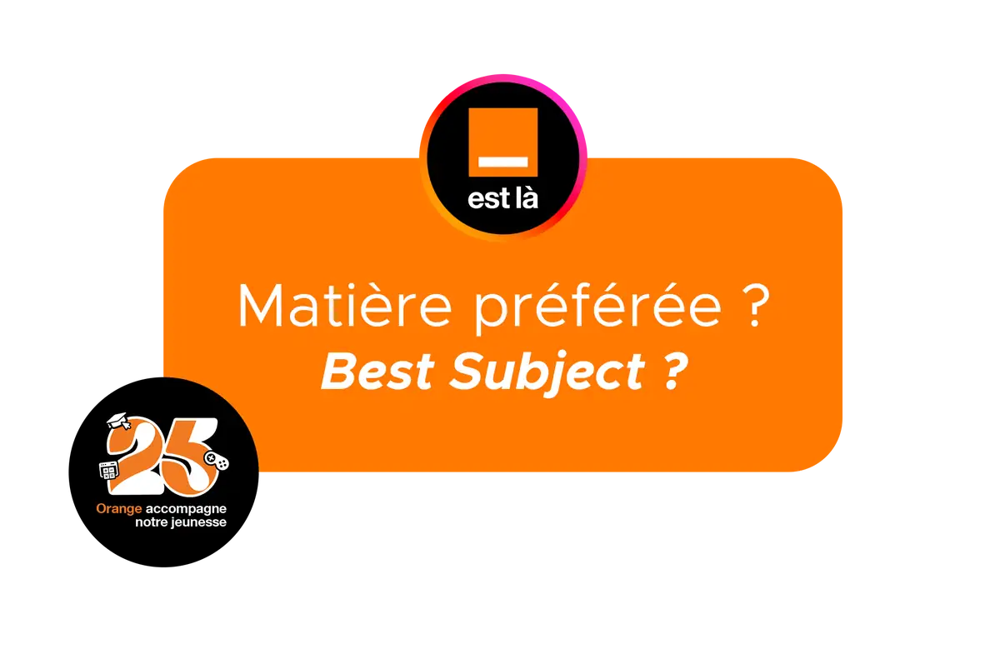
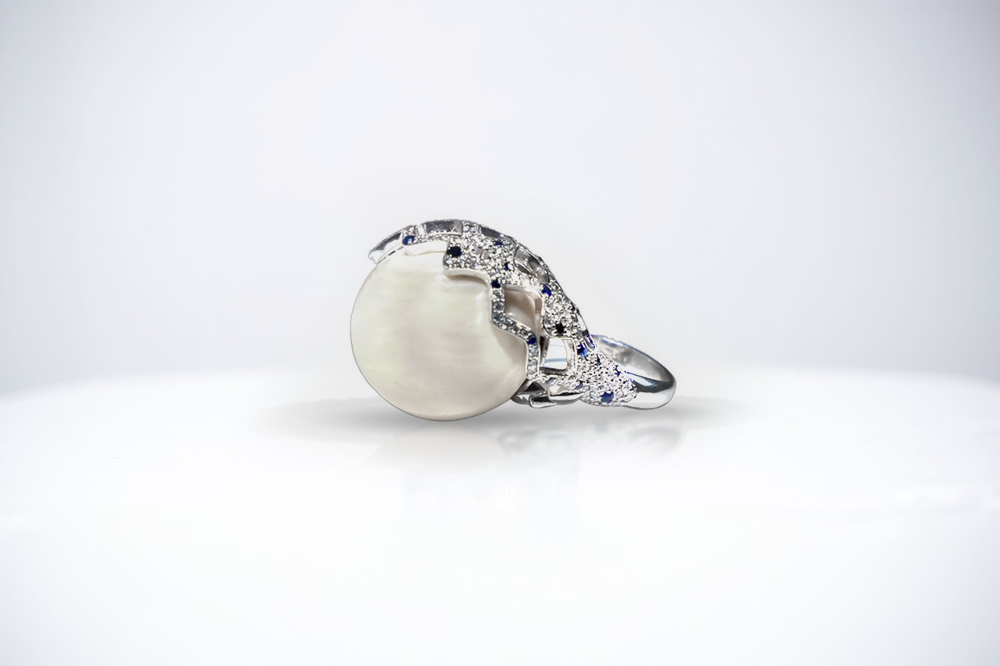

# Friends Photography Studio

<!-- wiki:infobox -->

| Friends Photography Studio | |
| --- | --- |
| Nature | Studio de production photo & vidéo (cellule « La Guilde ») |
| Relation | Partenaire |
| Rôle d’Alexandre | Responsable du développement d'activité |
| Période | 2020–… |
| Lieu | Douala |
| Personnes | [Stéphane Nounamo](../personnes/stephane-nounamo.md) |
| Projets liés | 8 |
| État de la fiche | Standard |
<!-- /wiki:infobox -->

**Friends Photography Studio** (studio de production photo & vidéo (cellule « La Guilde »)) est une structure partenaire d’Alexandre « Xtincell » Djengue, 2020–….

## Présentation

Studio de production audiovisuelle co-animé avec le photographe Stéphane Nounamo, partenaire d'exécution privilégié d'UPgraders. Pilotage commercial et créatif : direction artistique, partenariats, prises de vue corporate et événementielles.

Le studio naît de la collaboration entre Alexandre et le photographe [Stéphane Nounamo](../personnes/stephane-nounamo.md). Celui-ci tient d’abord le restaurant Friends Food, attesté de 2017 à 2020 par les profils d’Alexandre, puis se tourne vers la photographie. Selon Alexandre, leur collaboration commence après la pandémie de Covid-19 ; les premières séances communes rangées dans les archives datent de 2020. Le CV de 2026 fait remonter ce binôme aux campagnes Orange de 2013–2018 ; aucune source d’époque ne l’étaye ([confrontation des sources](../sources.md#confrontation-élément-par-élément)). _Sources : [facebook](../sources.md#facebook), [twitter](../sources.md#twitter), [disques](../sources.md#disques), [temoignage-2026-11-09](../sources.md#temoignage-2026-11-09)._

## Rôle d’Alexandre

Responsable du développement d'activité

## Galerie

<!-- wiki:galerie -->

<!-- /wiki:galerie -->

## Archives de travail

<!-- wiki:archives -->
_Relevé en lecture seule des disques de travail, 2026-11-09. Les pièces administratives et les commandes privées ne sont pas détaillées._

| | |
| --- | --- |
| Structure | UPgraders |
| Disques | C:, E:, P: |
| Fichiers | 374 307 (2 610 Go) |
| Contenu | 267 821 autres · 102 251 photos · 3 702 vidéos · 241 fichiers de création · 203 documents · 89 sons |
| Années | 2020–2026 |

**Dossiers**

- **_Le studio** (269 401 fichiers) : Folio (6) · Pilotage & offres (48) · Site web (4) · Sons (1) · _Identité & communication (62) · Événements (4)

Commandes privées : 101 381 fichiers (séances et événements de particuliers, non détaillés ici).
<!-- /wiki:archives -->

## Projets

<!-- wiki:projets -->
- **2026** — [Friends Studio — Studio photo premium](../projets/friends-studio.md)
- **2025** — [Akwa Palace — vidéo publicitaire](../projets/akwa-palace.md) _(en tant qu’agence relais)_
- **2025–2026** — [Orange Cameroun — événements 2025–2026](../projets/orange-evenements-2025-2026.md) _(en tant qu’agence relais)_
- **2024** — [Maison Gimane — production photo & vidéo](../projets/maison-gimane.md) _(en tant qu’agence relais)_
- **2024** — [Oceanis Kribi · The Villa — production vidéo & image](../projets/oceanis-kribi-the-villa.md) _(en tant qu’agence relais)_
- **2023–2024** — [Cimencam — vidéo corporate](../projets/cimencam-video-corporate.md) _(en tant qu’agence relais)_
- [Orange Cameroun — photographie de campagnes](../projets/orange-campagnes-photo.md) _(en tant qu’agence relais)_
- [Retlaw × HoHaaa Music — clip](../projets/retlaw-clip.md) _(en tant qu’agence relais)_
<!-- /wiki:projets -->

## Sources

- Export du compte Facebook (2023) — voir [facebook](../sources.md#facebook)
- Export du compte Twitter (28 juillet 2023) — voir [twitter](../sources.md#twitter)
- Archives de travail rangées sur les disques — voir [disques](../sources.md#disques)
- Témoignage d’Alexandre Djengue, 9 novembre 2026 — voir [temoignage-2026-11-09](../sources.md#temoignage-2026-11-09)
- CV de 2026, repris par le CV du site et `practices.ts` — voir [cv-2026](../sources.md#cv-2026)

<!-- wiki:liens-entrants -->
---
**Pages liées** : [Akwa Palace — vidéo publicitaire](../projets/akwa-palace.md) · [Alexandre « Xtincell » Djengue](../personnes/alexandre-djengue.md) · [Cimencam — vidéo corporate](../projets/cimencam-video-corporate.md) · [Friends Studio — Studio photo premium](../projets/friends-studio.md) · [Maison Gimane — production photo & vidéo](../projets/maison-gimane.md) · [Oceanis Kribi · The Villa — production vidéo & image](../projets/oceanis-kribi-the-villa.md) · [Orange Cameroun](orange-cameroun.md) · [Orange Cameroun — événements 2025–2026](../projets/orange-evenements-2025-2026.md) · [Orange Cameroun — photographie de campagnes](../projets/orange-campagnes-photo.md) · [Retlaw × HoHaaa Music — clip](../projets/retlaw-clip.md) · [Stéphane Nounamo](../personnes/stephane-nounamo.md)
<!-- /wiki:liens-entrants -->
