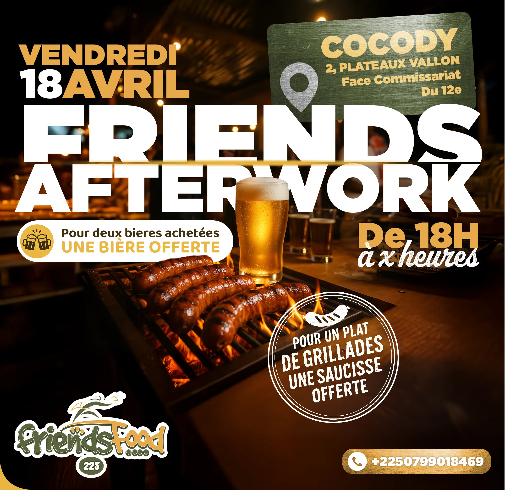

# FriendsFood 225

<!-- wiki:infobox -->

| FriendsFood 225 | |
| --- | --- |
| Nature | Restauration |
| Relation | Client |
| Projets liés | 1 |
| État de la fiche | Ébauche |
<!-- /wiki:infobox -->

**FriendsFood 225** (restauration) est un client d’Alexandre « Xtincell » Djengue.

## Présentation

_À documenter._

## Archives de travail

<!-- wiki:archives -->
_Relevé en lecture seule des disques de travail, 2026-11-09. Les pièces administratives et les commandes privées ne sont pas détaillées._

| | |
| --- | --- |
| Structure | UPgraders |
| Disques | C:, P: |
| Fichiers | 28 (0,7 Go) |
| Contenu | 14 autres · 11 photos · 2 fichiers de création · 1 vidéos |
| Année | 2024 |

**Dossiers**

- **2024** (13 fichiers) : Bêtisier (1)

**Opérations repérées lors du rangement**

- Affiche BBQ foot, restau-grill
- Bêtisier Friends Food
- Visuels Friends Food
<!-- /wiki:archives -->

## Projets

<!-- wiki:projets -->
- **2025** — [FriendsFood 225 — Friends Afterwork](../projets/friendsfood.md)
<!-- /wiki:projets -->

<!-- wiki:liens-entrants -->
---
**Pages liées** : [FriendsFood 225 — Friends Afterwork](../projets/friendsfood.md)
<!-- /wiki:liens-entrants -->
