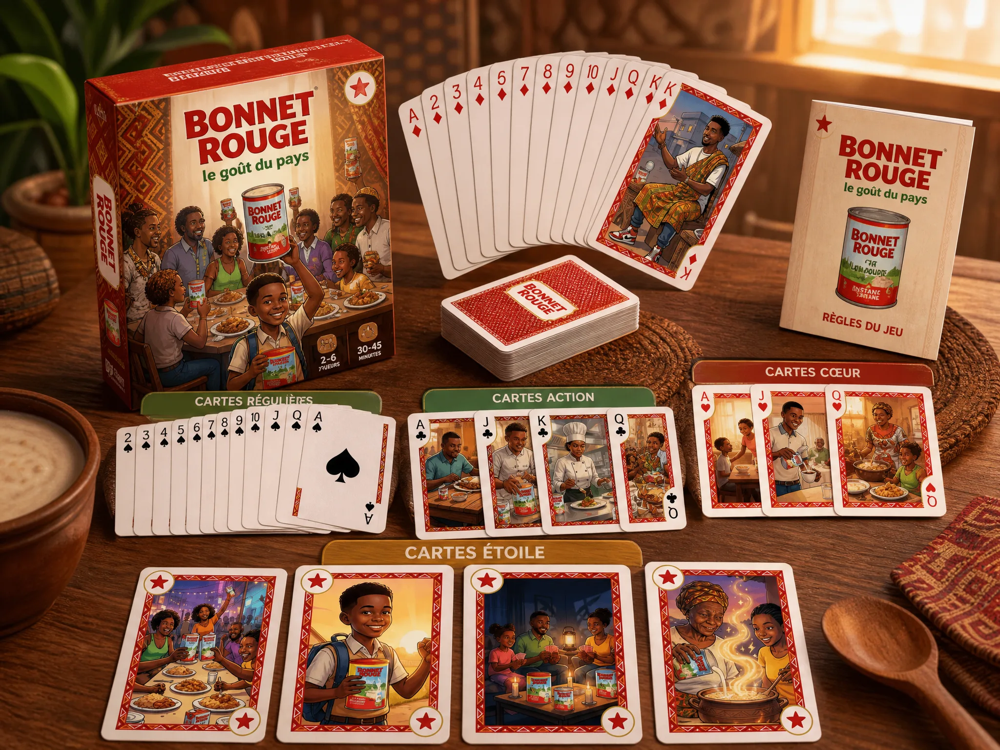
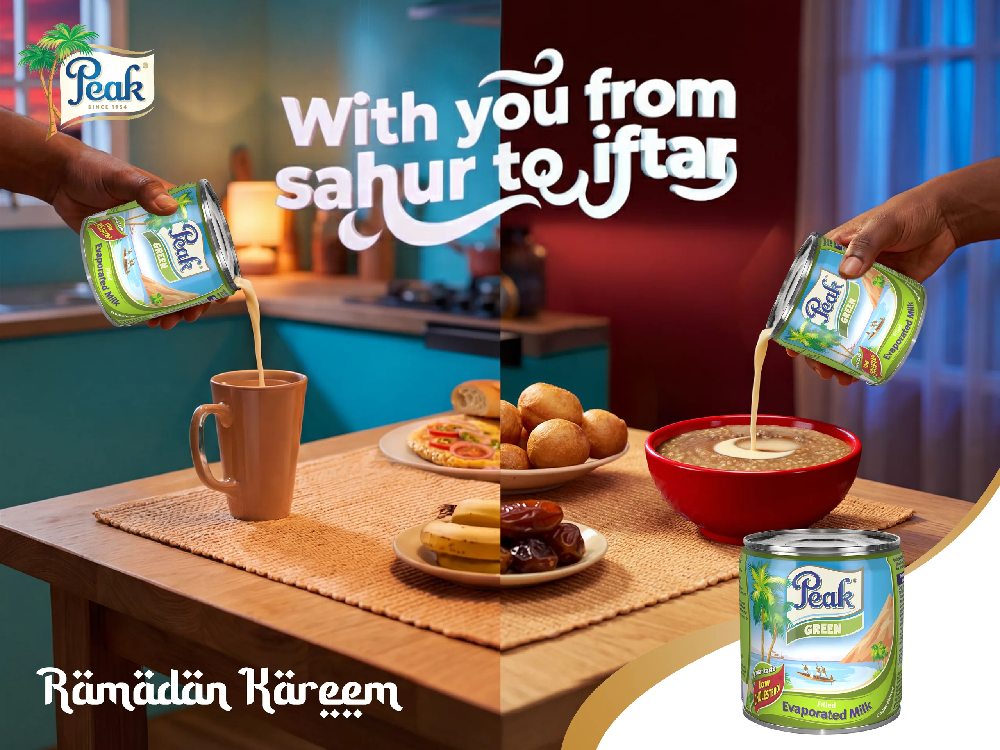

# FrieslandCampina

<!-- wiki:infobox -->

| FrieslandCampina | |
| --- | --- |
| Nature | Industrie laitière |
| Relation | Client |
| Marques | Peak · Bonnet Rouge |
| Projets liés | 2 |
| État de la fiche | Ébauche |
<!-- /wiki:infobox -->

**FrieslandCampina** (industrie laitière) est un client d’Alexandre « Xtincell » Djengue.

## Présentation

_À documenter._

## Marques

- Peak
- Bonnet Rouge

## Galerie

<!-- wiki:galerie -->

<!-- /wiki:galerie -->

## Archives de travail

<!-- wiki:archives -->
_Relevé en lecture seule des disques de travail, 2026-11-09. Les pièces administratives et les commandes privées ne sont pas détaillées._

| | |
| --- | --- |
| Structure | MATANGA |
| Disques | C:, P: |
| Fichiers | 303 (12 Go) |
| Contenu | 193 photos · 73 documents · 31 fichiers de création · 5 autres · 1 vidéos |
| Années | 2023–2026 |

**Dossiers**

- **Belle Hollandaise** (22 fichiers) : 2026 (3) · Campagnes ponctuelles (2) · Le long de l'année (16)
- **Bonnet Rouge** (177 fichiers) : Campagnes ponctuelles (108) · Le long de l'année (52) · _Identité de marque (4) · _Packaging & étiquettes (12)
- **Coast** (3 fichiers) : 2025 (2)
- **Peak** (38 fichiers) : 2023 (4) · Campagnes ponctuelles (4) · Le long de l'année (27) · _Packaging & étiquettes (1)
- **Pearl** (6 fichiers) : Le long de l'année (3) · _Identité de marque (1) · _Packaging & étiquettes (1)
- **_Groupe — stickers 2026** (56 fichiers)
<!-- /wiki:archives -->

## Projets

<!-- wiki:projets -->
- **2025** — [Bonnet Rouge — « Puissance Lactée » (TCG)](../projets/tcg-bonnet-rouge.md)
- **2025–2026** — [Peak & Bonnet Rouge — Campagnes saisonnières](../projets/friesland-campina.md)
<!-- /wiki:projets -->

<!-- wiki:liens-entrants -->
---
**Pages liées** : [Bonnet Rouge — « Puissance Lactée » (TCG)](../projets/tcg-bonnet-rouge.md) · [Peak & Bonnet Rouge — Campagnes saisonnières](../projets/friesland-campina.md)
<!-- /wiki:liens-entrants -->
