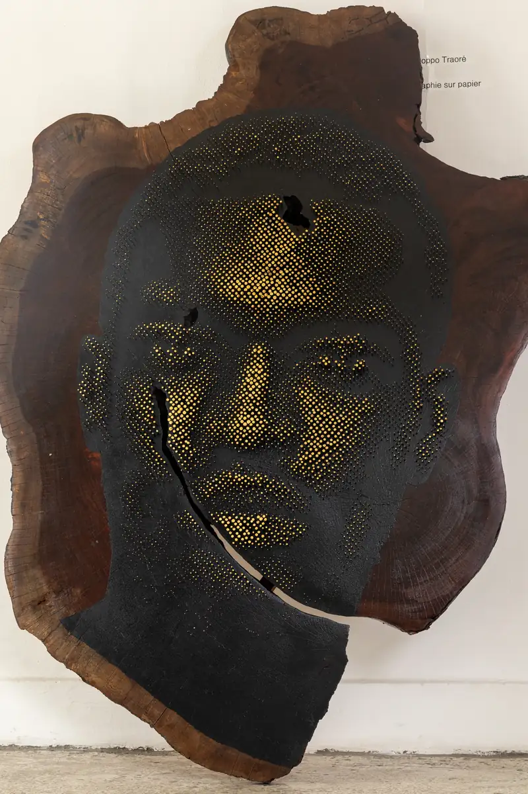
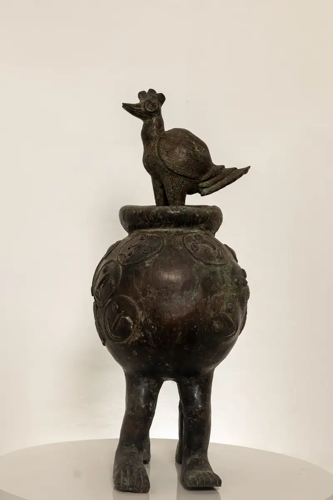

# Galerie MAM

<!-- wiki:infobox -->

| Galerie MAM | |
| --- | --- |
| Nature | Galerie d'art |
| Relation | Client |
| Projets liés | 2 |
| État de la fiche | Ébauche |
<!-- /wiki:infobox -->

**Galerie MAM** est un client d’Alexandre « Xtincell » Djengue, suivi avec UPgraders.

## Présentation

_À documenter._

## Galerie

<!-- wiki:galerie -->

<!-- /wiki:galerie -->

## Archives de travail

<!-- wiki:archives -->
_Relevé en lecture seule des disques de travail, 2026-11-09. Les pièces administratives et les commandes privées ne sont pas détaillées._

| | |
| --- | --- |
| Structure | UPgraders |
| Disques | C:, P: |
| Fichiers | 61 (0,6 Go) |
| Contenu | 60 photos · 1 documents |
| Année | 2022 |

**Dossiers**

- **2022** (61 fichiers) : Galerie MAM (60)

**Opérations repérées lors du rangement**

- Archive Spark : Galerie MAM (archive Spark)
<!-- /wiki:archives -->

## Projets

<!-- wiki:projets -->
- **2022** — [Galerie MAM — photographies d'œuvres d'une exposition](../projets/evt-2022-09-29-galerie-mam-photographies-d-uvres-d-une-exposition.md)
- **2022** — [Galerie MAM — travaux](../projets/galerie-mam-travaux.md)
<!-- /wiki:projets -->

<!-- wiki:liens-entrants -->
---
**Pages liées** : [Galerie MAM — photographies d'œuvres d'une exposition](../projets/evt-2022-09-29-galerie-mam-photographies-d-uvres-d-une-exposition.md) · [Galerie MAM — travaux](../projets/galerie-mam-travaux.md)
<!-- /wiki:liens-entrants -->
