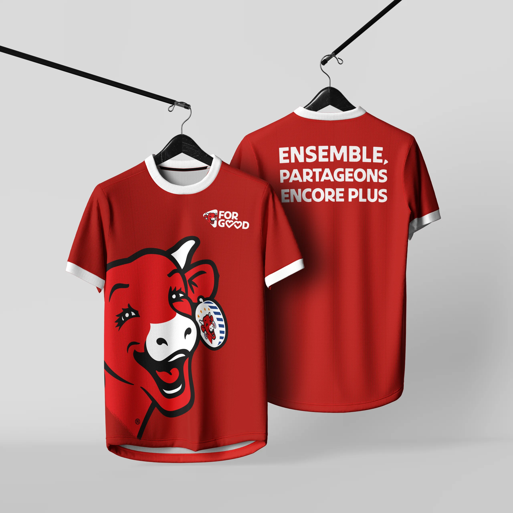

# Groupe Bel

<!-- wiki:infobox -->

| Groupe Bel | |
| --- | --- |
| Nature | Industrie fromagère |
| Relation | Client |
| Marques | La Vache qui rit |
| Projets liés | 1 |
| État de la fiche | Ébauche |
<!-- /wiki:infobox -->

**Groupe Bel** (industrie fromagère) est un client d’Alexandre « Xtincell » Djengue.

## Présentation

_À documenter._

## Marques

- La Vache qui rit

## Archives de travail

<!-- wiki:archives -->
_Relevé en lecture seule des disques de travail, 2026-11-09. Les pièces administratives et les commandes privées ne sont pas détaillées._

| | |
| --- | --- |
| Structure | MATANGA |
| Disques | C: |
| Fichiers | 14 (0,5 Go) |
| Contenu | 7 documents · 4 photos · 3 fichiers de création |
| Année | 2026 |

**Dossiers**

- **La Vache qui rit** (14 fichiers) : 2026 (7) · Le long de l'année (4) · _Identité de marque (2)
<!-- /wiki:archives -->

## Projets

<!-- wiki:projets -->
- **2026** — [La Vache qui rit — Merch « For Good »](../projets/la-vache-qui-rit.md)
<!-- /wiki:projets -->

<!-- wiki:liens-entrants -->
---
**Pages liées** : [La Vache qui rit — Merch « For Good »](../projets/la-vache-qui-rit.md)
<!-- /wiki:liens-entrants -->
