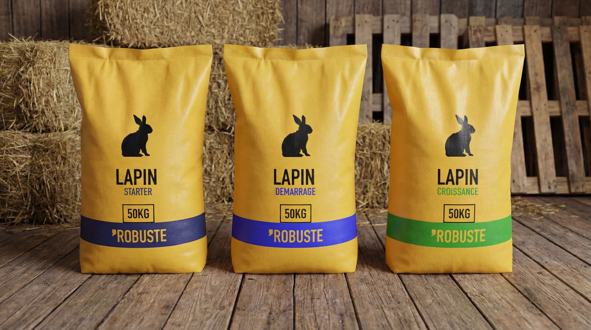
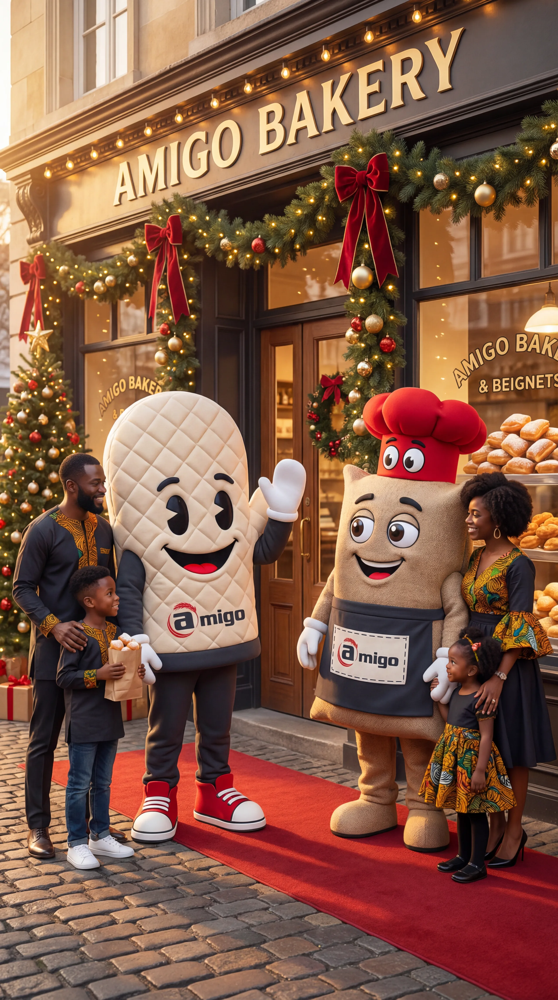
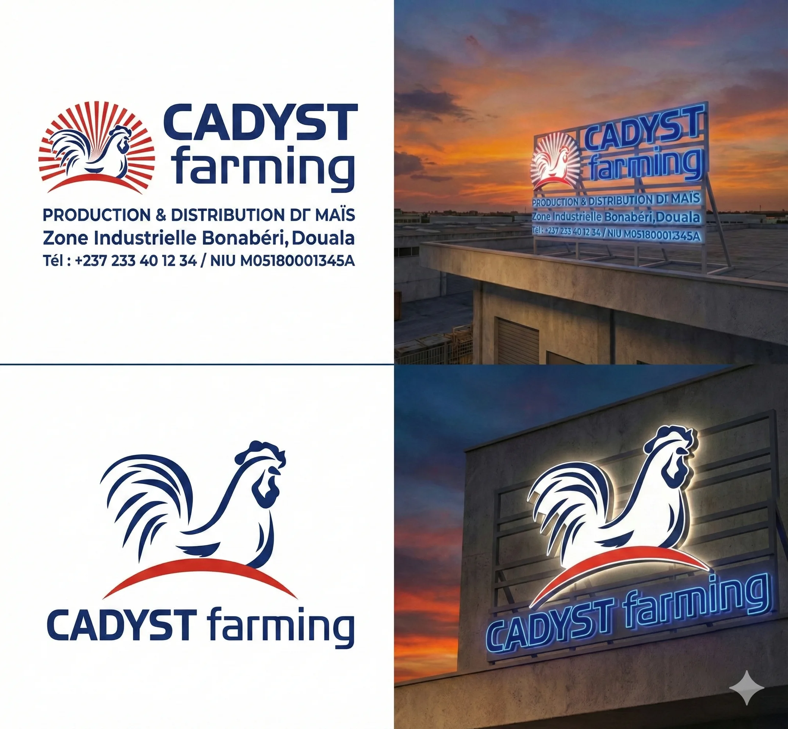
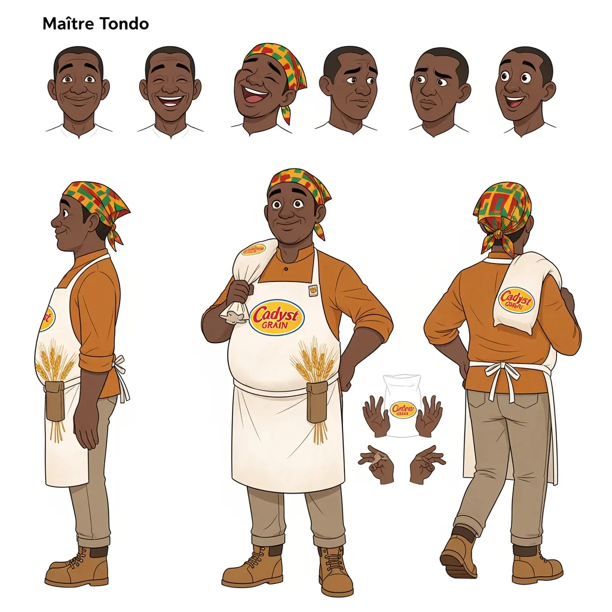
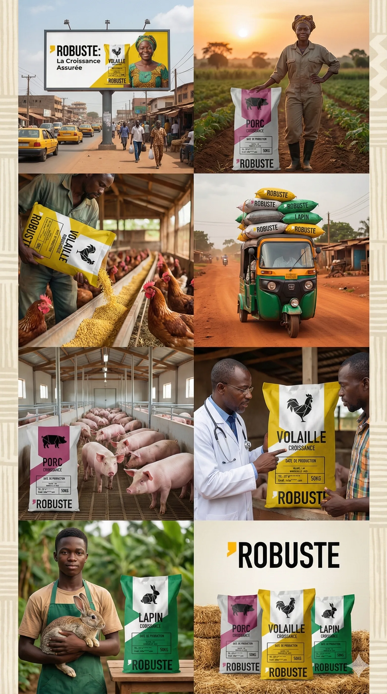

# Groupe Cadyst

<!-- wiki:infobox -->

| Groupe Cadyst | |
| --- | --- |
| Nature | Groupe agro-industriel (Cadyst Grain, Cadyst Farming) |
| Relation | Client |
| Marques | Amigo · Robuste · Delys · Barka |
| Projets liés | 6 |
| État de la fiche | À vérifier |
<!-- /wiki:infobox -->

**Groupe Cadyst** (groupe agro-industriel (Cadyst Grain, Cadyst Farming)) est un client d’Alexandre « Xtincell » Djengue.

## Présentation

_À documenter._

## Marques

- Amigo
- Robuste
- Delys
- Barka

## Galerie

<!-- wiki:galerie -->

<!-- /wiki:galerie -->

## Archives de travail

<!-- wiki:archives -->
_Relevé en lecture seule des disques de travail, 2026-11-09. Les pièces administratives et les commandes privées ne sont pas détaillées._

| | |
| --- | --- |
| Structure | MATANGA |
| Disques | C:, P: |
| Fichiers | 257 (3,2 Go) |
| Contenu | 126 documents · 111 photos · 10 fichiers de création · 7 autres · 3 vidéos |
| Année | 2025 |

**Dossiers**

- **Amigo** (44 fichiers) : 2025 (1) · Le long de l'année (17) · _Packaging & étiquettes (24)
- **Balao** (2 fichiers) : _Identité de marque (1)
- **Cadyst Farming** (3 fichiers) : _Identité de marque (2)
- **Cadyst Grain** (10 fichiers) : Le long de l'année (3) · _Identité de marque (3) · _Packaging & étiquettes (3)
- **Daily Market** (82 fichiers) : Campagnes ponctuelles (81)
- **Delys** (2 fichiers) : Le long de l'année (1)
- **La Pasta** (32 fichiers) : Campagnes ponctuelles (5) · Le long de l'année (12) · _Identité de marque (8) · _Packaging & étiquettes (6)
- **Panzani** (3 fichiers) : Le long de l'année (2)
- **Plenty** (13 fichiers) : Références (2) · _Identité de marque (5)
- **Robuste** (14 fichiers) : _Identité de marque (1) · _Packaging & étiquettes (12)
- **_Cadyst Group — institutionnel** (51 fichiers) : Campagnes ponctuelles (11) · Le long de l'année (39)
<!-- /wiki:archives -->

## Projets

<!-- wiki:projets -->
- **2026** — [Delys — Saint-Valentin](../projets/delys.md)
- **2026** — [Robuste — Packaging aliments](../projets/robuste-packaging.md)
- **2025** — [Amigo — Boulangerie & beignets](../projets/amigo.md)
- **2025** — [Cadyst Farming — Enseigne](../projets/enseigne.md)
- **2025** — [Cadyst Grain — Mascotte « Maître Tondo »](../projets/cadyst-grain.md)
- **2025** — [Robuste — Aliments pour bétail](../projets/robuste.md)
<!-- /wiki:projets -->

<!-- wiki:liens-entrants -->
---
**Pages liées** : [Amigo — Boulangerie & beignets](../projets/amigo.md) · [Cadyst Farming — Enseigne](../projets/enseigne.md) · [Cadyst Grain — Mascotte « Maître Tondo »](../projets/cadyst-grain.md) · [Delys — Saint-Valentin](../projets/delys.md) · [Robuste — Aliments pour bétail](../projets/robuste.md) · [Robuste — Packaging aliments](../projets/robuste-packaging.md)
<!-- /wiki:liens-entrants -->
