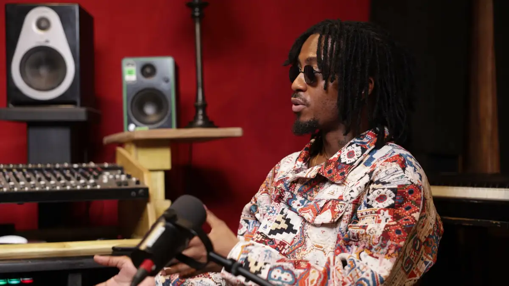

# H3riQ

<!-- wiki:infobox -->

| H3riQ | |
| --- | --- |
| Nature | Artiste musical |
| Relation | Client |
| Projets liés | 2 |
| État de la fiche | Ébauche |
<!-- /wiki:infobox -->

**H3riQ** est un client d’Alexandre « Xtincell » Djengue, suivi avec UPgraders.

## Présentation

_À documenter._

## Galerie

<!-- wiki:galerie -->

<!-- /wiki:galerie -->

## Archives de travail

<!-- wiki:archives -->
_Relevé en lecture seule des disques de travail, 2026-11-09. Les pièces administratives et les commandes privées ne sont pas détaillées._

| | |
| --- | --- |
| Structure | UPgraders |
| Disques | C:, P: |
| Fichiers | 1 011 (50 Go) |
| Contenu | 964 photos · 42 vidéos · 3 sons · 1 autres · 1 fichiers de création |
| Années | 2022–2024 |

**Dossiers**

- **2022** (661 fichiers) : Clip — shooting en appartement (18-10-2022) (577) · Studio Eagle (84)
- **2023** (1 fichiers)
- **2024** (32 fichiers) : Interview en studio (09-03-2024) (12) · Vidéos (montages et reçues) (5) · podcast (3) · Épisodes (8)
- **Shooting H3riQ** (314 fichiers) : 0714 BKS Clip H3RIQ (77) · 0909 Studio Shoot (27) · 1110 Studio Shoot (104) · BKS Clip (106)

**Opérations repérées lors du rangement**

- Épisode Q1 du podcast (montages vertical et 16:9)
- Épisode du podcast H3riq (interview autour de l'artiste « Debakki », Whisper) — correction
- Shooting H3riQ
- Podcast H3riq, mars 2024
- H3riQ au Studio Eagle, septembre 2022
<!-- /wiki:archives -->

## Projets

<!-- wiki:projets -->
- **2022–2024** — [H3riQ — travaux](../projets/h3riq-travaux.md)
- [H3riQ — galerie photo](../projets/photo-h3riq.md)
<!-- /wiki:projets -->

<!-- wiki:liens-entrants -->
---
**Pages liées** : [H3riQ — galerie photo](../projets/photo-h3riq.md) · [H3riQ — travaux](../projets/h3riq-travaux.md)
<!-- /wiki:liens-entrants -->
