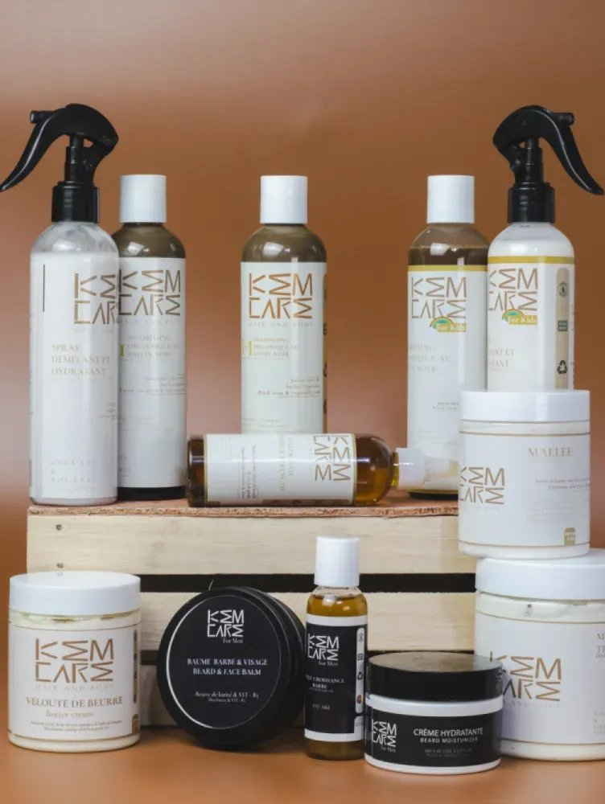
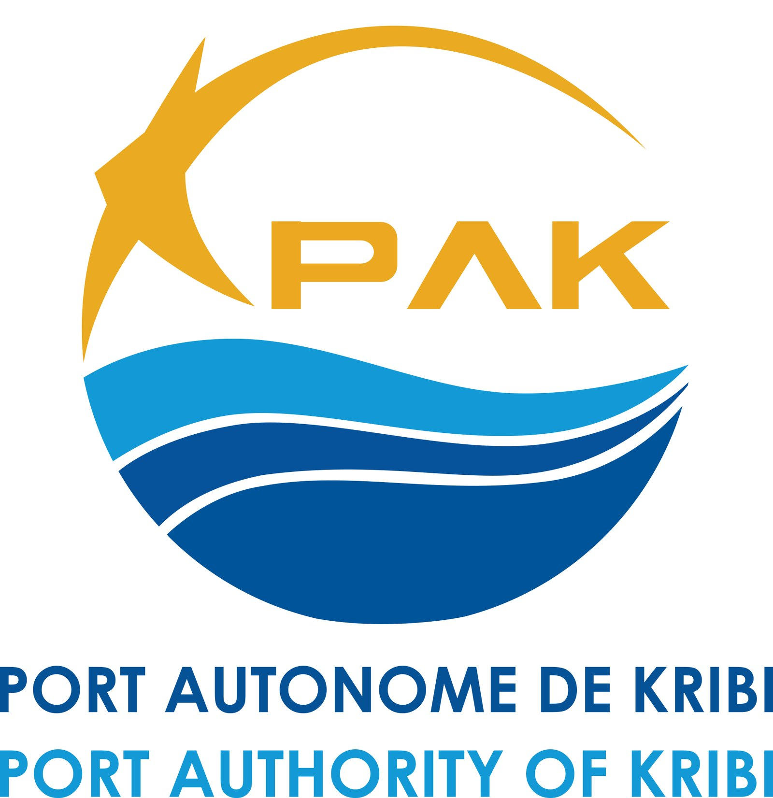

# Her Media

<!-- wiki:infobox -->

| Her Media | |
| --- | --- |
| Nature | Agence |
| Relation | Agence relais |
| Projets liés | 3 |
| État de la fiche | Standard |
<!-- /wiki:infobox -->

**Her Media** (agence) est une agence relais qui a confié des missions à Alexandre « Xtincell » Djengue.

## Présentation

Agence relais qui sous-traitait des prestations à Alexandre, souvent en marque blanche, pour ses clients (Moët & Chandon, Port Autonome de Kribi, Kemcare…).

## Galerie

<!-- wiki:galerie -->

<!-- /wiki:galerie -->

## Archives de travail

<!-- wiki:archives -->
_Relevé en lecture seule des disques de travail, 2026-11-09. Les pièces administratives et les commandes privées ne sont pas détaillées._

| | |
| --- | --- |
| Structure | UPgraders |
| Disques | P: |
| Fichiers | 18 (97 Mo) |
| Contenu | 10 photos · 5 documents · 3 fichiers de création |
<!-- /wiki:archives -->

## Projets

<!-- wiki:projets -->
- **2024** — [Maison Moët & Chandon — assets visuels](../projets/moet-chandon.md) _(en tant qu’agence relais)_
- **2021–…** — [Kemcare — stratégie de marque & lancement](../projets/kemcare.md) _(en tant qu’agence relais)_
- [Port Autonome de Kribi — Octobre Rose](../projets/port-kribi-octobre-rose.md) _(en tant qu’agence relais)_
<!-- /wiki:projets -->

<!-- wiki:liens-entrants -->
---
**Pages liées** : [Kemcare — stratégie de marque & lancement](../projets/kemcare.md) · [Maison Moët & Chandon — assets visuels](../projets/moet-chandon.md) · [Port Autonome de Kribi — Octobre Rose](../projets/port-kribi-octobre-rose.md)
<!-- /wiki:liens-entrants -->
