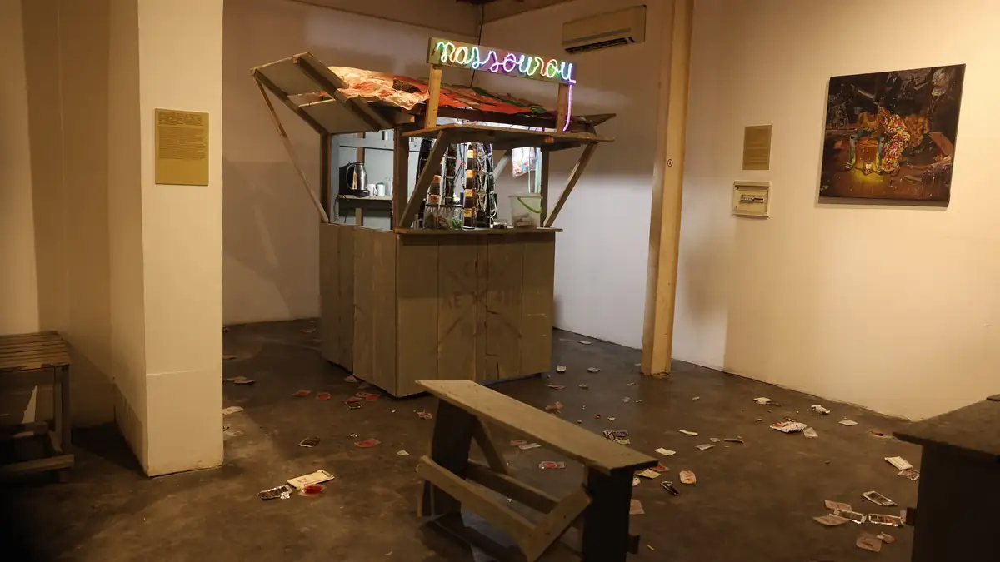
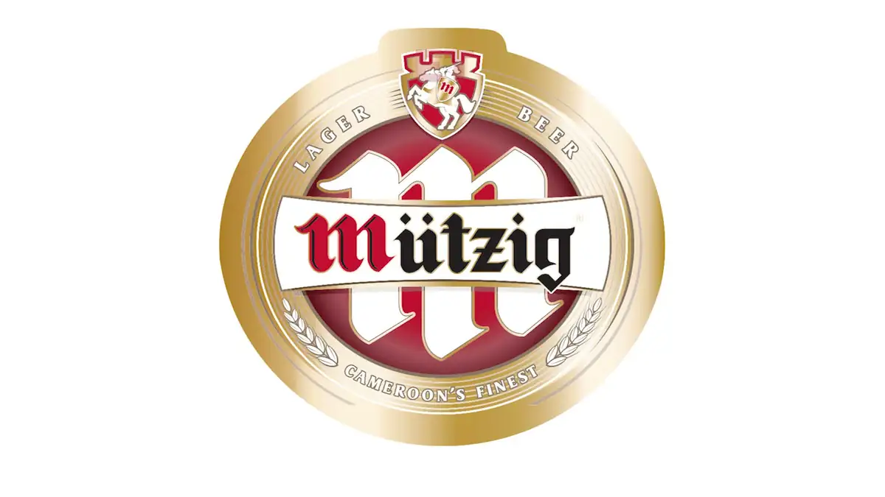

# IFC Douala

<!-- wiki:infobox -->

| IFC Douala | |
| --- | --- |
| Nature | Institut français du Cameroun (Douala) |
| Relation | Client |
| Projets liés | 2 |
| État de la fiche | Ébauche |
<!-- /wiki:infobox -->

**IFC Douala** est un client d’Alexandre « Xtincell » Djengue, suivi avec UPgraders.

## Présentation

_À documenter._

## Galerie

<!-- wiki:galerie -->

<!-- /wiki:galerie -->

## Archives de travail

<!-- wiki:archives -->
_Relevé en lecture seule des disques de travail, 2026-11-09. Les pièces administratives et les commandes privées ne sont pas détaillées._

| | |
| --- | --- |
| Structure | UPgraders |
| Disques | C:, P: |
| Fichiers | 72 (20 Go) |
| Contenu | 66 vidéos · 6 documents |
| Années | 2021–2026 |

**Dossiers**

- **2021** (2 fichiers)
- **2025** (1 fichiers)
- **2026** (69 fichiers) : Vernissage janvier 2026 (déduit) (65)

**Opérations repérées lors du rangement**

- Vidéo IFC
<!-- /wiki:archives -->

## Projets

<!-- wiki:projets -->
- **2026** — [Vernissage et résidence d'artistes (janvier 2026)](../projets/evt-2026-01-29-vernissage-et-residence-d-artistes-janvier-2026.md)
- **2021–2026** — [IFC Douala — travaux](../projets/ifc-douala-travaux.md)
<!-- /wiki:projets -->

<!-- wiki:liens-entrants -->
---
**Pages liées** : [IFC Douala — travaux](../projets/ifc-douala-travaux.md) · [Vernissage et résidence d'artistes (janvier 2026)](../projets/evt-2026-01-29-vernissage-et-residence-d-artistes-janvier-2026.md)
<!-- /wiki:liens-entrants -->
