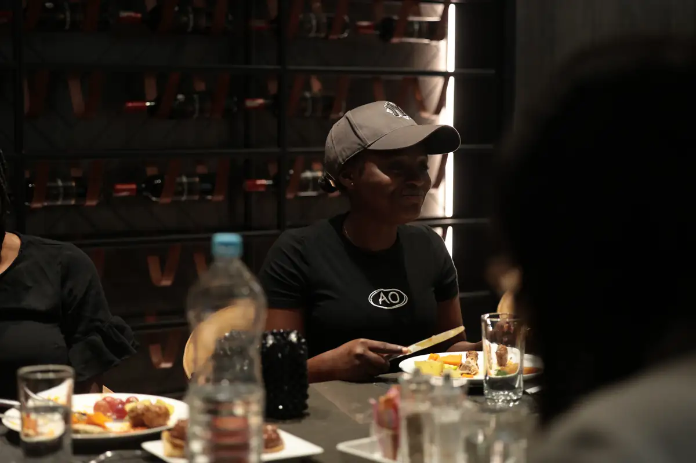

# K Hotel

<!-- wiki:infobox -->

| K Hotel | |
| --- | --- |
| Nature | Hôtellerie |
| Relation | Client |
| Projets liés | 2 |
| État de la fiche | Ébauche |
<!-- /wiki:infobox -->

**K Hotel** est un client d’Alexandre « Xtincell » Djengue, suivi avec UPgraders.

## Présentation

_À documenter._

## Galerie

<!-- wiki:galerie -->

<!-- /wiki:galerie -->

## Archives de travail

<!-- wiki:archives -->
_Relevé en lecture seule des disques de travail, 2026-11-09. Les pièces administratives et les commandes privées ne sont pas détaillées._

| | |
| --- | --- |
| Structure | UPgraders |
| Disques | P: |
| Fichiers | 109 (3,2 Go) |
| Contenu | 105 photos · 4 vidéos |
| Année | 2025 |

**Dossiers**

- **2025** (109 fichiers) : Activation (109)

**Opérations repérées lors du rangement**

- Activation K Hotel, février 2025 (photos Canon et Sony, vidéos)
<!-- /wiki:archives -->

## Projets

<!-- wiki:projets -->
- **2025** — [K Hotel — déjeuner d'équipe « AO » (activation)](../projets/evt-2025-02-15-k-hotel-dejeuner-d-equipe-ao-activation.md)
- **2025** — [K Hotel — travaux](../projets/k-hotel-travaux.md)
<!-- /wiki:projets -->

<!-- wiki:liens-entrants -->
---
**Pages liées** : [K Hotel — déjeuner d'équipe « AO » (activation)](../projets/evt-2025-02-15-k-hotel-dejeuner-d-equipe-ao-activation.md) · [K Hotel — travaux](../projets/k-hotel-travaux.md)
<!-- /wiki:liens-entrants -->
