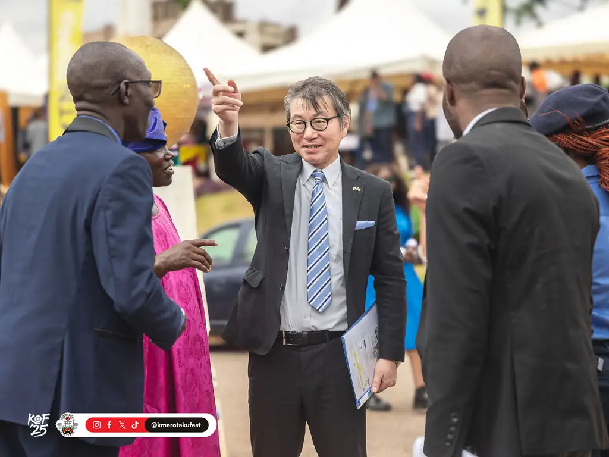
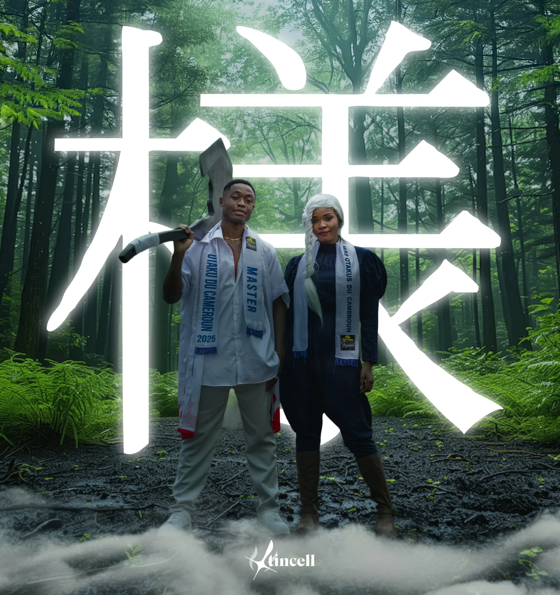
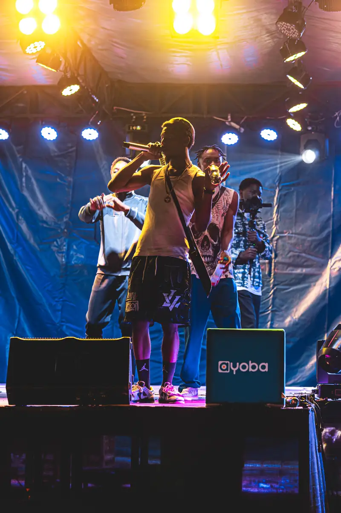
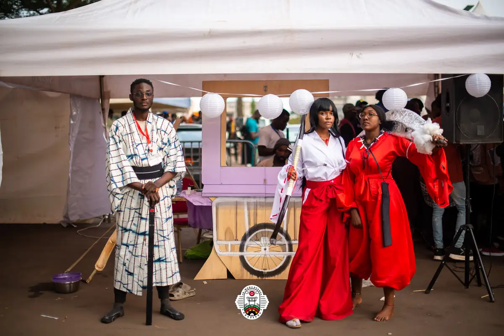
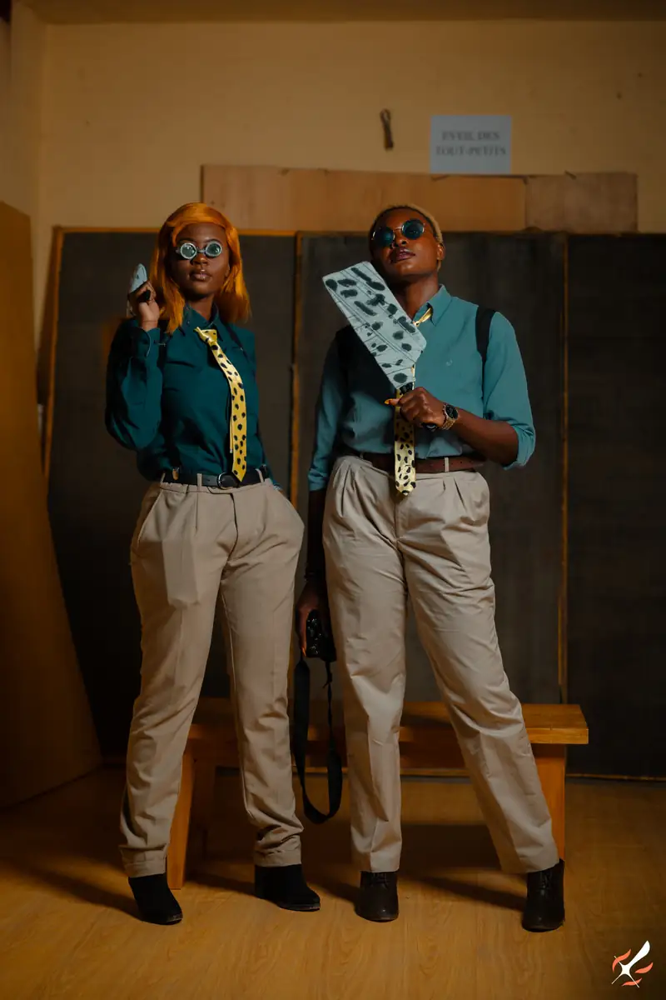
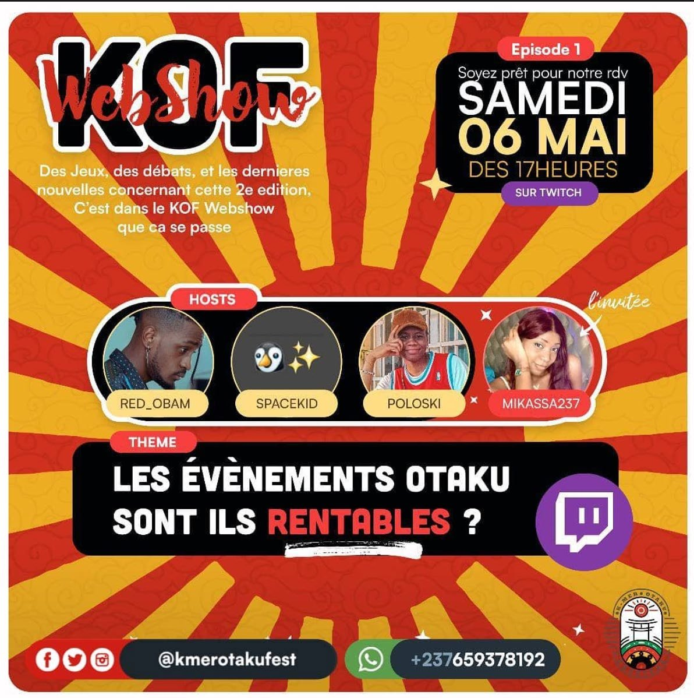
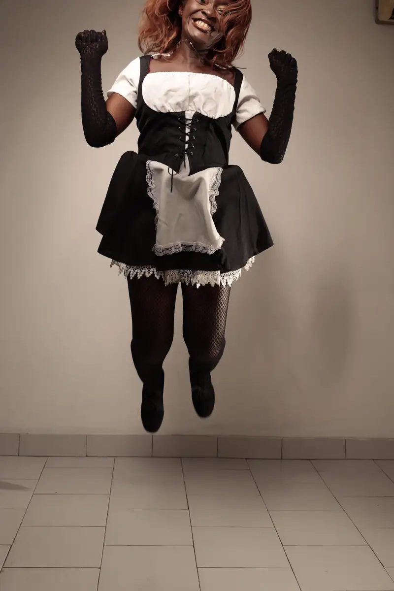
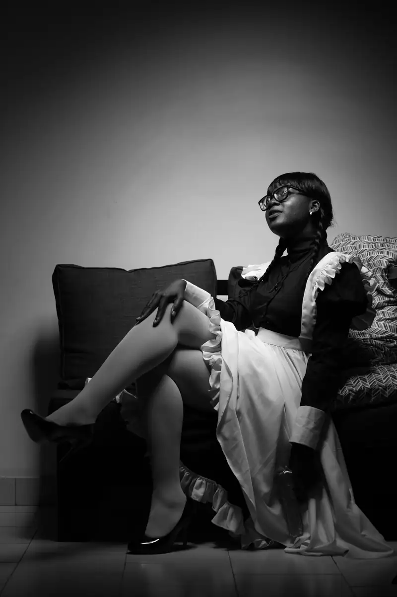
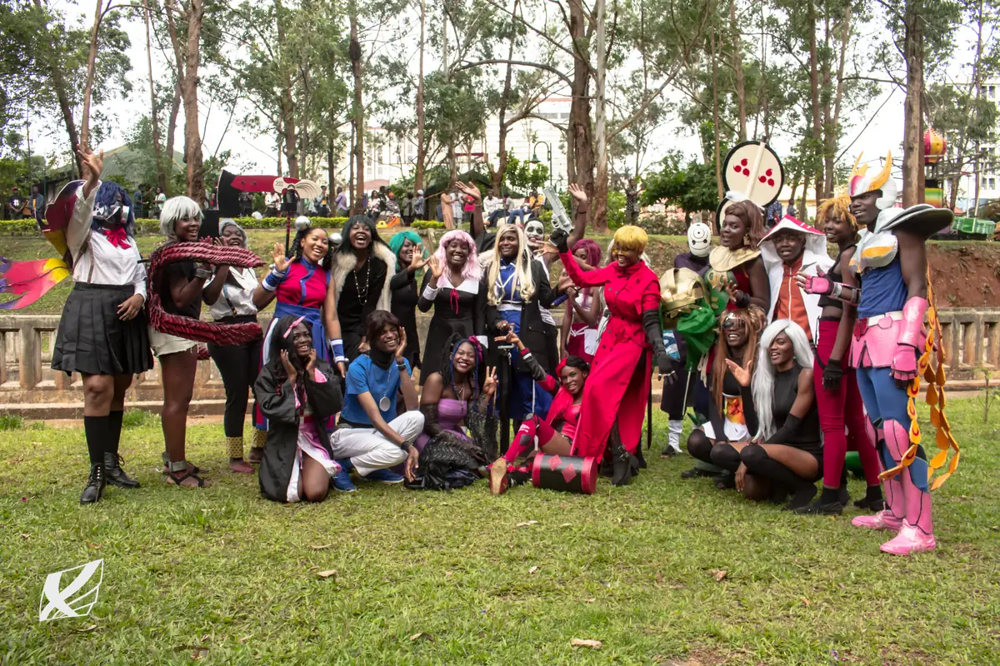
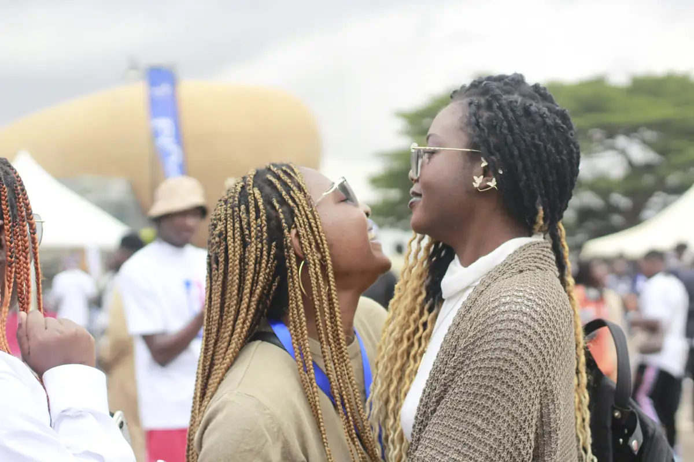

# Kamer Otaku Festival (KOF)

<!-- wiki:infobox -->

| Kamer Otaku Festival (KOF) | |
| --- | --- |
| Nature | Festival pop culture |
| Relation | Client |
| Rôle d’Alexandre | Photographe (2022), puis directeur artistique et de la communication (depuis 2023) |
| Période | 2022 |
| Projets liés | 10 |
| État de la fiche | Ébauche |
<!-- /wiki:infobox -->

**Kamer Otaku Festival (KOF)** (festival pop culture) est un client d’Alexandre « Xtincell » Djengue.

## Présentation

Festival de pop culture (manga, cosplay, jeu vidéo, bande dessinée) organisé à Yaoundé depuis 2022.

La première édition du festival, en 2022, est couverte en photographie. En 2023, Alexandre est directeur artistique et directeur de la communication du festival. Le CV de 2026 parle de photographie « depuis la 1ʳᵉ édition » et de direction artistique « depuis la 2ᵉ » : les deux versions concordent. _Sources : [disques](../sources.md#disques), [cv-2023-05](../sources.md#cv-2023-05)._

## Rôle d’Alexandre

Photographe de la 1ʳᵉ édition (2022), puis directeur artistique et de la communication à partir de 2023.

## Galerie

<!-- wiki:galerie -->

<!-- /wiki:galerie -->

## Archives de travail

<!-- wiki:archives -->
_Relevé en lecture seule des disques de travail, 2026-11-09. Les pièces administratives et les commandes privées ne sont pas détaillées._

| | |
| --- | --- |
| Structure | UPgraders |
| Disques | C:, P: |
| Fichiers | 24 947 (430 Go) |
| Contenu | 23 915 photos · 722 vidéos · 113 documents · 104 autres · 55 sons · 38 fichiers de création |
| Années | 2018–2026 |

**Dossiers**

- **2018** (1 fichiers)
- **2020** (1 494 fichiers) : CPL — cosplays (26-27-09-2020) (déduit) (507) · Cosplay Land 237 — concert anime « JAMP » (20-09-2020) (371) · week21 — cosplays (29-09-2020) (déduit) (615)
- **2021** (2 131 fichiers) : Shooting cosplay (août 2021) (1 525) · Shooting cosplay (septembre 2021) (606)
- **2022** (2 613 fichiers) : Kmer Otaku Festival (47) · Photos (6 août 2022) (1 889) · Shooting KOF2022 (340) · Sélection (6 août 2022) (336)
- **2023** (5 170 fichiers) : Amène ton Nakama (10) · Billetterie (4) · Charte et documents (found.000) (77) · Concours (update) (20) · Cosplay Land 237 — concours cosplay (25-11-2023, photos reçues) (30) · Exports photo (1 444) · Invitations (2) · Kmer Otaku Festival (90) · Médias (1 350) · Photos reçues (WhatsApp) (10) · Rushes photo (KOF NC) (1 386) · Vidéos (05-08-2023) (83)
- **2024** (2 405 fichiers) : Exports (dossier EXPORT, vrac) (853) · Exports photo (1 521) · Projet Premiere « Reunion KOF » (3) · Radio Otaku Pulse (bêtisier) (1)
- **2025** (11 006 fichiers) : Clip musical (Suno) (17) · KOF4 2025 DLA EDITION FR MTN JPG100 (302) · KOF4 PHOTO (6 716) · KOF4 PHOTO 2025 (2 569) · KOF4 VIDEO (22) · KOF4 VIDEO 2025 (404) · Photos (dossier PHOTOS) (272) · Projet Premiere « KOF25 » (4) · Radio Otaku Pulse (4) · Vidéos (montages et reçues) (1) · Édition de Douala × MTN Y'ello Hub (septembre, horloge décalée d'un an) (270)
- **2026** (26 fichiers)
- **Photos reçues sans date (IMG_0458-0709)** (27 fichiers)
- **Pilotage** (6 fichiers) : PROJETS (1)
- **_Identité** (9 fichiers)

**Opérations repérées lors du rangement**

- Selon la date de prise de vue : festival du 3 août 2025 ou séance studio du 10 oct. 2025
- Festival otaku/cosplay, 3–4 août 2025 (KOF déduit)
- Festival, 5 août 2023 (KOF déduit)
- 5e édition : direction artistique, concepts, plans et recherches
- Dossier partenaire édition 2026
- Brand assets KOF (patterns atomic, guide)
- Clip musical KOF : version instrumentale, aucune voix (Whisper) — attribution d'après le dossier et les stems
- Clip musical KOF : paroles « anime spirit… African pride », « Two worlds become one » (Whisper)
- Festival otaku, 21/08/2023 (images WhatsApp)
- Festival en plein air, stands, cosplay, partenaire MTN, 24/09/2024 — KOF déduit
- Communiqué KOF
- Médias KOF 2023 (photos par partie et séances individuelles)
- KOF (archive Spark)
- Shooting KOF 2022 (archive Spark)
- Plan de gestion des fonds (entreprise cosplay)
- Mini-plan photo/vidéo KOF
- KOF 2026 : affiches, flyers, kits social media (générés)
- Image sans nom identifiée sur la planche (n° 116)
- KOF 2025 : DA, plan stratégique, tirage au sort, refonte
- Archive « les pitchs »
- … et 17 autres
<!-- /wiki:archives -->

## Projets

<!-- wiki:projets -->
- **2025** — [K-mer Otaku Festival 2025 (KOF4)](../projets/evt-2025-08-02-k-mer-otaku-festival-2025-kof4.md)
- **2025** — [KOF — Kamer Otaku Festival](../projets/kof-festival.md)
- **2024** — [K-mer Otaku Festival 2024](../projets/evt-2024-08-03-k-mer-otaku-festival-2024.md)
- **2023** — [K-mer Otaku Festival 2023](../projets/evt-2023-08-05-k-mer-otaku-festival-2023.md)
- **2022** — [K-mer Otaku Festival 2022](../projets/evt-2022-08-06-k-mer-otaku-festival-2022.md)
- **2022–2024** — [Kamer Otaku Festival — éditions 2022 à 2024](../projets/kof-2022-2024.md)
- **2021** — [Shooting cosplay en studio (septembre 2021)](../projets/evt-2021-09-30-shooting-cosplay-en-studio-septembre-2021.md)
- **2021** — [Shootings cosplay en studio (août 2021)](../projets/evt-2021-08-10-shootings-cosplay-en-studio-aout-2021.md)
- **2020** — [Cosplay Land 237 — concert anime et journée cosplay (20 et 26 septembre 2020)](../projets/evt-2020-09-20-cosplay-land-237-concert-anime-et-journee-cosplay-20-et-2.md)
- [Kamer Otaku Festival — photos reçues (édition à dater)](../projets/evt-sans-date-kamer-otaku-festival-photos-recues-edition-a-dater.md)
<!-- /wiki:projets -->

## Sources

- Archives de travail rangées sur les disques — voir [disques](../sources.md#disques)
- CV « Dircom », 16 mai 2023 — voir [cv-2023-05](../sources.md#cv-2023-05)
- Folio — `src/components/folio/data/practices.ts`, entrée « KOF — Kamer Otaku Festival »

<!-- wiki:liens-entrants -->
---
**Pages liées** : [Alexandre « Xtincell » Djengue](../personnes/alexandre-djengue.md) · [Cosplay Land 237 — concert anime et journée cosplay (20 et 26 septembre 2020)](../projets/evt-2020-09-20-cosplay-land-237-concert-anime-et-journee-cosplay-20-et-2.md) · [Japanimes (association otaku)](../projets/japanimes.md) · [K-mer Otaku Festival 2022](../projets/evt-2022-08-06-k-mer-otaku-festival-2022.md) · [K-mer Otaku Festival 2023](../projets/evt-2023-08-05-k-mer-otaku-festival-2023.md) · [K-mer Otaku Festival 2024](../projets/evt-2024-08-03-k-mer-otaku-festival-2024.md) · [K-mer Otaku Festival 2025 (KOF4)](../projets/evt-2025-08-02-k-mer-otaku-festival-2025-kof4.md) · [Kamer Otaku Festival — éditions 2022 à 2024](../projets/kof-2022-2024.md) · [Kamer Otaku Festival — photos reçues (édition à dater)](../projets/evt-sans-date-kamer-otaku-festival-photos-recues-edition-a-dater.md) · [KOF — Kamer Otaku Festival](../projets/kof-festival.md) · [Shooting cosplay en studio (septembre 2021)](../projets/evt-2021-09-30-shooting-cosplay-en-studio-septembre-2021.md) · [Shootings cosplay en studio (août 2021)](../projets/evt-2021-08-10-shootings-cosplay-en-studio-aout-2021.md)
<!-- /wiki:liens-entrants -->
