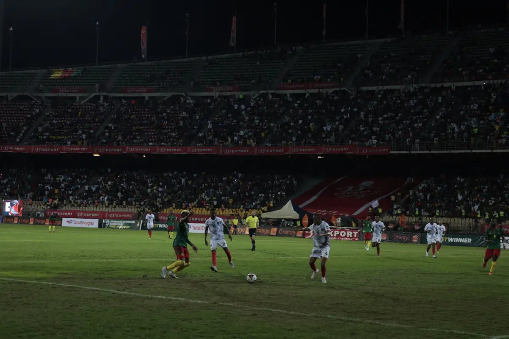
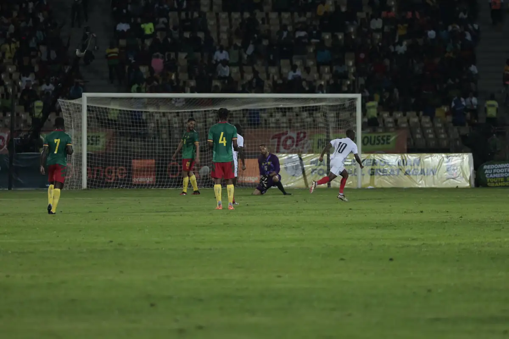
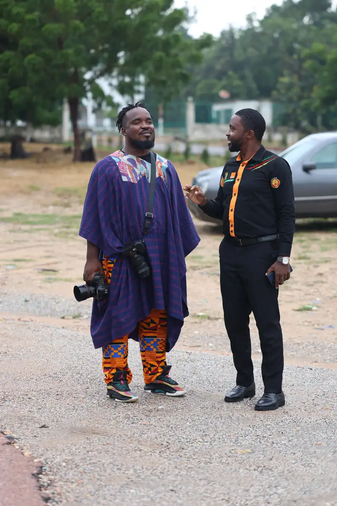

# LION DEN

<!-- wiki:infobox -->

| LION DEN | |
| --- | --- |
| Nature | À préciser |
| Relation | Client |
| Projets liés | 3 |
| État de la fiche | Ébauche |
<!-- /wiki:infobox -->

**LION DEN** est un client d’Alexandre « Xtincell » Djengue, suivi avec UPgraders.

## Présentation

_À documenter._

## Galerie

<!-- wiki:galerie -->

<!-- /wiki:galerie -->

## Archives de travail

<!-- wiki:archives -->
_Relevé en lecture seule des disques de travail, 2026-11-09. Les pièces administratives et les commandes privées ne sont pas détaillées._

| | |
| --- | --- |
| Structure | UPgraders |
| Disques | C:, P: |
| Fichiers | 17 482 (191 Go) |
| Contenu | 17 476 photos · 6 autres |
| Année | 2023 |

**Dossiers**

- **2023** (17 482 fichiers) : Garoua — match Cameroun–Burundi et visites (11-15-09-2023) (déduit) (13 715) · LION DEN (8) · Match Cameroun – Namibie (24-03-2023) (3 759)

**Opérations repérées lors du rangement**

- Archive Spark : LION DEN (archive Spark)
- Photos LION DEN, mars 2023
<!-- /wiki:archives -->

## Projets

<!-- wiki:projets -->
- **2023** — [LION DEN — travaux](../projets/lion-den-travaux.md)
- **2023** — [Match Cameroun–Namibie (éliminatoires CAN 2023)](../projets/evt-2023-03-24-match-camerounnamibie-eliminatoires-can-2023.md)
- **2023** — [Voyage Lion Den à Garoua — Cameroun–Burundi et visites](../projets/evt-2023-09-11-voyage-lion-den-a-garoua-camerounburundi-et-visites.md)
<!-- /wiki:projets -->

<!-- wiki:liens-entrants -->
---
**Pages liées** : [LION DEN — travaux](../projets/lion-den-travaux.md) · [Match Cameroun–Namibie (éliminatoires CAN 2023)](../projets/evt-2023-03-24-match-camerounnamibie-eliminatoires-can-2023.md) · [Voyage Lion Den à Garoua — Cameroun–Burundi et visites](../projets/evt-2023-09-11-voyage-lion-den-a-garoua-camerounburundi-et-visites.md)
<!-- /wiki:liens-entrants -->
