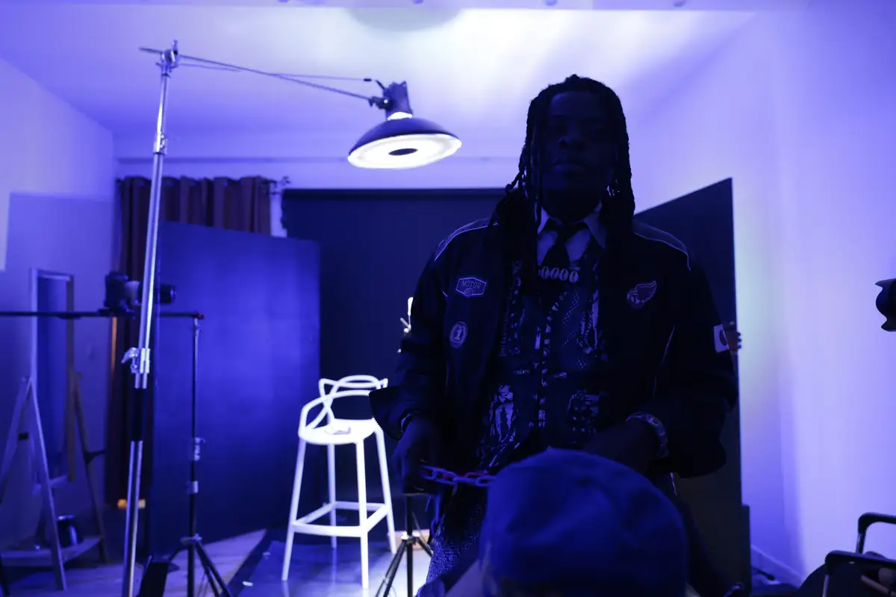
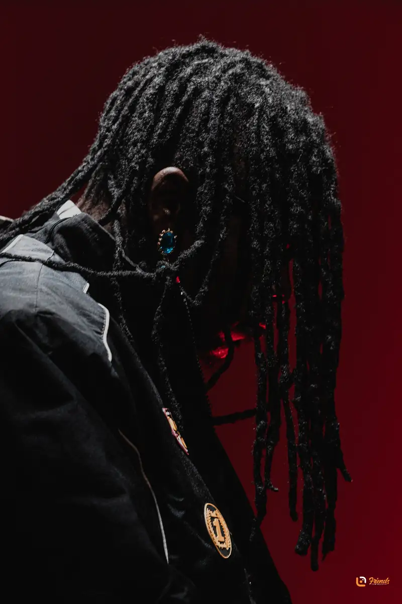
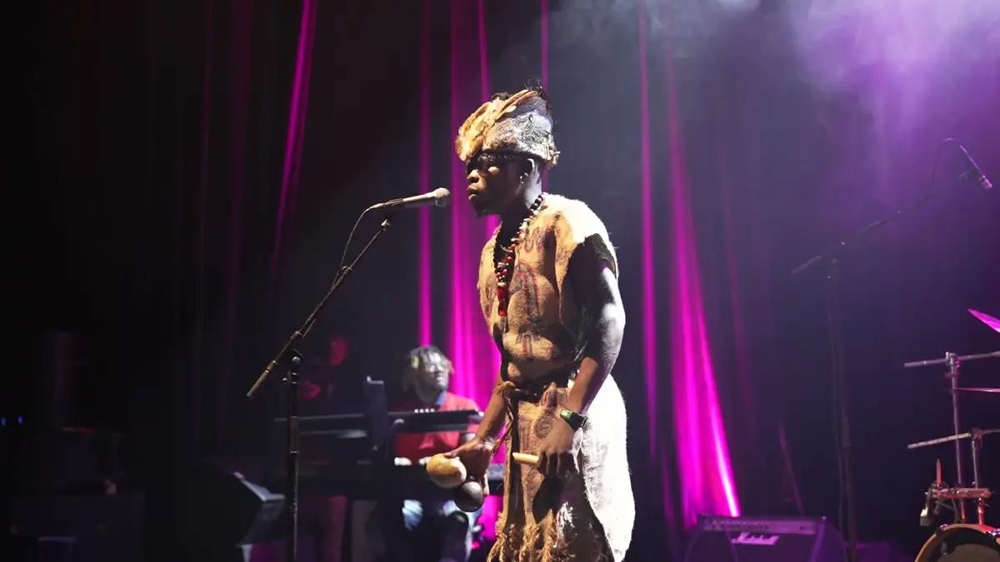

# Mounpoubeyi

<!-- wiki:infobox -->

| Mounpoubeyi | |
| --- | --- |
| Nature | Artiste musicale |
| Relation | Client |
| Projets liés | 4 |
| État de la fiche | Ébauche |
<!-- /wiki:infobox -->

**Mounpoubeyi** est un client d’Alexandre « Xtincell » Djengue, suivi avec UPgraders.

## Présentation

_À documenter._

## Galerie

<!-- wiki:galerie -->

<!-- /wiki:galerie -->

## Archives de travail

<!-- wiki:archives -->
_Relevé en lecture seule des disques de travail, 2026-11-09. Les pièces administratives et les commandes privées ne sont pas détaillées._

| | |
| --- | --- |
| Structure | UPgraders |
| Disques | C:, P: |
| Fichiers | 2 910 (116 Go) |
| Contenu | 2 713 photos · 159 vidéos · 33 fichiers de création · 3 sons · 2 autres |
| Années | 2023–2024 |

**Dossiers**

- **2023** (2 908 fichiers) : Archive WhatsApp (22) · Concert à l'IFC Douala (14-04-2023) (84) · Montages (33) · Mounpoubeyi (1) · Photos (Moun 2009) (2 610) · Rushes (Sony) (134) · Références (6) · Vidéos (montages et reçues) (1)
- **2024** (1 fichiers)

**Opérations repérées lors du rangement**

- Mounpoubeyi : clip « Yu-Gbie / Bosu », visualizer Friends (réal. Student Photographer, montage Xtincell)
- Montages du clip Mounpoubeyi
- Rushes du clip Mounpoubeyi
- Références téléchargées (Claude Ndam, Fela Kuti)
- Images reçues
- Mounpoubeyi (archive Spark)
- Premier montage du clip Mounpoubeyi ; export retrouvé dans le dossier de travail Premiere (Documents\Adobe\Premiere Pro\23.0)
- Projet Premiere « Mounpoubeyi » (nom du projet), laissé dans le dossier de travail de Premiere
- Projet Premiere « Mounpoubeyi v3 2023 » (nom du projet), laissé dans le dossier de travail de Premiere
- Projet Premiere « Mounpoubeyi v4 2023 » (nom du projet), laissé dans le dossier de travail de Premiere
- Clip Mounpoubeyi v10
- Crédits du clip
- Photos Mounpoubeyi *(déduit du nom)*
<!-- /wiki:archives -->

## Projets

<!-- wiki:projets -->
- **2023** — [Mounpoubeyi — séance photo en studio (« Moun 2009 »)](../projets/evt-2023-09-19-mounpoubeyi-seance-photo-en-studio-moun-2009.md)
- **2023–2024** — [Mounpoubeyi — travaux](../projets/mounpoubeyi-travaux.md)
- **2023** — [Mounpoubeyi en concert à l'IFC Douala, première partie Lucille Meneng](../projets/evt-2023-04-14-mounpoubeyi-en-concert-a-l-ifc-douala-premiere-partie-luc.md)
- [Mounpoubeyi — galerie photo](../projets/photo-mounpoubeyi.md)
<!-- /wiki:projets -->

<!-- wiki:liens-entrants -->
---
**Pages liées** : [Mounpoubeyi — galerie photo](../projets/photo-mounpoubeyi.md) · [Mounpoubeyi — séance photo en studio (« Moun 2009 »)](../projets/evt-2023-09-19-mounpoubeyi-seance-photo-en-studio-moun-2009.md) · [Mounpoubeyi — travaux](../projets/mounpoubeyi-travaux.md) · [Mounpoubeyi en concert à l'IFC Douala, première partie Lucille Meneng](../projets/evt-2023-04-14-mounpoubeyi-en-concert-a-l-ifc-douala-premiere-partie-luc.md)
<!-- /wiki:liens-entrants -->
