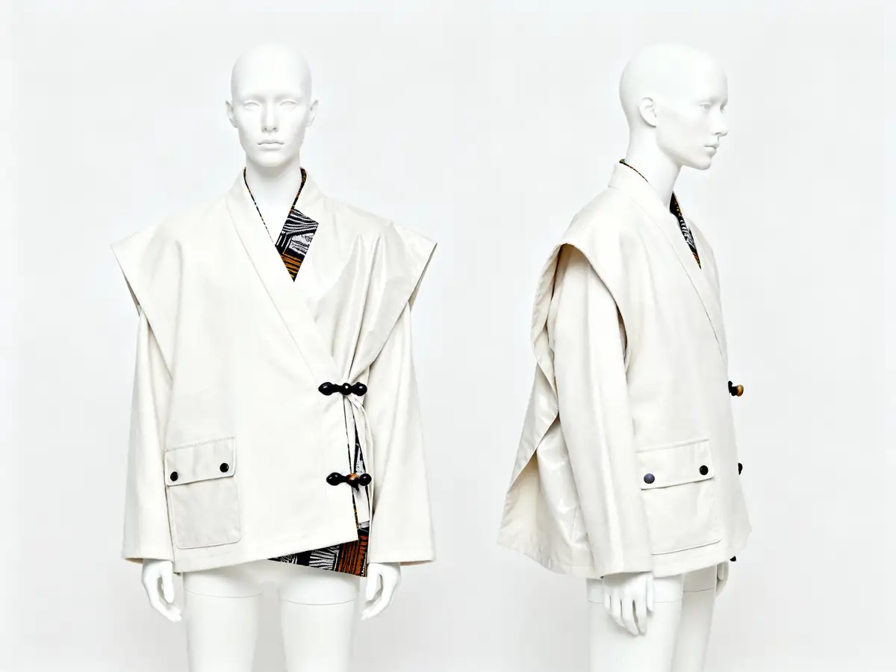

# Nomad Soul

<!-- wiki:infobox -->

| Nomad Soul | |
| --- | --- |
| Nature | À préciser |
| Relation | Client |
| Projets liés | 1 |
| État de la fiche | Ébauche |
<!-- /wiki:infobox -->

**Nomad Soul** est un client d’Alexandre « Xtincell » Djengue, suivi avec UPgraders.

## Présentation

_À documenter._

## Archives de travail

<!-- wiki:archives -->
_Relevé en lecture seule des disques de travail, 2026-11-09. Les pièces administratives et les commandes privées ne sont pas détaillées._

| | |
| --- | --- |
| Structure | UPgraders |
| Disques | C:, P: |
| Fichiers | 105 (0,2 Go) |
| Contenu | 105 photos |
| Années | 2023–2025 |

**Dossiers**

- **2023** (94 fichiers) : Branding fashion (94)
- **2025** (11 fichiers)

**Opérations repérées lors du rangement**

- Collection mode Nomad Soul (images IA)
- Branding mode Nomad Soul (casual, défilé, formel)
<!-- /wiki:archives -->

## Projets

<!-- wiki:projets -->
- **2023–2025** — [Nomad Soul — travaux](../projets/nomad-soul-travaux.md)
<!-- /wiki:projets -->

<!-- wiki:liens-entrants -->
---
**Pages liées** : [Nomad Soul — travaux](../projets/nomad-soul-travaux.md)
<!-- /wiki:liens-entrants -->
