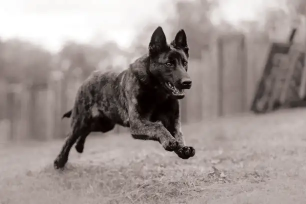

# Race Pure Kennel

<!-- wiki:infobox -->

| Race Pure Kennel | |
| --- | --- |
| Nature | À préciser |
| Relation | Client |
| Projets liés | 1 |
| État de la fiche | Ébauche |
<!-- /wiki:infobox -->

**Race Pure Kennel** est un client d’Alexandre « Xtincell » Djengue, suivi avec UPgraders.

## Présentation

_À documenter._

## Archives de travail

<!-- wiki:archives -->
_Relevé en lecture seule des disques de travail, 2026-11-09. Les pièces administratives et les commandes privées ne sont pas détaillées._

| | |
| --- | --- |
| Structure | UPgraders |
| Disques | C:, P: |
| Fichiers | 27 (66 Mo) |
| Contenu | 23 photos · 4 fichiers de création |
| Années | 2023–2025 |

**Dossiers**

- **2023** (7 fichiers)
- **2025** (1 fichiers)
- **_Identité** (10 fichiers) : 4x (6) · Friends K9 (2023) (3)

**Opérations repérées lors du rangement**

- Race Pure Kennel / Compagnon K9 (chenil)
- Logos Compagnon K9
- Logos K9 companion / K9 friends
<!-- /wiki:archives -->

## Projets

<!-- wiki:projets -->
- **2023–2025** — [Race Pure Kennel — travaux](../projets/race-pure-kennel-travaux.md)
<!-- /wiki:projets -->

<!-- wiki:liens-entrants -->
---
**Pages liées** : [Race Pure Kennel — travaux](../projets/race-pure-kennel-travaux.md)
<!-- /wiki:liens-entrants -->
