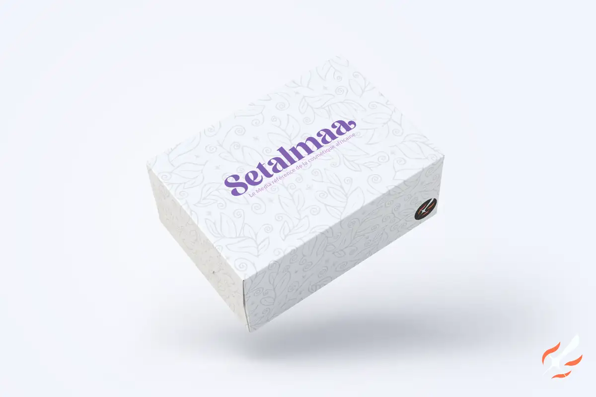

# Setalmaa

<!-- wiki:infobox -->

| Setalmaa | |
| --- | --- |
| Nature | À préciser |
| Relation | Client |
| Projets liés | 1 |
| État de la fiche | Ébauche |
<!-- /wiki:infobox -->

**Setalmaa** est un client d’Alexandre « Xtincell » Djengue, suivi avec UPgraders.

## Présentation

_À documenter._

## Archives de travail

<!-- wiki:archives -->
_Relevé en lecture seule des disques de travail, 2026-11-09. Les pièces administratives et les commandes privées ne sont pas détaillées._

| | |
| --- | --- |
| Structure | UPgraders |
| Disques | C:, P: |
| Fichiers | 14 (19 Mo) |
| Contenu | 11 photos · 3 autres |
| Année | 2022 |

**Dossiers**

- **2022** (13 fichiers) : Setalmaa (13)

**Opérations repérées lors du rangement**

- Archive Spark : Setalmaa (archive Spark)
<!-- /wiki:archives -->

## Projets

<!-- wiki:projets -->
- **2022** — [Setalmaa — travaux](../projets/setalmaa-travaux.md)
<!-- /wiki:projets -->

<!-- wiki:liens-entrants -->
---
**Pages liées** : [Setalmaa — travaux](../projets/setalmaa-travaux.md)
<!-- /wiki:liens-entrants -->
