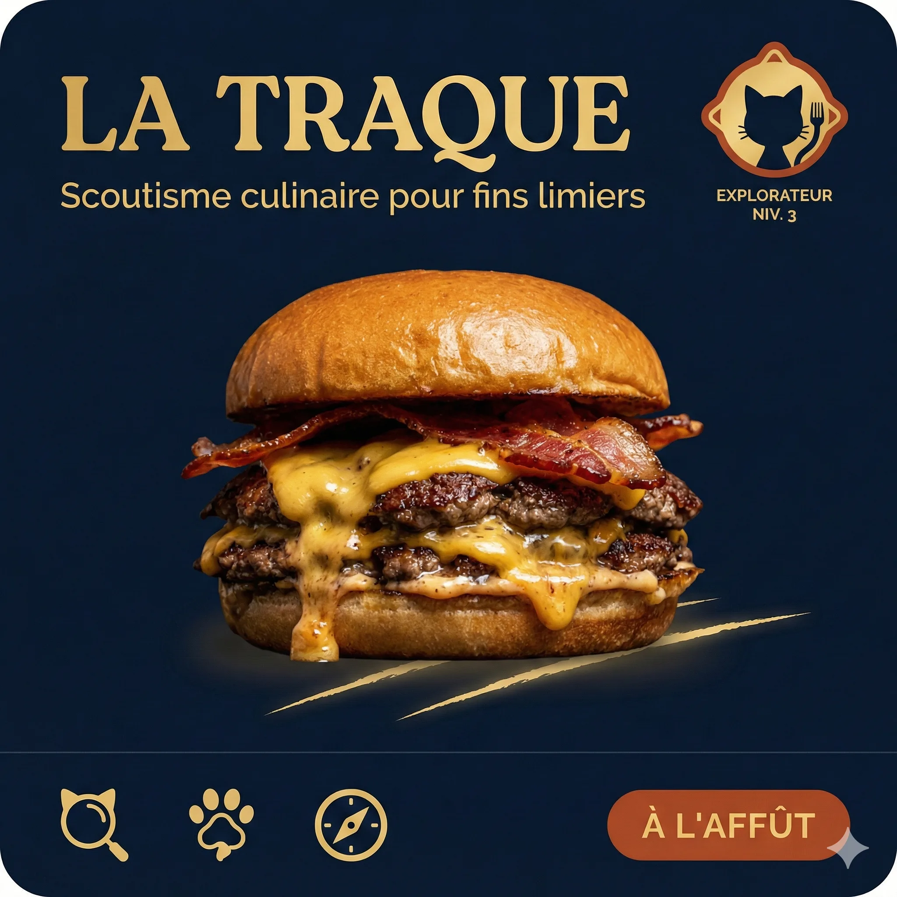

# Spawt

<!-- wiki:infobox -->

| Spawt | |
| --- | --- |
| Nature | Start-up (application mobile) |
| Relation | Client |
| Projets liés | 1 |
| État de la fiche | Ébauche |
<!-- /wiki:infobox -->

**Spawt** (start-up (application mobile)) est un client d’Alexandre « Xtincell » Djengue.

## Présentation

SPAWT est une application de découverte culinaire (« où manger ») lancée à Abidjan en 2026. Sa mascotte est un chat calico tricolore. Avant le lancement, un quiz de personnalité culinaire, « La Meute », sert de jeu de lancement et de liste d’attente (`quiz.spawt.online`) ; le portail `spawt.online` est en ligne depuis septembre 2026. _Sources : [spawt-online](../sources.md#spawt-online), [disques](../sources.md#disques)._

Alexandre en conçoit l’identité de marque et les contenus ([Spawt — La carte du bon goût](../projets/spawt.md)).

## Archives de travail

<!-- wiki:archives -->
_Relevé en lecture seule des disques de travail, 2026-11-09. Les pièces administratives et les commandes privées ne sont pas détaillées._

| | |
| --- | --- |
| Structure | UPgraders |
| Disques | C: |
| Fichiers | 483 (1,4 Go) |
| Contenu | 197 photos · 187 autres · 69 documents · 29 fichiers de création · 1 vidéos |
| Année | 2026 |

**Dossiers**

- **2026** (476 fichiers) : Archétypes (1) · CM (4) · ICONIC (21) · Identité et mascotte (8) · SPAWT_CODEX_PACKAGE (139) · SPAWT_STUDIO_V6 (37) · assets (39) · spawt (73) · Études (2)
- **_Identité** (7 fichiers)

**Opérations repérées lors du rangement**

- Cartes de visite Spawt (fondatrice)
- Spawt : formulaire terrain, gamification
- Études de marché food discovery Abidjan (Spawt)
- Spawt (mission Abidjan, GTM, design system, quiz « palais », mascottes)
- Image sans nom identifiée sur la planche (n° 37)
- Image sans nom identifiée sur la planche (n° 52)
- Image sans nom identifiée sur la planche (n° 72)
- Image sans nom identifiée sur la planche (n° 175)
- Image sans nom identifiée sur la planche (n° 168)
- Image sans nom identifiée sur la planche (n° 169)
- Image sans nom identifiée sur la planche (n° 170)
- Spawt : site, archétypes, handoff design, vecteurs
- Spawt : posts, quiz palais, cartes, visuels
- Carte de visite Spawt « Le radar culinaire »
- Archétypes Spawt (ancre, bouche d'or, braise…)
<!-- /wiki:archives -->

## Projets

<!-- wiki:projets -->
- **2026** — [Spawt — La carte du bon goût](../projets/spawt.md)
<!-- /wiki:projets -->

<!-- wiki:liens-entrants -->
---
**Pages liées** : [Spawt — La carte du bon goût](../projets/spawt.md)
<!-- /wiki:liens-entrants -->
