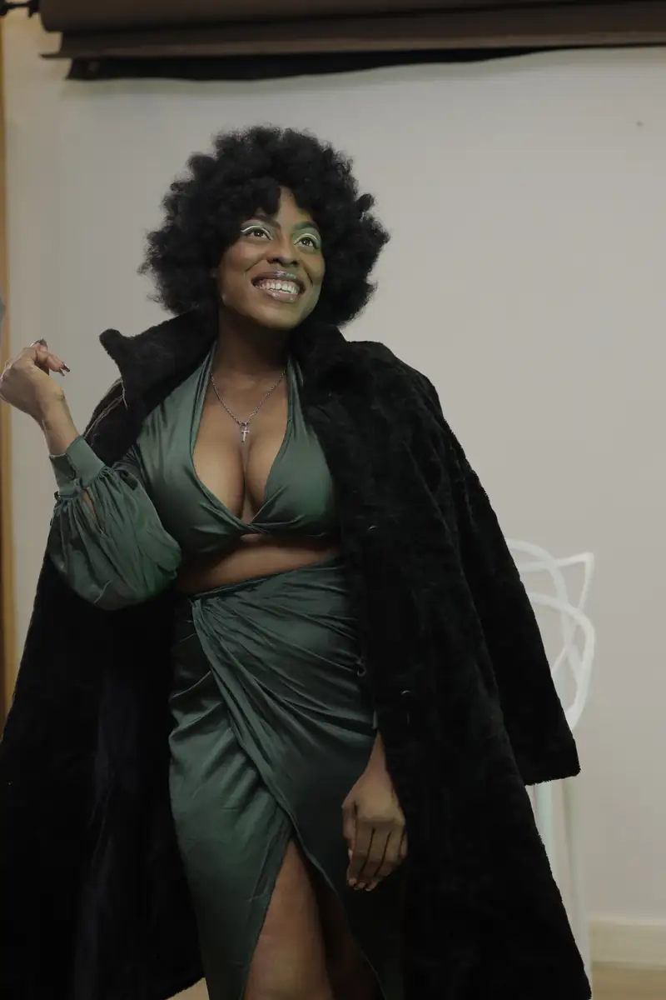
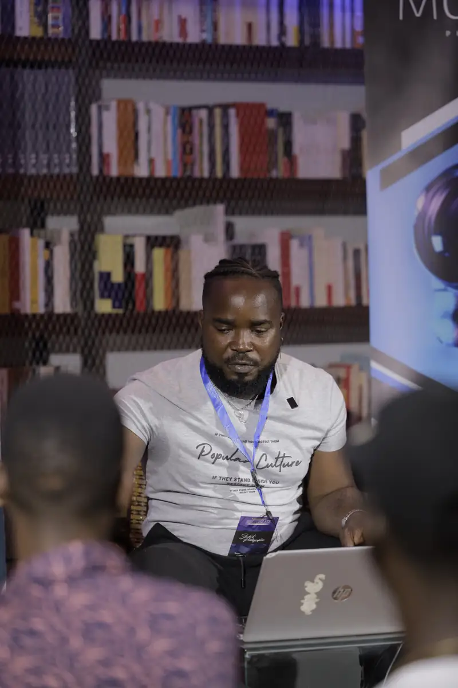
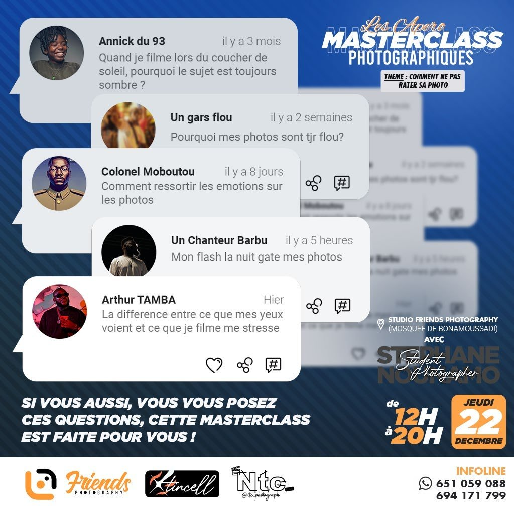
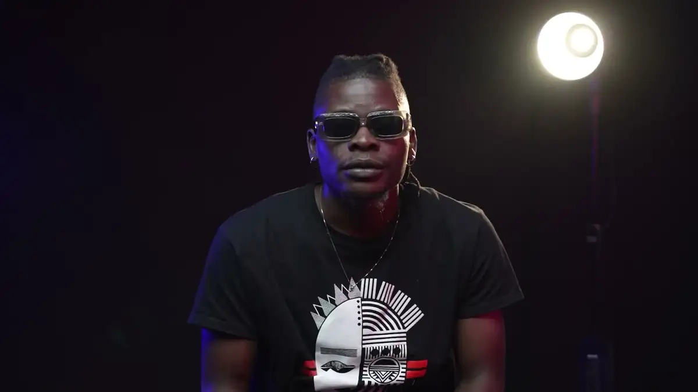

# Student Photographer (Stéphane Nounamo)

<!-- wiki:infobox -->

| Student Photographer (Stéphane Nounamo) | |
| --- | --- |
| Nature | Marque de formation photo de Stéphane Nounamo |
| Relation | Client |
| Projets liés | 4 |
| État de la fiche | Ébauche |
<!-- /wiki:infobox -->

**Student Photographer (Stéphane Nounamo)** est un client d’Alexandre « Xtincell » Djengue, suivi avec UPgraders.

## Présentation

_À documenter._

## Galerie

<!-- wiki:galerie -->

<!-- /wiki:galerie -->

## Archives de travail

<!-- wiki:archives -->
_Relevé en lecture seule des disques de travail, 2026-11-09. Les pièces administratives et les commandes privées ne sont pas détaillées._

| | |
| --- | --- |
| Structure | UPgraders |
| Disques | C:, P: |
| Fichiers | 3 288 (243 Go) |
| Contenu | 2 973 photos · 234 vidéos · 67 autres · 11 fichiers de création · 3 documents |
| Années | 2021–2024 |

**Dossiers**

- **2021** (9 fichiers) : Projets   StudentPhotographer (9)
- **2022** (1 015 fichiers) : Masterclass I (239) · Masterclass II (717) · Masterclass — badges et impressions (5) · Projet Premiere « Masterclass Steph 2022 » (3) · Projets   StudentPhotographer (25)
- **2023** (2 234 fichiers) : Masterclass « AP » — portraits (04-03-2023) (déduit) (54) · Projets   StudentPhotographer (1) · Roadtrip dans l'Ouest (18-19-02-2023) (déduit) (2 179)
- **2024** (2 fichiers)
- **_Identité** (8 fichiers) : STUDENT PHOTOGRAPHER (3)

**Opérations repérées lors du rangement**

- Signature Student Photographer
- Logo Stéphane Nounamo
- Signatures Student Photographer
- Student Photographer (archive Spark)
- Projet Premiere « Masterclass Steph 2022 » (nom du projet), laissé dans le dossier de travail de Premiere
- Masterclass Student Photographer
- Masterclass de Stéphane, août 2022
- Masterclass de Stéphane, décembre 2022
<!-- /wiki:archives -->

## Projets

<!-- wiki:projets -->
- **2022** — [« Les Apéro Masterclass photographiques » de Stéphane Nounamo (II)](../projets/evt-2022-12-22-les-apero-masterclass-photographiques-de-stephane-nounamo.md)
- **2022** — [« Photography Masterclass » de Stéphane Nounamo (I)](../projets/evt-2022-08-27-photography-masterclass-de-stephane-nounamo-i.md)
- **2022** — [Apéro Masterclass (masterclasses photo)](../projets/apero-masterclass.md)
- **2021–2024** — [Student Photographer (Stéphane Nounamo) — travaux](../projets/student-photographer-stephane-nounamo-travaux.md)
<!-- /wiki:projets -->

<!-- wiki:liens-entrants -->
---
**Pages liées** : [« Les Apéro Masterclass photographiques » de Stéphane Nounamo (II)](../projets/evt-2022-12-22-les-apero-masterclass-photographiques-de-stephane-nounamo.md) · [« Photography Masterclass » de Stéphane Nounamo (I)](../projets/evt-2022-08-27-photography-masterclass-de-stephane-nounamo-i.md) · [Apéro Masterclass (masterclasses photo)](../projets/apero-masterclass.md) · [Student Photographer (Stéphane Nounamo) — travaux](../projets/student-photographer-stephane-nounamo-travaux.md)
<!-- /wiki:liens-entrants -->
