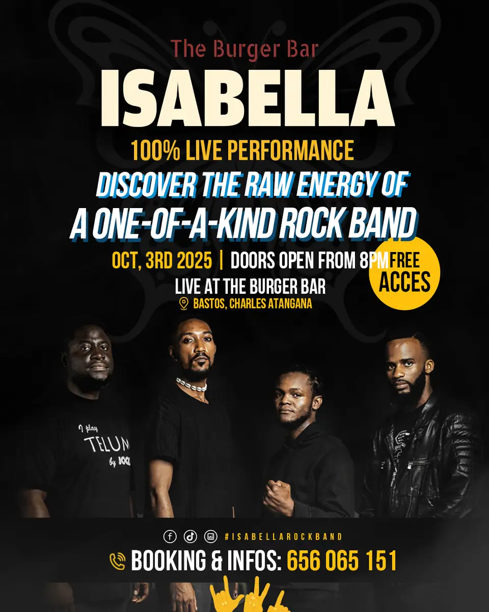

# The Burger Bar

<!-- wiki:infobox -->

| The Burger Bar | |
| --- | --- |
| Nature | À préciser |
| Relation | Client |
| Projets liés | 1 |
| État de la fiche | Ébauche |
<!-- /wiki:infobox -->

**The Burger Bar** est un client d’Alexandre « Xtincell » Djengue, suivi avec UPgraders.

## Présentation

_À documenter._

## Archives de travail

<!-- wiki:archives -->
_Relevé en lecture seule des disques de travail, 2026-11-09. Les pièces administratives et les commandes privées ne sont pas détaillées._

| | |
| --- | --- |
| Structure | UPgraders |
| Disques | C: |
| Fichiers | 1 (82 Mo) |
| Contenu | 1 fichiers de création |
| Année | 2025 |

**Dossiers**

- **2025** (1 fichiers)

**Opérations repérées lors du rangement**

- Affiche « Isabella » au Burger Bar, oct. 2025
<!-- /wiki:archives -->

## Projets

<!-- wiki:projets -->
- **2025** — [The Burger Bar — travaux](../projets/the-burger-bar-travaux.md)
<!-- /wiki:projets -->

<!-- wiki:liens-entrants -->
---
**Pages liées** : [The Burger Bar — travaux](../projets/the-burger-bar-travaux.md)
<!-- /wiki:liens-entrants -->
