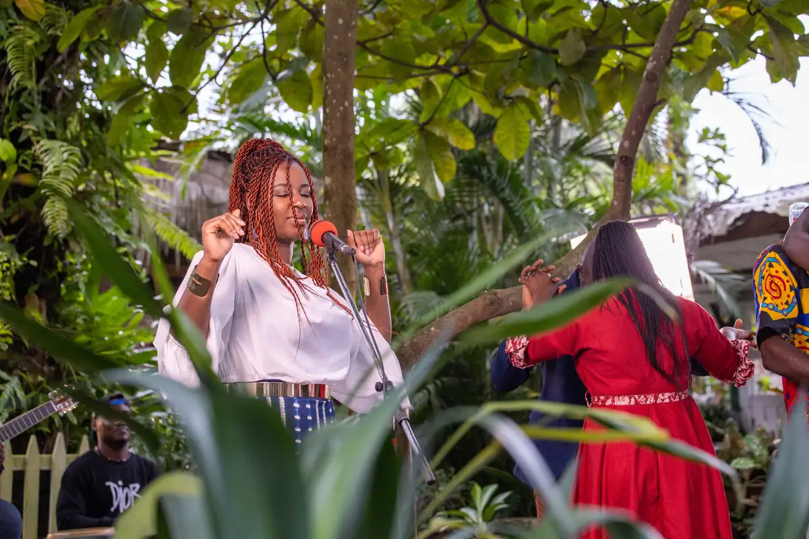
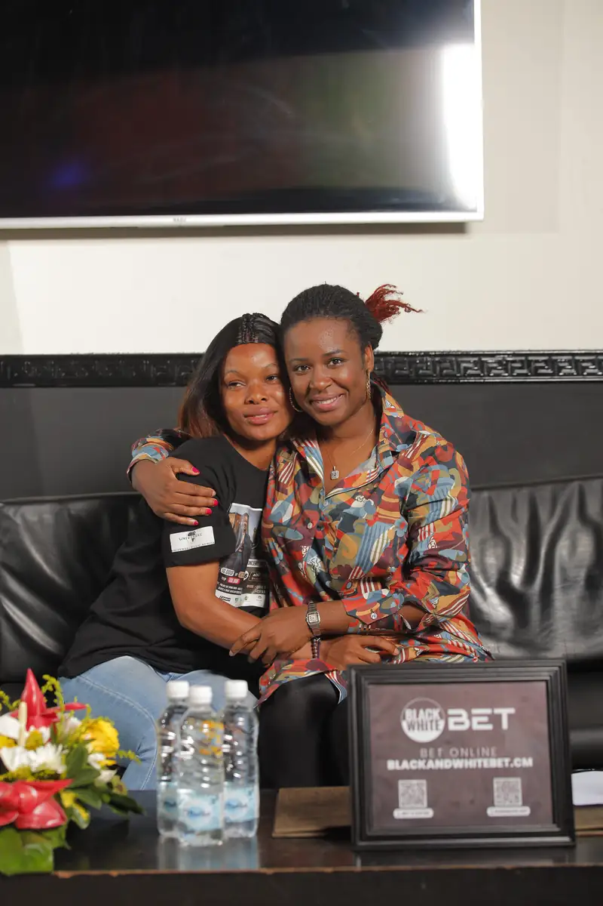
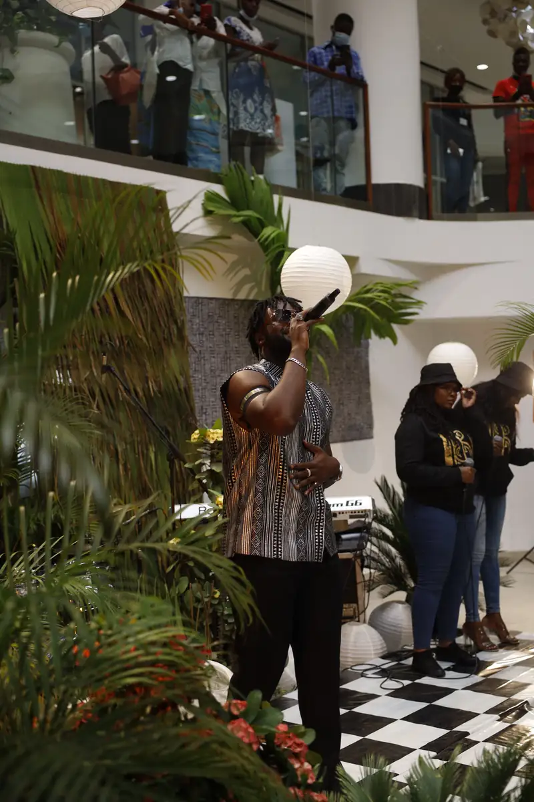
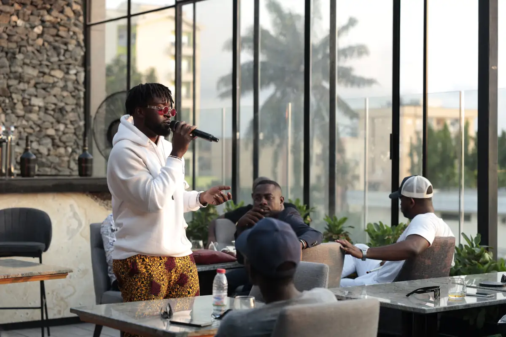
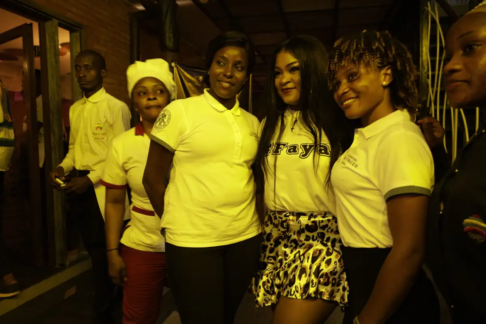
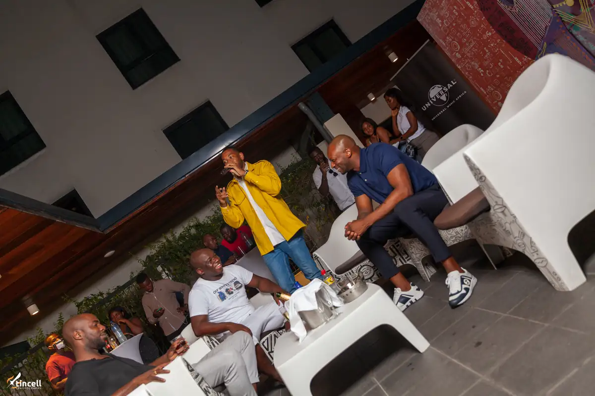
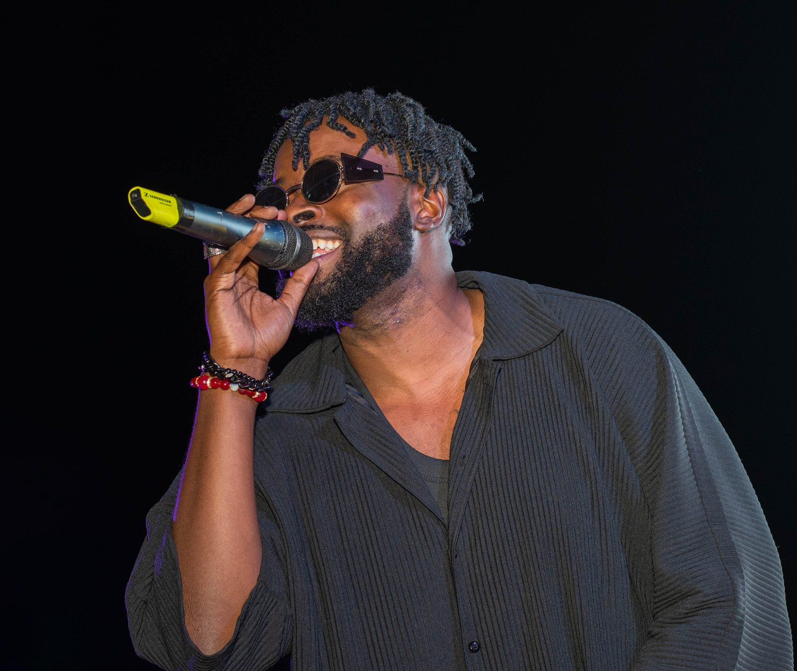

# Universal Music Africa

<!-- wiki:infobox -->

| Universal Music Africa | |
| --- | --- |
| Nature | Major du disque |
| Relation | Client |
| Rôle d’Alexandre | Direction artistique & image d'artistes (freelance) |
| Période | 2021–2022 |
| Projets liés | 8 |
| État de la fiche | Standard |
<!-- /wiki:infobox -->

**Universal Music Africa** (major du disque) est un client d’Alexandre « Xtincell » Djengue, 2021–2022.

## Présentation

Missions de direction artistique et de photographie pour le catalogue camerounais, obtenues via l'agence de talents Imperial (Esther Naah).

Le CV de 2026 et les données du site font remonter cette collaboration à 2016. Aucune source antérieure ne l’étaye : le CV de novembre 2020 ne la mentionne pas, les missions retrouvées dans les archives datent de 2021 et 2022, et un crédit « pour Universal Music Africa via l’agence Imperial » est publié le 31 août 2021. Le wiki retient 2021–2022 ([confrontation des sources](../sources.md#confrontation-élément-par-élément)). Seul un concert de fin d’année pourrait dater de décembre 2020 ; son année reste à trancher. _Sources : [disques](../sources.md#disques), [facebook](../sources.md#facebook), [cv-2020](../sources.md#cv-2020), [cv-2026](../sources.md#cv-2026)._

## Rôle d’Alexandre

Direction artistique & image d'artistes (freelance)

## Galerie

<!-- wiki:galerie -->

<!-- /wiki:galerie -->

## Archives de travail

<!-- wiki:archives -->
_Relevé en lecture seule des disques de travail, 2026-11-09. Les pièces administratives et les commandes privées ne sont pas détaillées._

| | |
| --- | --- |
| Structure | UPgraders |
| Disques | C:, P: |
| Fichiers | 11 023 (197 Go) |
| Contenu | 11 015 photos · 6 vidéos · 1 autres · 1 fichiers de création |
| Années | 2020–2022 |

**Dossiers**

- **2020** (2 203 fichiers) : TayC (décembre 2020) (2 203)
- **2021** (8 795 fichiers) : Charlotte Dipanda (found.000) (125) · Charlotte Dipanda — concert (27-29-08-2021) (6 011) · Charlotte Dipanda — dédicace (168) · Charlotte Dipanda — shooting « TheFamous » (21-22-08-2021), RAW (164) · Charlotte Dipanda — sortie d'album (15-05-2021) (454) · Dipanda (16) · Mimie — promo du single « Faya » (06-10-2021) (déduit) (731) · Projets   UNIVERSAL (552) · Shooting   Charlotte Dipanda (329) · Singuila — séance d'écoute de l'album « Docteur Love » (19-22-02-2021) (245)
- **2022** (16 fichiers) : Photos (20-08-2021) (3) · Photos (25-08-2021) (3) · Photos (26-02-2022) (4) · Photos (26-08-2021) (2) · Photos (27-02-2022) (2) · Photos (27-08-2021) (2)

**Opérations repérées lors du rangement**

- Projet Universal × Dipanda
- Projets Universal (archive Spark)
- Shooting Charlotte Dipanda (archive Spark)
- Visuels Universal Music
- Photos Charlotte *(déduit : Charlotte Dipanda, mai 2021)*
- Dédicace Charlotte *(déduit : Charlotte Dipanda, mai 2021)*
- Photos TayC *(déduit : artiste Universal, décembre 2020)*
<!-- /wiki:archives -->

## Projets

<!-- wiki:projets -->
- **2021** — [Charlotte Dipanda — sortie de l'album et soirées The Singleton (mai-juin 2021)](../projets/evt-2021-05-14-charlotte-dipanda-sortie-de-l-album-et-soirees-the-single.md)
- **2021** — [Charlotte Dipanda — tournée promo avec Madiba et concert au Palais des sports (août 2021)](../projets/evt-2021-08-20-charlotte-dipanda-tournee-promo-avec-madiba-et-concert-au.md)
- **2021** — [Locko — promotion de l'album « Era »](../projets/evt-2021-12-05-locko-promotion-de-l-album-era.md)
- **2021** — [Locko — session d'écoute de l'album « Era » sur un rooftop](../projets/evt-2021-11-26-locko-session-d-ecoute-de-l-album-era-sur-un-rooftop.md)
- **2021** — [Mimie — tournée promo du single « Faya »](../projets/evt-2021-10-06-mimie-tournee-promo-du-single-faya.md)
- **2021** — [Singuila — séance d'écoute de l'album « Docteur Love »](../projets/evt-2021-02-19-singuila-seance-d-ecoute-de-l-album-docteur-love.md)
- **2021–2022** — [Universal Music Africa — image d’artistes](../projets/uma-artistes.md)
- [Locko — galerie photo](../projets/photo-locko.md)
<!-- /wiki:projets -->

## Sources

- Archives de travail rangées sur les disques — voir [disques](../sources.md#disques)
- Export du compte Facebook (2023) — voir [facebook](../sources.md#facebook)
- CV « Creative Consultant », 30 novembre 2020 — voir [cv-2020](../sources.md#cv-2020)
- CV de 2026, repris par le CV du site et `practices.ts` — voir [cv-2026](../sources.md#cv-2026)

<!-- wiki:liens-entrants -->
---
**Pages liées** : [Charlotte Dipanda — sortie de l'album et soirées The Singleton (mai-juin 2021)](../projets/evt-2021-05-14-charlotte-dipanda-sortie-de-l-album-et-soirees-the-single.md) · [Charlotte Dipanda — tournée promo avec Madiba et concert au Palais des sports (août 2021)](../projets/evt-2021-08-20-charlotte-dipanda-tournee-promo-avec-madiba-et-concert-au.md) · [Locko — galerie photo](../projets/photo-locko.md) · [Locko — promotion de l'album « Era »](../projets/evt-2021-12-05-locko-promotion-de-l-album-era.md) · [Locko — session d'écoute de l'album « Era » sur un rooftop](../projets/evt-2021-11-26-locko-session-d-ecoute-de-l-album-era-sur-un-rooftop.md) · [Mimie — tournée promo du single « Faya »](../projets/evt-2021-10-06-mimie-tournee-promo-du-single-faya.md) · [Singuila — séance d'écoute de l'album « Docteur Love »](../projets/evt-2021-02-19-singuila-seance-d-ecoute-de-l-album-docteur-love.md) · [Universal Music Africa — image d’artistes](../projets/uma-artistes.md)
<!-- /wiki:liens-entrants -->
