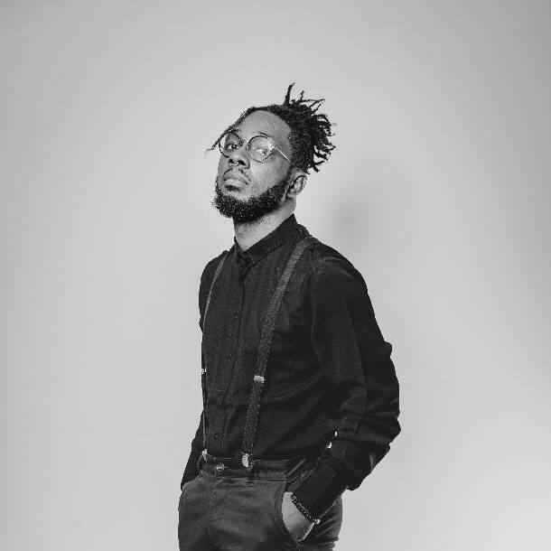

# Alexandre « Xtincell » Djengue

<!-- wiki:infobox -->

| Alexandre « Xtincell » Djengue | |
| --- | --- |
| Rôle | Directeur créatif et artistique, photographe, stratège de marque |
| Naissance | 1991 |
| Nationalité | Camerounaise |
| Lieu | Douala, Cameroun |
| Formation | Iftic-Sup, Yaoundé (Ingénieur des Travaux, 2013) |
| Activité | Directeur Créatif & Artistique de MATANGA Agency (depuis 2025) · Directeur général d’UPgraders (depuis 2022 ou 2023) |
| Langues | Français · Anglais · Japonais (notions) |
| Organisations | [UPgraders](../organisations/upgraders.md) · [MATANGA Agency](../organisations/matanga-agency.md) · [Friends Photography Studio](../organisations/friends-studio.md) |
| Liens | [Folio](https://xtincell.powerupgraders.com) · [LinkedIn](https://www.linkedin.com/in/dmalexandre) · [Behance](https://www.behance.net/xtincell) · [Pixieset](https://xtincell.pixieset.com) · [YouTube](https://www.youtube.com/@x-tincell) · [GitHub](https://github.com/xtincell) |
| État de la fiche | Standard |
<!-- /wiki:infobox -->

**Alexandre Djengue** (de son nom complet Alexandre Djengue Mbangue), dit **Xtincell**, né en 1991 à Douala, est un directeur créatif et artistique, photographe et stratège de marque camerounais installé à Douala. Ingénieur en télécommunications de formation, il se fait d’abord connaître en ligne comme graphiste, blogueur et militant de la culture otaku. Il passe ensuite par l’agence Bimstr (2019–2021) et développe à partir de 2020 une activité de photographe avec Stéphane Nounamo. En 2017, il co-fonde le cabinet de conseil [UPgraders](../organisations/upgraders.md), qu’il dirige depuis 2022 ou 2023 selon ses CV. Depuis janvier 2025, il est Directeur Créatif & Artistique de l’agence [MATANGA](../organisations/matanga-agency.md), pour laquelle il conduit des campagnes de FrieslandCampina, d’Ecobank et du Groupe Cadyst. Il conçoit aussi ses propres outils, dont la méthode de stratégie de marque [ADVE/RTIS](../projets/methode-adve-rtis.md) et la plateforme [La Fusée](../projets/la-fusee.md).

## Biographie

### Formation

Alexandre Djengue obtient un baccalauréat D (sciences) au Collège Saint-Michel en 2008. Il étudie ensuite les télécommunications et les réseaux à [Iftic-Sup](../organisations/iftic-sup.md), à Yaoundé, de 2008 à 2013. Ses CV de 2020 à 2024 parlent d’une licence ; son CV de 2026, d’un diplôme d’Ingénieur des Travaux. _Sources : [cv-2020](../sources.md#cv-2020), [cv-2024](../sources.md#cv-2024), [blog-disrupteur-2018](../sources.md#blog-disrupteur-2018)._ Son CV présente cette formation comme celle qui « informe encore » sa manière de modéliser une marque comme un système d’information.

### Blogs, graphisme et culture otaku (2011–2018)

Dès 2011, encore étudiant, Alexandre Djengue se présente en ligne comme « graphiste freelance ». Il s’engage aussi dans la communauté otaku camerounaise : en juillet 2013, il relaie le compte rendu d’une soirée de l’association [Japanimes](../projets/japanimes.md), fondée en 2009. Vers 2013, il ouvre le blog [Geek de brousse](../projets/geek-de-brousse-blog.md), consacré à la technologie, aux mangas et à la vie de créatif en Afrique francophone, et se met à [YouTube](../projets/youtube-xtincell.md) ; on lit des billets du blog jusqu’en 2020. En passant au graphisme, il change de pseudonyme pour « Xtincell ». En 2016, il rejoint [Mondoblog](../projets/mondoblog.md), la communauté de blogueurs francophones de RFI. _Sources : [facebook](../sources.md#facebook), [geekdebrousse](../sources.md#geekdebrousse), [mondoblog-2016](../sources.md#mondoblog-2016), [mboabd-japanimes](../sources.md#mboabd-japanimes)._

Il travaille un temps comme agent conseiller technique dans un centre d’appels, chez [Intelcia](../organisations/intelcia.md), pour le compte de l’opérateur SFR, puis démissionne pour se lancer à son compte. À l’été 2016, il est graphiste consultant chez Organiz Agency et Lead Designer chez [Sellkako](../organisations/sellkako.md), un site marchand ; il n’y reste que deux mois. _Sources : [blog-disrupteur-2018](../sources.md#blog-disrupteur-2018), [cv-2023-05](../sources.md#cv-2023-05), [facebook](../sources.md#facebook)._

En février 2017, il rejoint [UPgraders](../organisations/upgraders.md), un cabinet de conseil dont il se présente comme co-fondateur ; il y prend en charge le graphisme et le web, avec des clients comme [BanaHealth](../organisations/banahealth.md). De février à l’été 2018, il est business developer chez [Will & Brothers](../organisations/will-and-brothers.md) Consulting. Il cite l’entrepreneur [William Elong](william-elong.md) parmi ceux dont il a observé les méthodes. De septembre à décembre 2018, il est brand strategist pour le lancement de [Studio 44](../organisations/studio44.md). La même année, il anime le meetup « Geek de brousse Talk ». En octobre 2018, il raconte ce parcours dans *Le blog du disrupteur*. De 2018 à 2021, il anime aussi le podcast [Créapreneur](../projets/creapreneur-podcast.md). _Sources : [facebook](../sources.md#facebook), [cv-2020](../sources.md#cv-2020), [cv-2023-05](../sources.md#cv-2023-05), [blog-disrupteur-2018](../sources.md#blog-disrupteur-2018)._

Cette présence en ligne lui vaut une première visibilité : en 2020, un classement des blogs camerounais le présente comme « un infographiste de talent ». Selon son témoignage, le quotidien *Cameroon Tribune* le cite aussi, en 2020, parmi les étoiles montantes de la photographie ; l’article reste à retrouver. En 2021 et 2022, la podcasteuse [Anne-Marie C. Befoune](anne-marie-befoune.md) le reçoit dans plusieurs épisodes de *Digressions*. _Sources : [nkowa-2020](../sources.md#nkowa-2020), [digressions](../sources.md#digressions), [temoignage-2026-11-09](../sources.md#temoignage-2026-11-09)._

### Agence, photographie et image d’artistes (2019–2024)

Du 15 mai 2019 au 30 novembre 2021, il est directeur artistique assistant, puis lead designer, chez [Bimstr Agency](../organisations/bimstr.md), une agence et un média musical de Douala. Il y est à la fois photographe, designer et motion designer. Il travaille pour l’IFC, Cible RH, la SABC (campagne [Top](../projets/top-sabc.md)) et, dès 2020, pour [Chococam](../projets/chococam.md). Il continue de travailler pour Chococam avec UPgraders jusqu’en 2023 : photo produit, contenus et tournages pour Benny, Big Gum, Tartina, Matinal, Mambo et Kola. _Sources : [facebook](../sources.md#facebook), [cv-2020](../sources.md#cv-2020), [cv-2024](../sources.md#cv-2024), [disques](../sources.md#disques), [twitter](../sources.md#twitter)._

À partir de 2020, il développe une activité de photographe avec [Stéphane Nounamo](stephane-nounamo.md). Celui-ci tenait jusque-là le restaurant Friends Food, que fréquente Alexandre ; il se tourne alors vers la photographie et, selon Alexandre, l’encourage à se mettre à son compte. Leur collaboration donne [Friends Photography Studio](../organisations/friends-studio.md) ; les premières séances rangées dans ses archives datent de 2020. _Sources : [facebook](../sources.md#facebook), [twitter](../sources.md#twitter), [disques](../sources.md#disques), [temoignage-2026-11-09](../sources.md#temoignage-2026-11-09)._

En 2021 et 2022, il signe la direction artistique et les photographies d’artistes du catalogue camerounais d’[Universal Music Africa](../projets/uma-artistes.md), par l’intermédiaire de l’agence de talents Imperial, dirigée par [Esther Naah](esther-naah.md). On lui doit notamment :

- [la séance d’écoute de l’album *Docteur Love* de Singuila](../projets/evt-2021-02-19-singuila-seance-d-ecoute-de-l-album-docteur-love.md) (février 2021) ;
- [la sortie de l’album de Charlotte Dipanda](../projets/evt-2021-05-14-charlotte-dipanda-sortie-de-l-album-et-soirees-the-single.md) (mai 2021) et [son concert au Palais des sports](../projets/evt-2021-08-20-charlotte-dipanda-tournee-promo-avec-madiba-et-concert-au.md) (août 2021) ;
- la promotion de l’album *Era* de Locko (novembre–décembre 2021).

Son CV de 2026 fait remonter cette collaboration à 2016 ; aucune source antérieure ne l’étaye. _Sources : [disques](../sources.md#disques), [facebook](../sources.md#facebook), [cv-2023-02](../sources.md#cv-2023-02)._

Ses archives recensent près d’une centaine d’événements couverts en photo et en vidéo entre 2020 et 2026, dont la majorité entre 2021 et 2023. On y trouve :

- des festivals : le [Kamer Otaku Festival](../organisations/kamer-otaku-festival.md) à chaque édition depuis la première, en 2022, le DOMAF (2021, 2022, 2024), la [Douala Art Fair](../projets/evt-2022-11-03-douala-art-fair.md) (2022) et le festival [Street Whale](../projets/street-whale.md) de l’ONG [AMMCO](../organisations/ammco.md) (2021–2023) ;
- des opérations de marque pour [MTN Cameroon](../organisations/mtn-cameroon.md), dont la finale du MTN Zik Festival (2022) et le Y’ello Forum (2023), ainsi que pour Hennessy Artistry (2021) ;
- des événements institutionnels : la sélection des artistes de ResiliArt Cameroun pour l’[UNESCO](../organisations/unesco.md) (2021), les ateliers médias [Talk Paix](../organisations/talk-paix-cfi.md) de CFI (2023–2024) et le bal des Marines de l’[ambassade des États-Unis](../organisations/ambassade-des-etats-unis.md) (2023).

Il est directeur artistique et directeur de la communication du Kamer Otaku Festival en 2023. _Sources : [disques](../sources.md#disques), [cv-2023-05](../sources.md#cv-2023-05)._

### UPgraders, Motion19 et Friends Studio (2021–2024)

D’avril 2021 à février 2023, il est Brand Manager de [Motion19](../projets/motion19-lancement.md), une marque de matériel audiovisuel qu’UPgraders construit de A à Z : système de vente, recrutement de l’équipe, programme communautaire « Aventurier ». Il prend la direction d’UPgraders au début des années 2020 : ses CV indiquent tantôt janvier 2022, tantôt janvier 2023. Avec [Friends Photography Studio](../organisations/friends-studio.md), dont il assure le développement commercial, il réalise des productions pour [Cimencam](../projets/cimencam-video-corporate.md) (via OmenKart, 2023), [Maison Gimane](../projets/maison-gimane.md), [Oceanis Kribi](../projets/oceanis-kribi-the-villa.md) et [Akwa Palace](../projets/akwa-palace.md). Pour l’agence Her Media, il réalise aussi des visuels pour [Moët & Chandon](../projets/moet-chandon.md) (2024). À partir de 2025, le studio couvre [des événements d’Orange Cameroun](../projets/orange-evenements-2025-2026.md) via McCann. _Sources : [cv-2023-05](../sources.md#cv-2023-05), [cv-2023-02](../sources.md#cv-2023-02), [cv-2024](../sources.md#cv-2024), [disques](../sources.md#disques)._

### Direction de création chez MATANGA (depuis 2025)

En janvier 2025, Alexandre Djengue devient Directeur Créatif & Artistique de [MATANGA Agency](../organisations/matanga-agency.md), une agence marketing de Douala. Il y est responsable de la narration et de la cohérence des opérations clients, et coordonne l’équipe créative. Il y signe notamment :

- les campagnes saisonnières de [Peak et Bonnet Rouge](../projets/friesland-campina.md) pour FrieslandCampina ;
- la campagne des [40 ans d’Ecobank](../projets/ecobank.md) ;
- pour le Groupe Cadyst, la [mascotte de Cadyst Grain](../projets/cadyst-grain.md) et des campagnes [Amigo](../projets/amigo.md), [Robuste](../projets/robuste.md) et [Delys](../projets/delys.md) ;
- des campagnes pour [La Pasta](../projets/lapasta.md), [NSIA Assurances](../projets/nsia.md), [Tradex](../projets/tradex.md), [La Vache qui rit](../projets/la-vache-qui-rit.md) et [Cap Esterias](../projets/cap-esterias.md).

### Méthode et outils (depuis 2025)

Alexandre Djengue formalise sa pratique de la stratégie de marque dans la méthode [ADVE/RTIS](../projets/methode-adve-rtis.md). Ses quatre premiers piliers (Authenticité, Distinction, Valeur, Engagement) posent l’identité de la marque. Les quatre suivants (Risk, Track, Innovation, Stratégie) en tirent l’analyse, le marché, le champ d’actions et la feuille de route. Il la traduit en logiciels :

- la plateforme [La Fusée](../projets/la-fusee.md), dont les versions se succèdent depuis 2025 ;
- le programme [Shinkiro](../projets/shinkiro.md) d’UPgraders et son poste de travail du directeur de la création, [La Barre](../projets/la-barre.md) ;
- le moteur de recherche de campagnes [Argos Studio](../projets/argos-studio.md) ;
- [Galahad](../projets/galahad.md), une équipe d’agents d’intelligence artificielle auto-hébergée.

Il développe aussi des projets personnels : le jeu narratif [NEO-KINARA](../projets/neo-kinara.md), des [moteurs de character design](../projets/moteur-charadesign.md) et une [cartographie de 285 genres musicaux](../projets/atlas-of-recorded-sound.md).

## Activités

| Casquette | Domaines | Exemples |
| --- | --- | --- |
| Stratégie | Positionnement, lancement de marque, méthode | [Motion19](../projets/motion19-lancement.md), [Kemcare](../projets/kemcare.md), [Shakazz](../projets/shakazz.md), [ADVE/RTIS](../projets/methode-adve-rtis.md) |
| Direction créative et artistique | Campagnes, key visuals, identités, image d’artistes, festivals | [MATANGA](../organisations/matanga-agency.md), [Universal Music Africa](../projets/uma-artistes.md), [Kamer Otaku Festival](../projets/kof-festival.md) |
| Exécution | Photographie, vidéo, production, logiciels | [Chococam](../projets/chococam.md), [Orange Cameroun](../projets/orange-evenements-2025-2026.md), [La Barre](../projets/la-barre.md) |

L’ensemble des projets est classé par année dans la [chronologie](../chronologie.md) et par client dans l’[index](../index.md).

## Projets personnels

En marge de ses commandes, Alexandre Djengue mène des projets d’écriture, d’illustration et d’audio. On y compte :

- la nouvelle de fantasy [Dawn of the Unchained](../projets/dawn-of-the-unchained.md), signée de son nom complet ;
- le projet d’écriture [République de Mbengola](../projets/republique-de-mbengola.md), les projets [Forgemonde](../projets/forgemonde.md) et [Darkroom](../projets/darkroom.md), et l’histoire illustrée [Popcorn Man](../projets/popcorn-man.md) ;
- l’agence de talents [Spark](../projets/spark-agence-de-talents.md) ;
- le blog [Geek de brousse](../projets/geek-de-brousse-blog.md), décliné en 2024 en [essais de podcast](../projets/podcast-geek-de-brousse.md), et le podcast [Frontières de l’innovation](../projets/podcast-frontieres-de-l-innovation.md) (2021) ;
- des séries de défis graphiques comme [AI Inktober](../projets/ai-inktober.md) (2023) et le [Charadesign Challenge](../projets/charadesign-challenge-2024.md) (2024).

## Réception et publications

La liste complète, datée et sourcée, est sur la page [Presse et médias](../presse.md).

- En octobre 2018, *Le blog du disrupteur*, édité par Ace, publie son témoignage « Mon expérience de designer graphique free-lance au Cameroun ».
- En octobre 2020, le blog Nkowa&Co le classe parmi les blogs camerounais à suivre.
- Selon son témoignage, *Cameroon Tribune* le cite en 2020 parmi les étoiles montantes de la photographie (article à retrouver).
- En 2021 et 2022, [Anne-Marie C. Befoune](anne-marie-befoune.md) le reçoit dans son podcast *Digressions* : être créatif en Afrique, freelancing et conseil, prix des offres, réussite personnelle et réseaux sociaux. Il cite aussi une interview dans *Elle Citoyenne*, encore à retrouver.
- En avril 2022, le blog de la banque d’images Iwaria lui consacre un portrait dans sa série *Pixels Hunters*, sous le titre « Xtincell, une étoile qui brille dans la photographie ».
- Le podcast [Créapreneur](../projets/creapreneur-podcast.md) (2018–2021, 19 épisodes) est archivé sur Apple Podcasts, Spotify et Internet Archive.
- Son portfolio de direction artistique (design et photographie) est publié sur Behance.

## Notes

- Les dates de ce parcours ont été confrontées le 9 novembre 2026 : CV successifs, profils et publications datés, archives de travail et témoignage. Le détail, élément par élément, est sur la page [Sources du parcours](../sources.md). Le CV de 2026 et le CV du site reprenaient plusieurs dates que les sources d’époque démentent : Orange via McCann 2013–2018, Chococam 2014–2020, Universal Music Africa 2016–2022, Bimstr 2018–2020, Sellkako 2017–2019, Studio44 2024.
- La liste des événements vient des notes de rangement des disques de travail, établies à partir des images, des dates de prise de vue et des livrables. Chaque fiche d’événement indique sa fiabilité.

## Sources

Voir la page [Sources du parcours](../sources.md) : bibliographie complète, hiérarchie des sources et tableau de confrontation.

## Voir aussi

- [Chronologie](../chronologie.md)
- [Presse et médias](../presse.md) · [Sources du parcours](../sources.md)
- [Index des projets](../index.md)
- [UPgraders](../organisations/upgraders.md) · [MATANGA Agency](../organisations/matanga-agency.md) · [Friends Photography Studio](../organisations/friends-studio.md)

<!-- wiki:liens-entrants -->
<!-- /wiki:liens-entrants -->
