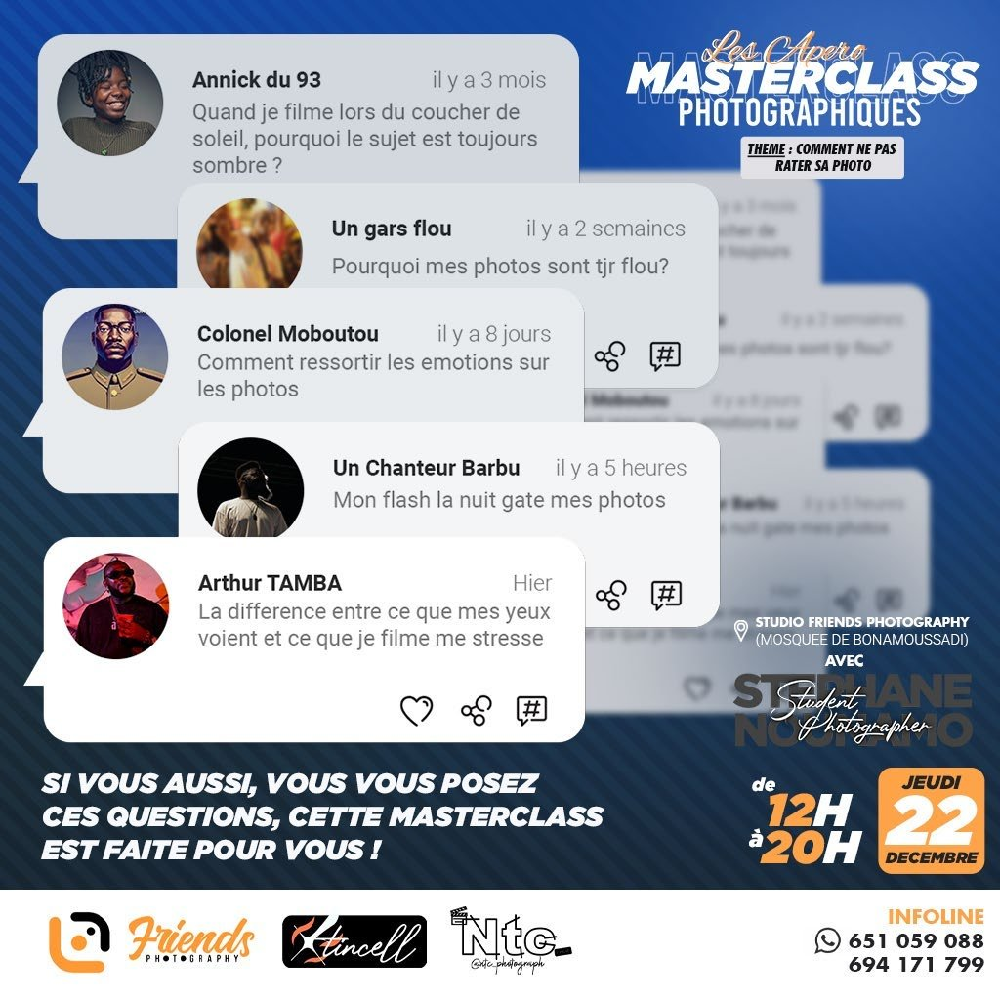
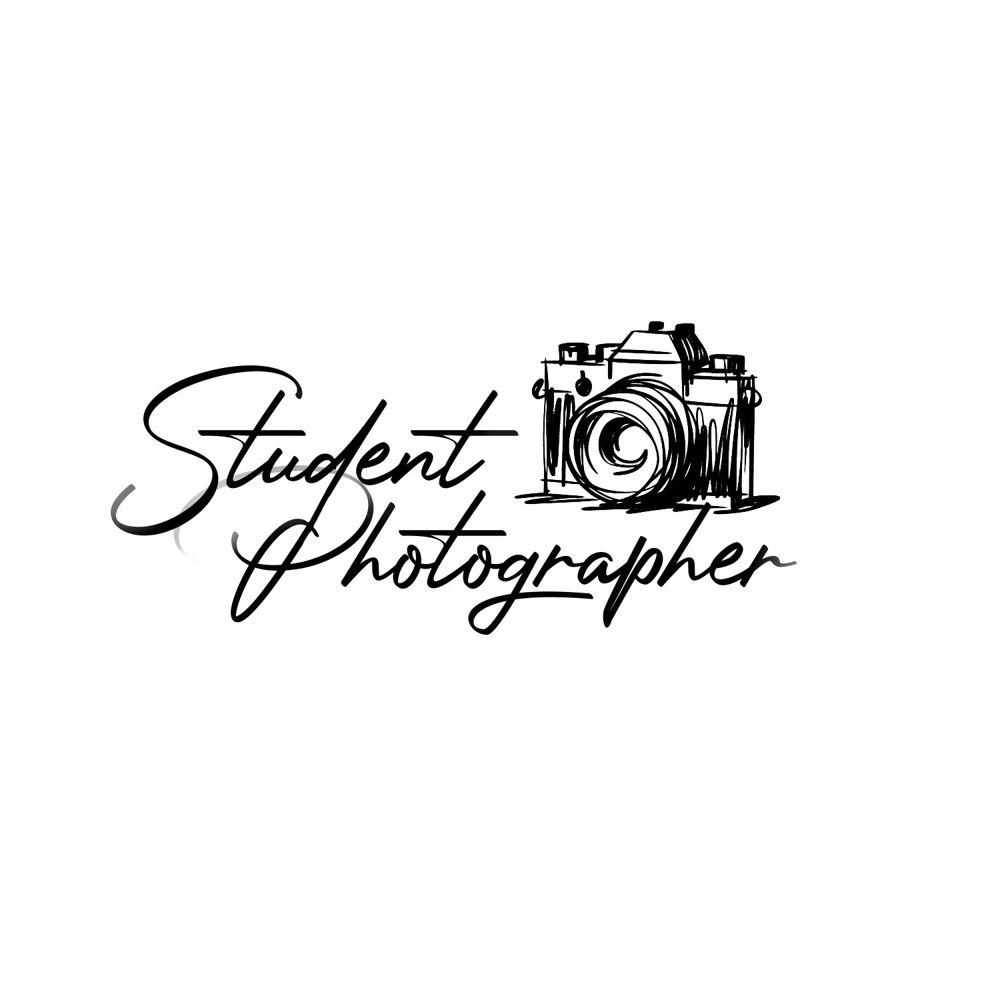

# Stéphane Nounamo

<!-- wiki:infobox -->

| Stéphane Nounamo | |
| --- | --- |
| Rôle | Photographe, co-animateur de Friends Photography Studio |
| Organisations | [Friends Photography Studio](../organisations/friends-studio.md) |
| État de la fiche | Ébauche |
<!-- /wiki:infobox -->

**Stéphane Nounamo** est un photographe camerounais. Il co-anime [Friends Photography Studio](../organisations/friends-studio.md) avec Alexandre « Xtincell » Djengue.

## Parcours

Stéphane Nounamo tient d’abord le restaurant Friends Food (« Friend’s Food by chef Stéphane »), qu’Alexandre fréquente : le restaurant figure parmi ses favoris sur Facebook dès décembre 2017, et ils échangent sur Twitter d’octobre 2019 à janvier 2020. Il se tourne ensuite vers la photographie et, selon Alexandre, l’encourage à se mettre à son compte. Leur collaboration commence en 2020, après la pandémie de Covid-19 selon Alexandre ; les premières séances communes rangées dans les archives datent de cette année-là. En 2022, il anime des masterclasses photographiques. _Sources : [facebook](../sources.md#facebook), [twitter](../sources.md#twitter), [disques](../sources.md#disques), [temoignage-2026-11-09](../sources.md#temoignage-2026-11-09)._

Le CV de 2026 présente Alexandre et Stéphane Nounamo comme un binôme dès les campagnes Orange de 2013–2018. Aucune source d’époque ne l’étaye ([confrontation des sources](../sources.md#confrontation-élément-par-élément)).

## Projets en commun

<!-- wiki:projets -->
- **2022** — [Apéro Masterclass (masterclasses photo)](../projets/apero-masterclass.md)
- **2020–…** — [Friends Photography Studio](../organisations/friends-studio.md)
- [Orange Cameroun — photographie de campagnes](../projets/orange-campagnes-photo.md)
<!-- /wiki:projets -->

## Galerie

<!-- wiki:galerie -->

<!-- /wiki:galerie -->

## Sources

- Export du compte Facebook (2023) — voir [facebook](../sources.md#facebook)
- Export du compte Twitter (28 juillet 2023) — voir [twitter](../sources.md#twitter)
- Archives de travail rangées sur les disques — voir [disques](../sources.md#disques)
- Témoignage d’Alexandre Djengue, 9 novembre 2026 — voir [temoignage-2026-11-09](../sources.md#temoignage-2026-11-09)

<!-- wiki:liens-entrants -->
---
**Pages liées** : [Alexandre « Xtincell » Djengue](alexandre-djengue.md) · [Apéro Masterclass (masterclasses photo)](../projets/apero-masterclass.md) · [Friends Photography Studio](../organisations/friends-studio.md) · [Orange Cameroun — photographie de campagnes](../projets/orange-campagnes-photo.md)
<!-- /wiki:liens-entrants -->
