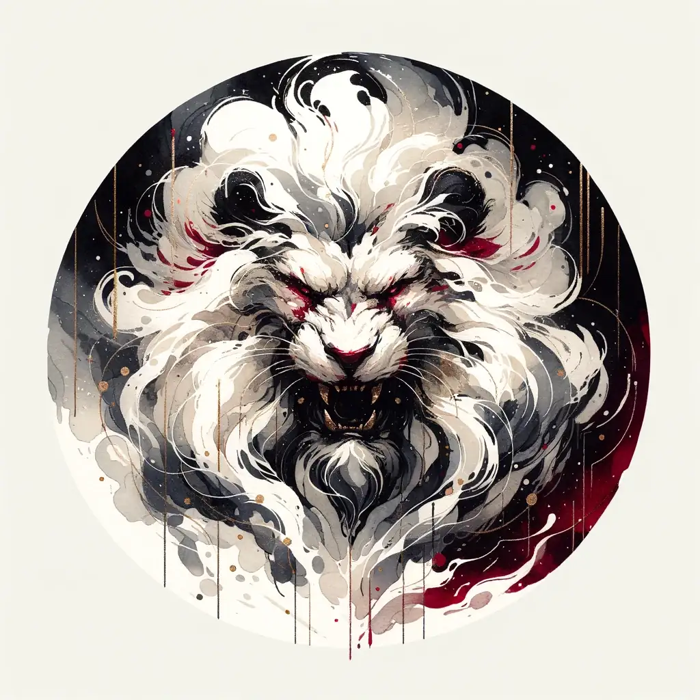
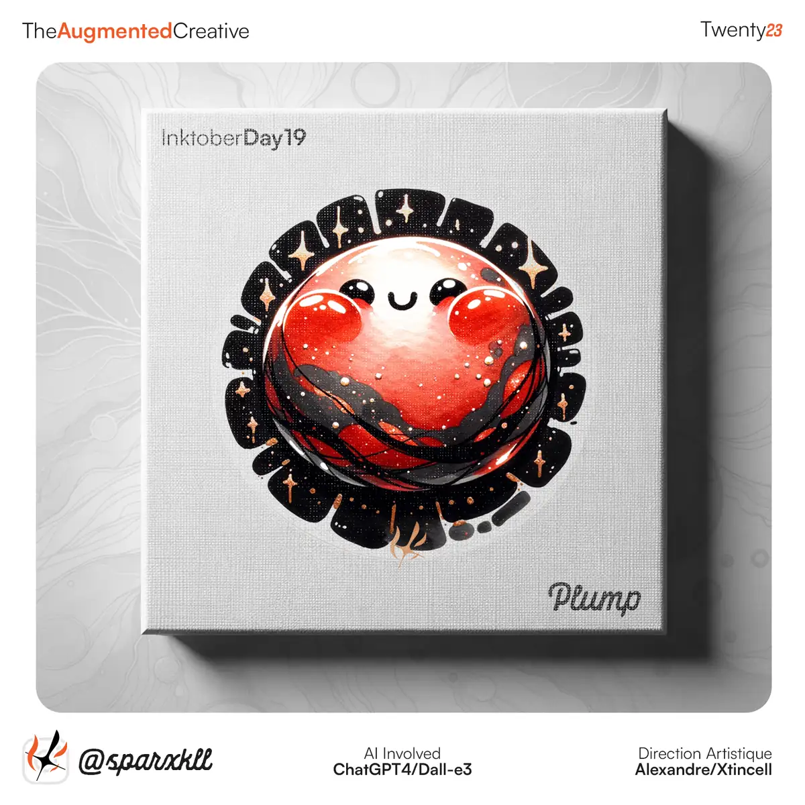
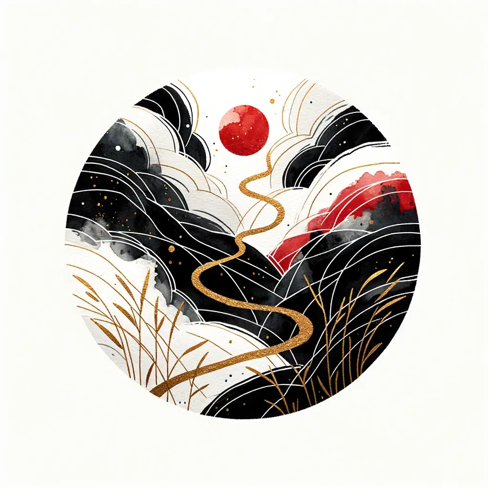
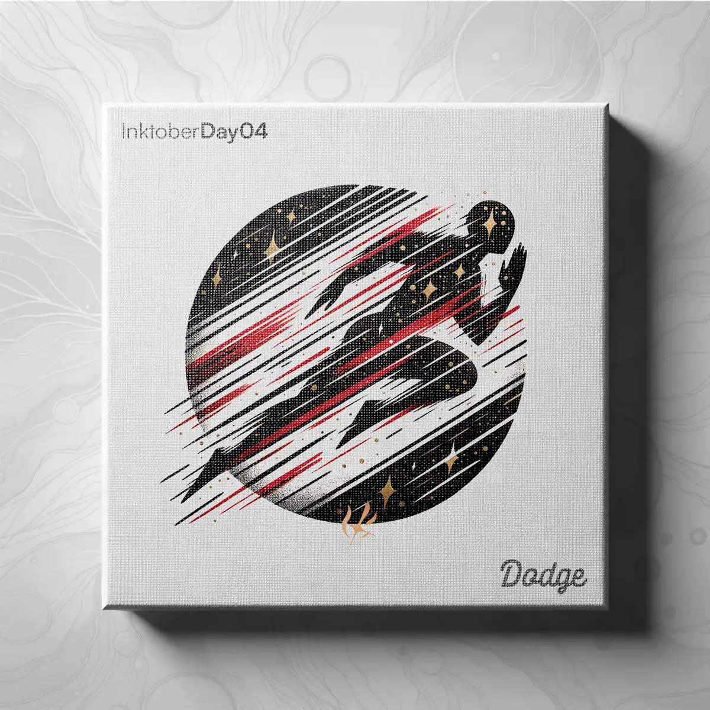
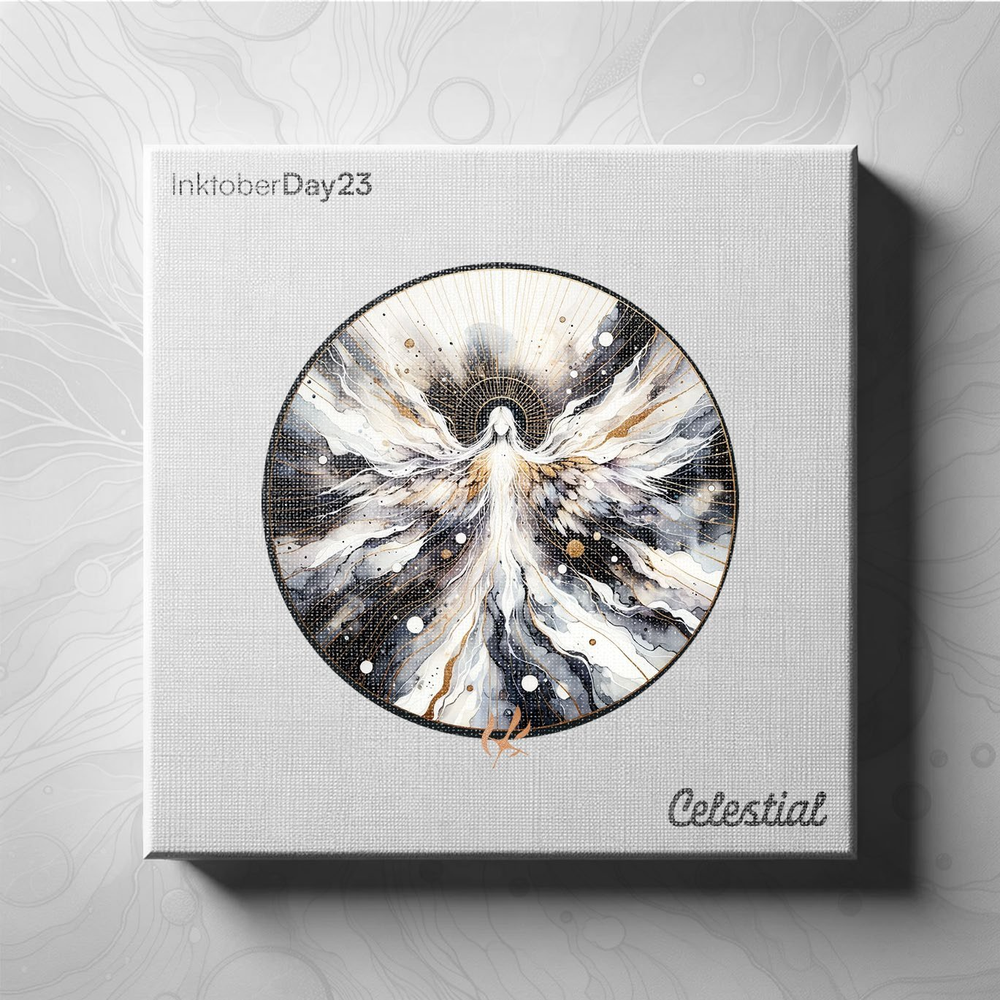
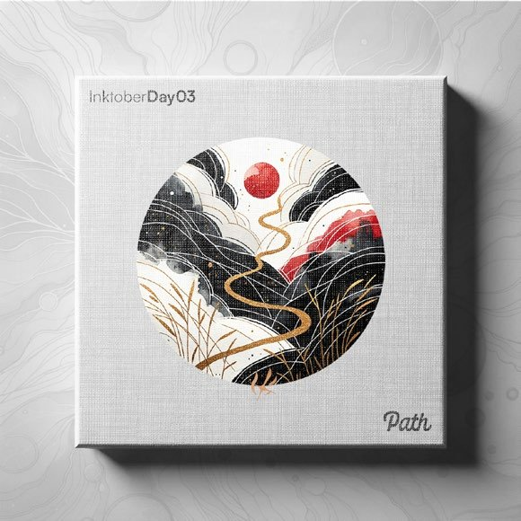
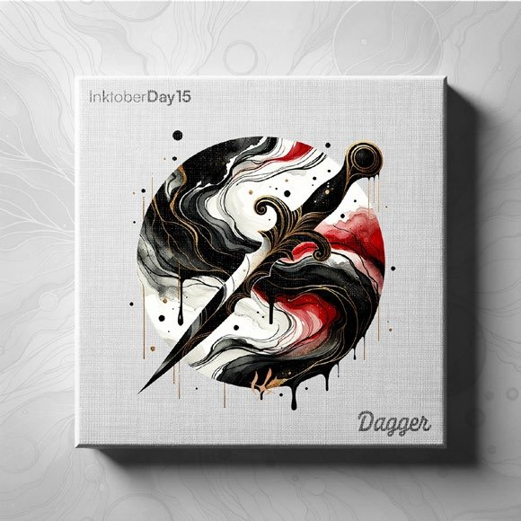
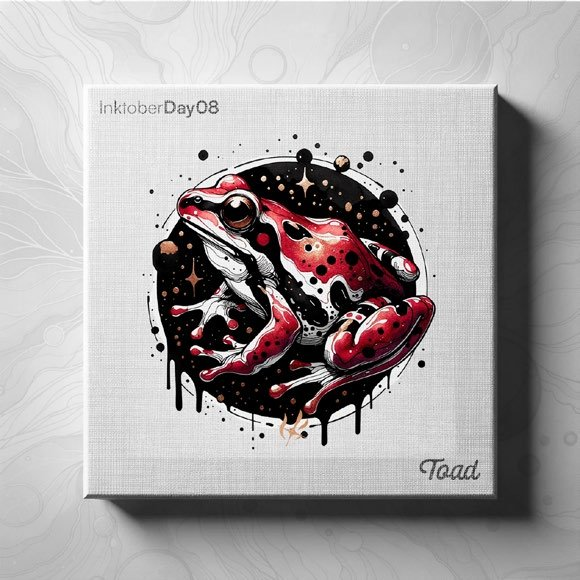
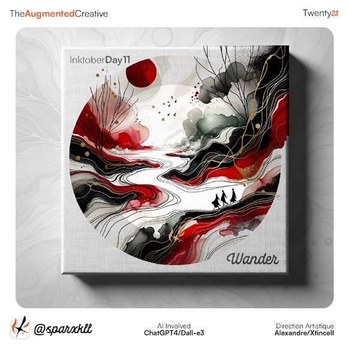
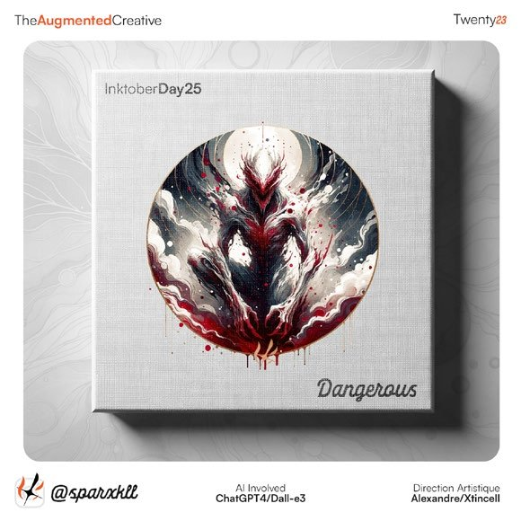

# AI Inktober

<!-- wiki:infobox -->

| AI Inktober | |
| --- | --- |
| Client | Projet personnel |
| Casquette | Direction créative & artistique |
| Catégorie | Collection |
| Folio | _pas encore sur le site_ |
| État de la fiche | Ébauche |
<!-- /wiki:infobox -->

**AI Inktober** est une collection personnelle d’Alexandre « Xtincell » Djengue.

## Description

_À documenter : contexte, demande, rôle, résultat._

## Galerie

<!-- wiki:galerie -->

<!-- /wiki:galerie -->

## Preuves et médias

- Visuels : `public/work/historique/19-ai-inktober/` (6 fichiers)

## Sources

- Dossier de visuels du folio (`public/work/`)

<!-- wiki:liens-entrants -->
---
**Pages liées** : [Alexandre « Xtincell » Djengue](../personnes/alexandre-djengue.md)
<!-- /wiki:liens-entrants -->
