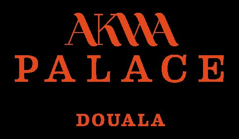
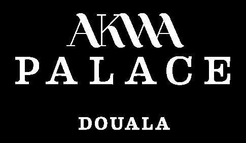
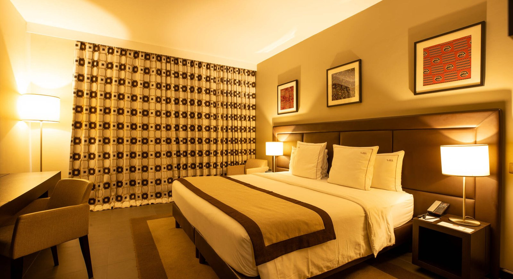

# Akwa Palace — vidéo publicitaire

<!-- wiki:infobox -->

| Akwa Palace — vidéo publicitaire | |
| --- | --- |
| Client | [Akwa Palace](../organisations/akwa-palace.md) |
| Via | [Friends Photography Studio](../organisations/friends-studio.md) · [UPgraders](../organisations/upgraders.md) |
| Période | 2025 |
| Casquette | Exécution |
| Catégorie | Production |
| Rôle | Réalisation video advertising |
| Disciplines | Vidéo · Hospitality · Advertising |
| Folio | [Folio ↗](https://xtincell.powerupgraders.com/work) _(cité, sans page dédiée)_ |
| État de la fiche | Standard |
<!-- /wiki:infobox -->

**Akwa Palace — vidéo publicitaire** est une production réalisée pour [Akwa Palace](../organisations/akwa-palace.md), via [Friends Photography Studio](../organisations/friends-studio.md) puis [UPgraders](../organisations/upgraders.md) (2025).

## Description

Campagne vidéo publicitaire pour l'hôtel Akwa Palace (Douala). Direction d'image, captation, montage, livrables multi-formats — production Friends Studio × UPgraders.

## Rôle

Réalisation video advertising. Repère d’origine : « 2025 ».

## Galerie

<!-- wiki:galerie -->

<!-- /wiki:galerie -->

## Preuves et médias

- Visuels : `public/work/tier23/akwa-palace-2025/` (3 fichiers)

## Sources

- Folio — `src/components/folio/data/practices.ts`, entrée « AKWA PALACE »

<!-- wiki:liens-entrants -->
---
**Pages liées** : [Alexandre « Xtincell » Djengue](../personnes/alexandre-djengue.md)
<!-- /wiki:liens-entrants -->
