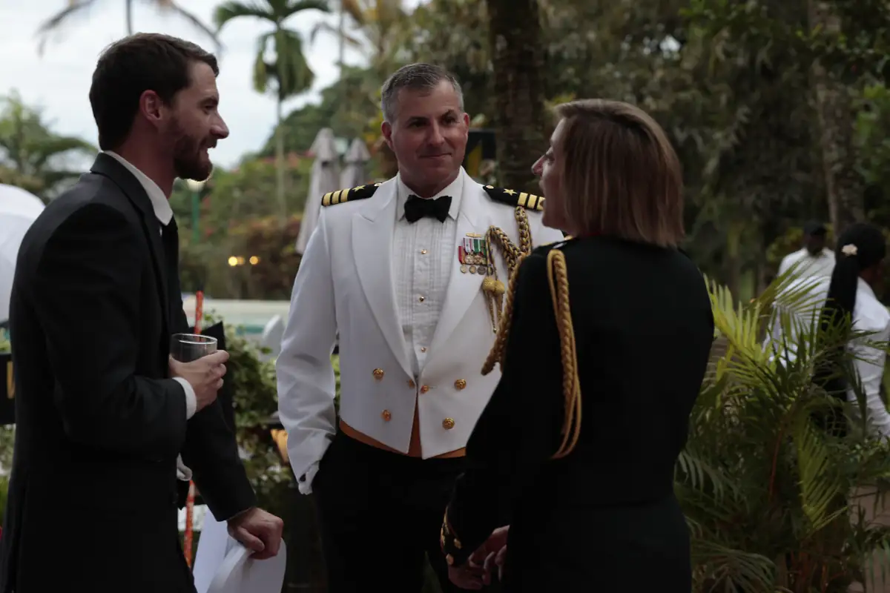
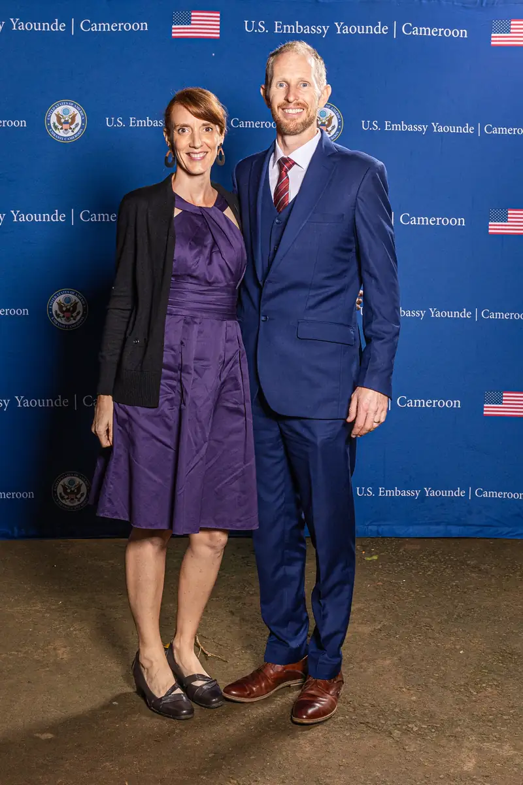
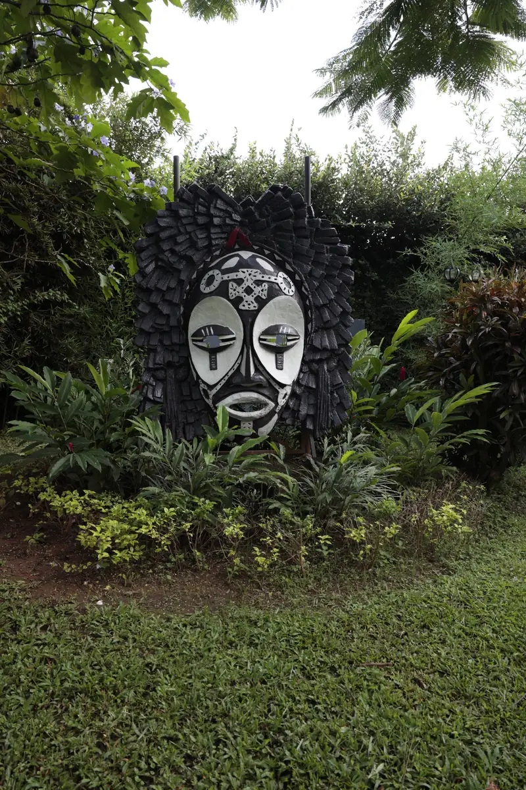
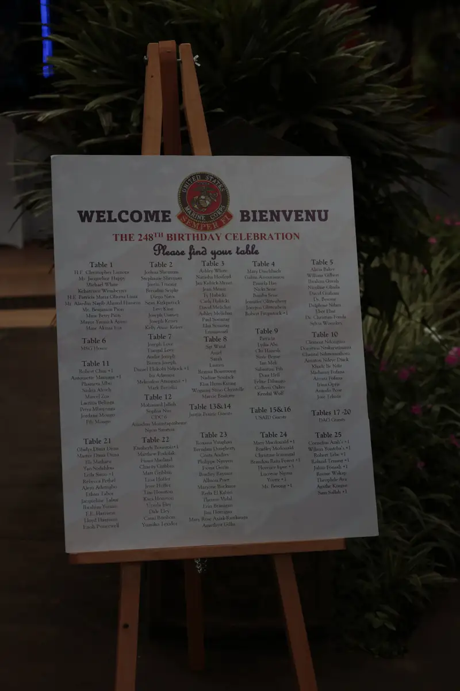

# Ambassade des États-Unis — travaux

<!-- wiki:infobox -->

| Ambassade des États-Unis — travaux | |
| --- | --- |
| Client | [Ambassade des États-Unis](../organisations/ambassade-des-etats-unis.md) |
| Via | [UPgraders](../organisations/upgraders.md) |
| Période | 2023 |
| Casquette | Exécution |
| Catégorie | Production |
| Sous-projets | [Bal des Marines de l'ambassade des États-Unis (Marine Corps Ball)](evt-2023-11-11-bal-des-marines-de-l-ambassade-des-etats-unis-marine-corp.md) |
| Folio | _pas encore sur le site_ |
| État de la fiche | Ébauche |
<!-- /wiki:infobox -->

**Ambassade des États-Unis — travaux** regroupe le travail réalisé pour [Ambassade des États-Unis](../organisations/ambassade-des-etats-unis.md) avec [UPgraders](../organisations/upgraders.md) (2023).

## Description

_À documenter : demande, rôle, livrables._ Les dossiers et opérations retrouvés sur les disques sont détaillés sur la fiche [Ambassade des États-Unis](../organisations/ambassade-des-etats-unis.md#archives-de-travail).

## Galerie

<!-- wiki:galerie -->

<!-- /wiki:galerie -->

## Sources

- Archives de travail rangées sur les disques (2026-11-09)

<!-- wiki:liens-entrants -->
---
**Pages liées** : [Bal des Marines de l'ambassade des États-Unis (Marine Corps Ball)](evt-2023-11-11-bal-des-marines-de-l-ambassade-des-etats-unis-marine-corp.md)
<!-- /wiki:liens-entrants -->
