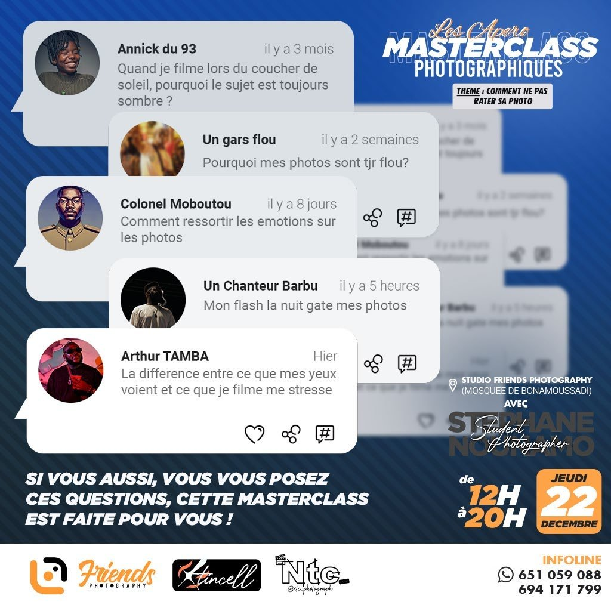
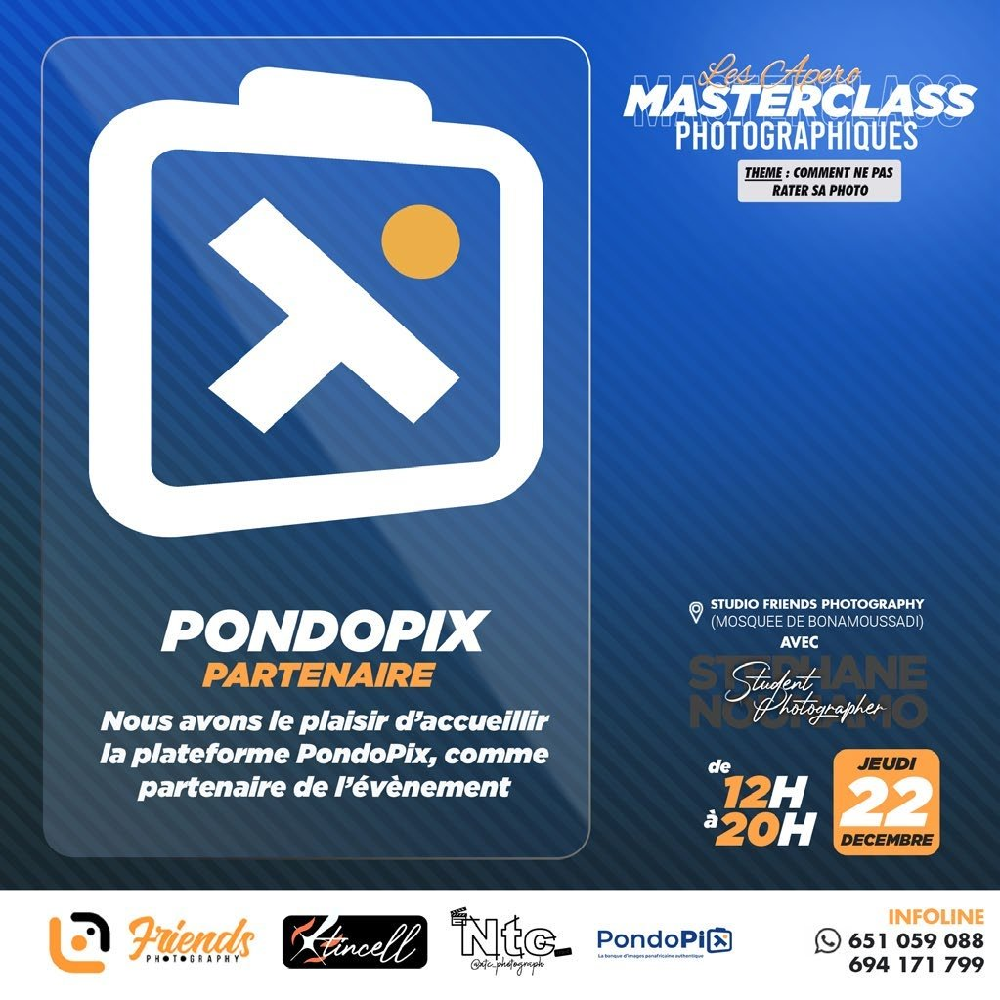
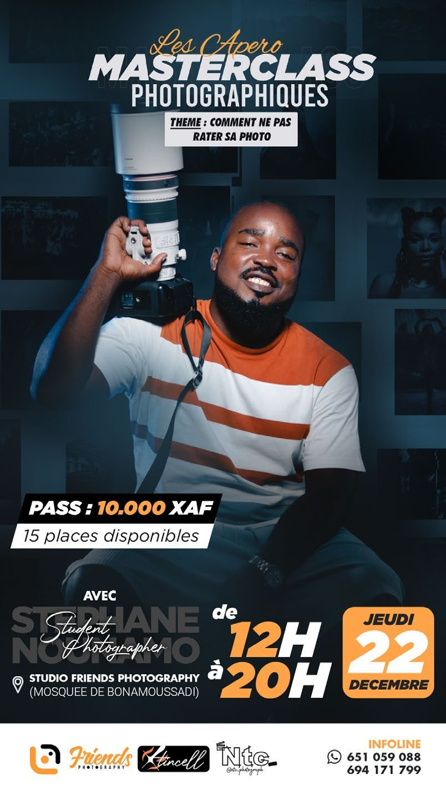

# Apéro Masterclass

<!-- wiki:infobox -->

| Apéro Masterclass (masterclasses photo) | |
| --- | --- |
| Client | [Student Photographer (Stéphane Nounamo)](../organisations/student-photographer-stephane-nounamo.md) |
| Via | [UPgraders](../organisations/upgraders.md) |
| Période | 2022 |
| Casquette | Direction créative & artistique |
| Catégorie | Événement |
| Rôle | Couverture photo et vidéo, communication |
| Sous-projets | [« Les Apéro Masterclass photographiques » de Stéphane Nounamo (II)](evt-2022-12-22-les-apero-masterclass-photographiques-de-stephane-nounamo.md) · [« Photography Masterclass » de Stéphane Nounamo (I)](evt-2022-08-27-photography-masterclass-de-stephane-nounamo-i.md) |
| Personnes | [Stéphane Nounamo](../personnes/stephane-nounamo.md) |
| Folio | _pas encore sur le site_ |
| État de la fiche | Standard |
<!-- /wiki:infobox -->

**Apéro Masterclass** est une série de masterclasses de photographie animées par [Stéphane Nounamo](../personnes/stephane-nounamo.md) sous sa marque [Student Photographer](../organisations/student-photographer-stephane-nounamo.md), à Douala, à partir de 2022. Alexandre « Xtincell » Djengue participe aux premières éditions.

## Description

La première séance, la « [Photography Masterclass](evt-2022-08-27-photography-masterclass-de-stephane-nounamo-i.md) », a lieu le 27 août 2022 dans une bibliothèque-salon de Douala, avec le soutien de Motion19 : démonstrations au boîtier et projection des images en direct. La deuxième, « [Les Apéro Masterclass photographiques](evt-2022-12-22-les-apero-masterclass-photographiques-de-stephane-nounamo.md) », se tient le 22 décembre 2022 au Friends Photography Studio, à Bonamoussadi : un cours en salle suivi d’une prise de vue pratique. L’affiche de cette séance cite Xtincell parmi les organisateurs. Le 22 février 2023, Alexandre publie sur LinkedIn au sujet des Apéro Masterclass. _Sources : [disques](../sources.md#disques), [linkedin-apero-2023](../sources.md#linkedin-apero-2023), [temoignage-2026-11-09](../sources.md#temoignage-2026-11-09)._

## Rôle

Alexandre couvre les séances en photo et en vidéo. Les visuels conservés dans le folio relèvent de la communication de la série.

## Galerie

<!-- wiki:galerie -->

<!-- /wiki:galerie -->

## Preuves et médias

- Visuels : `public/work/historique/14-apero-masterclass/` (3 fichiers)

## Sources

- Dossier de visuels du folio (`public/work/`)
- Archives de travail rangées sur les disques — voir [disques](../sources.md#disques)
- Publication LinkedIn #aperomasterclass, 22 février 2023 — voir [linkedin-apero-2023](../sources.md#linkedin-apero-2023)
- Témoignage d’Alexandre Djengue, 9 novembre 2026 — voir [temoignage-2026-11-09](../sources.md#temoignage-2026-11-09)

<!-- wiki:liens-entrants -->
---
**Pages liées** : [« Les Apéro Masterclass photographiques » de Stéphane Nounamo (II)](evt-2022-12-22-les-apero-masterclass-photographiques-de-stephane-nounamo.md) · [« Photography Masterclass » de Stéphane Nounamo (I)](evt-2022-08-27-photography-masterclass-de-stephane-nounamo-i.md)
<!-- /wiki:liens-entrants -->
