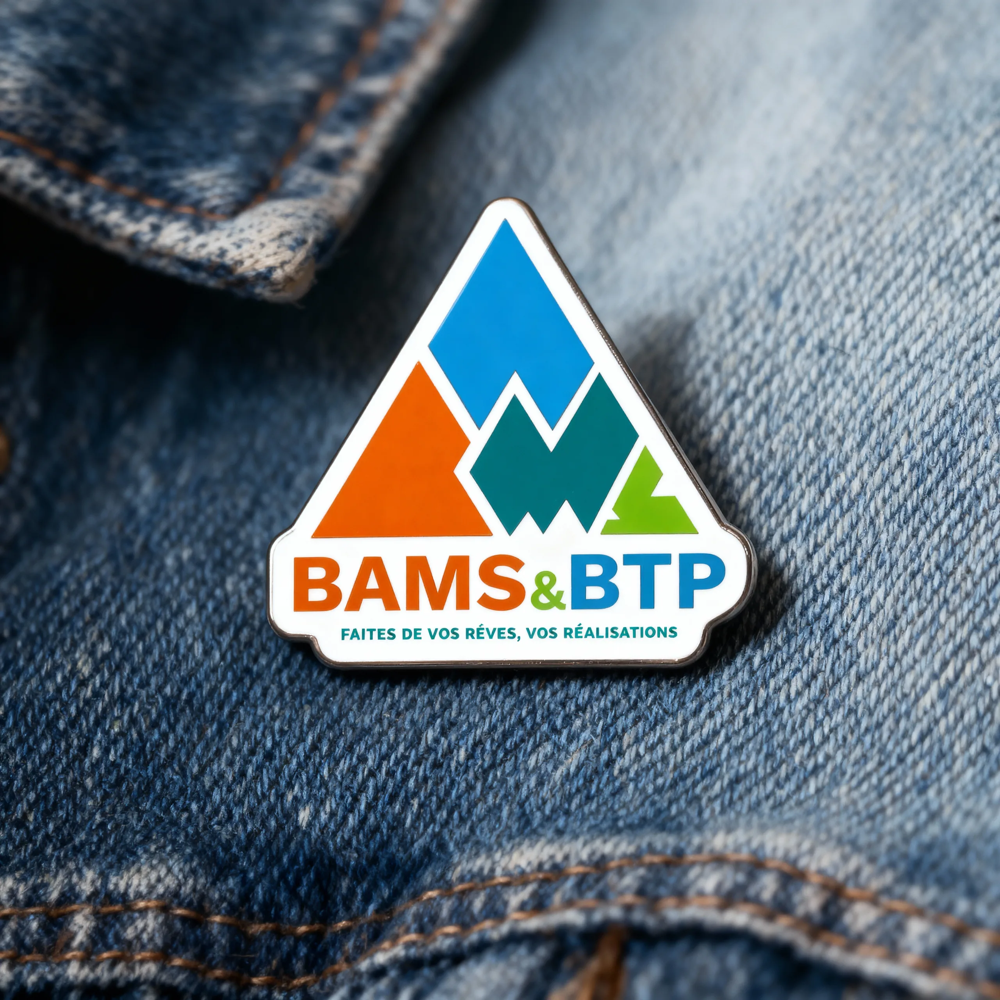
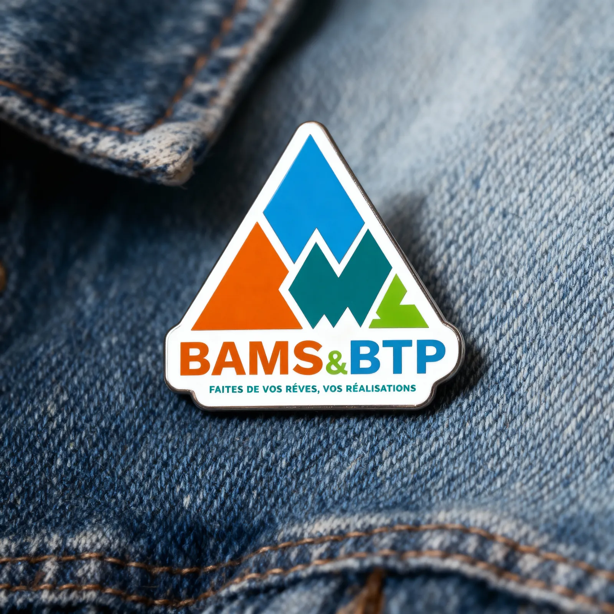
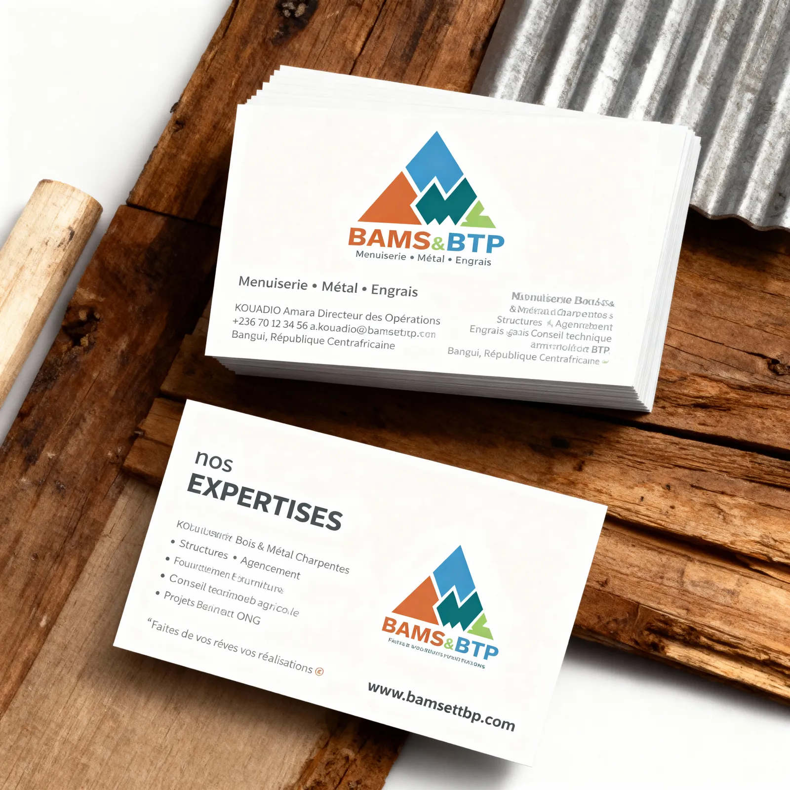
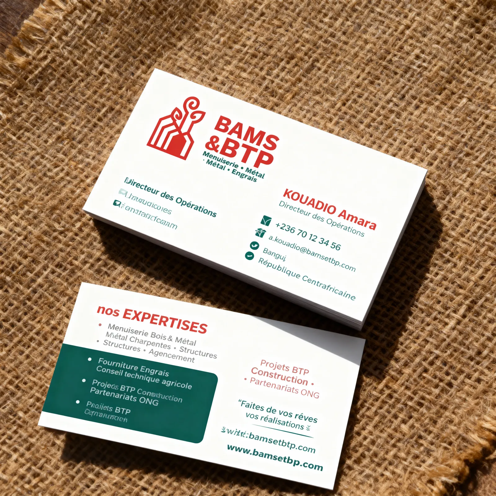
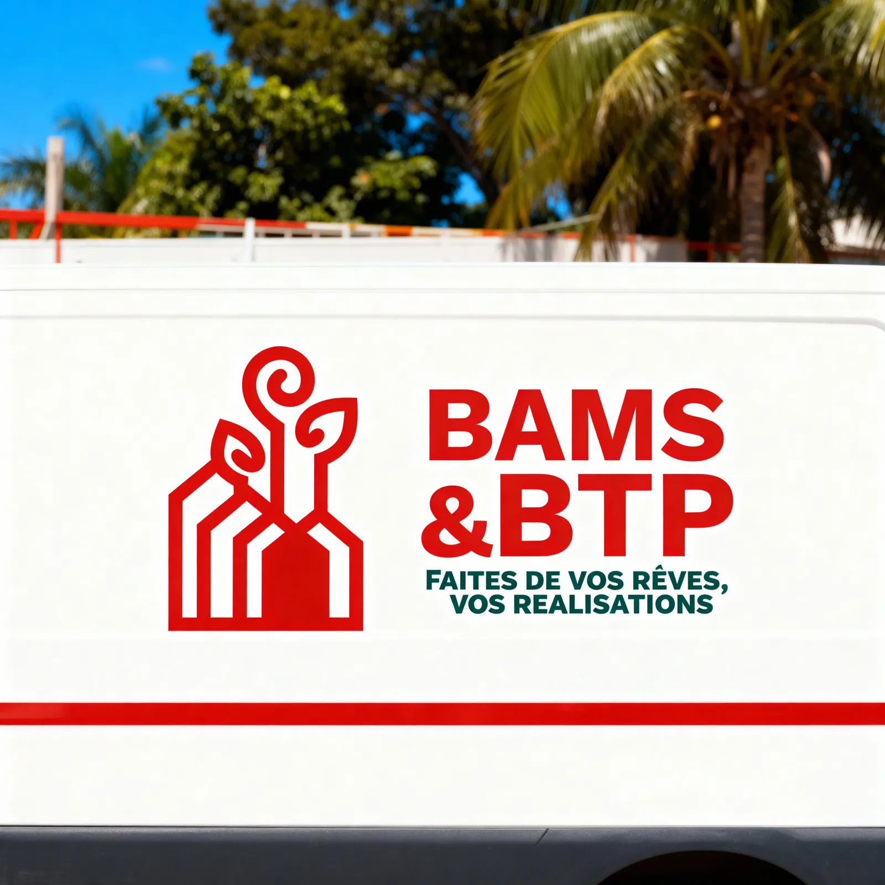
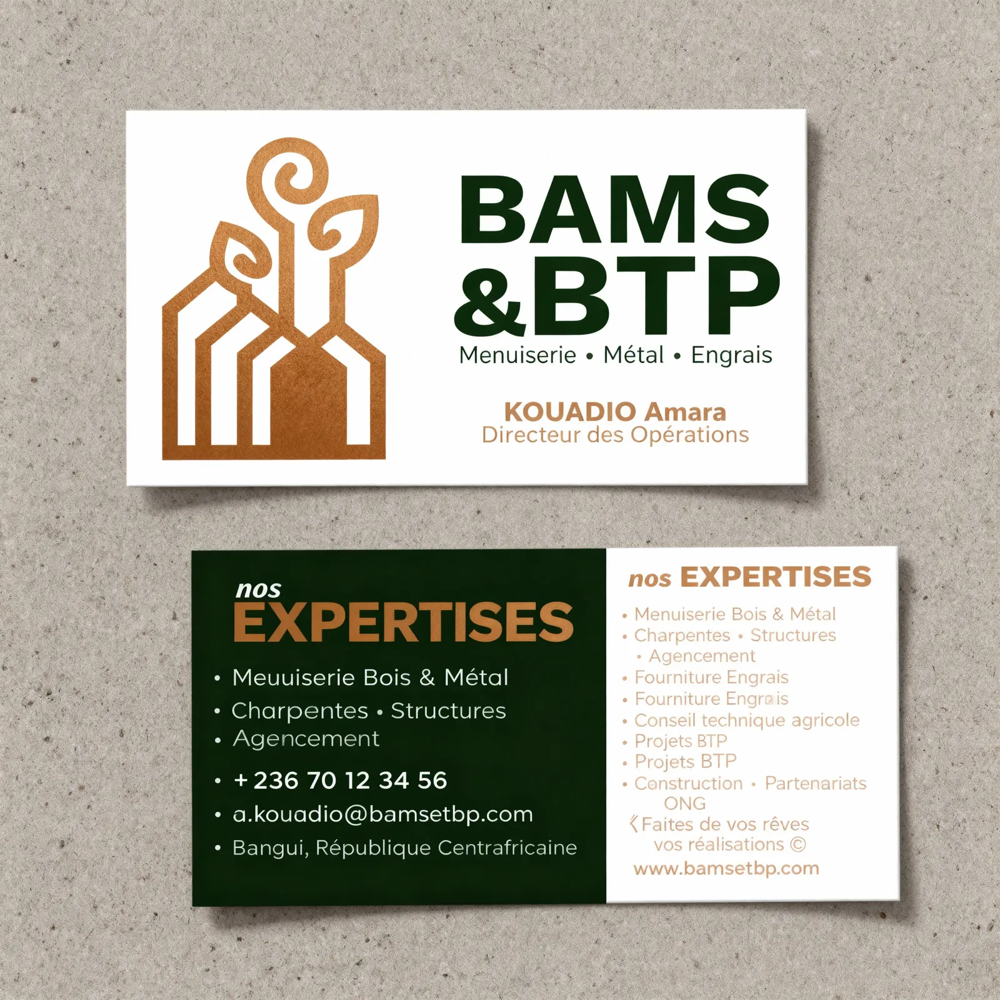
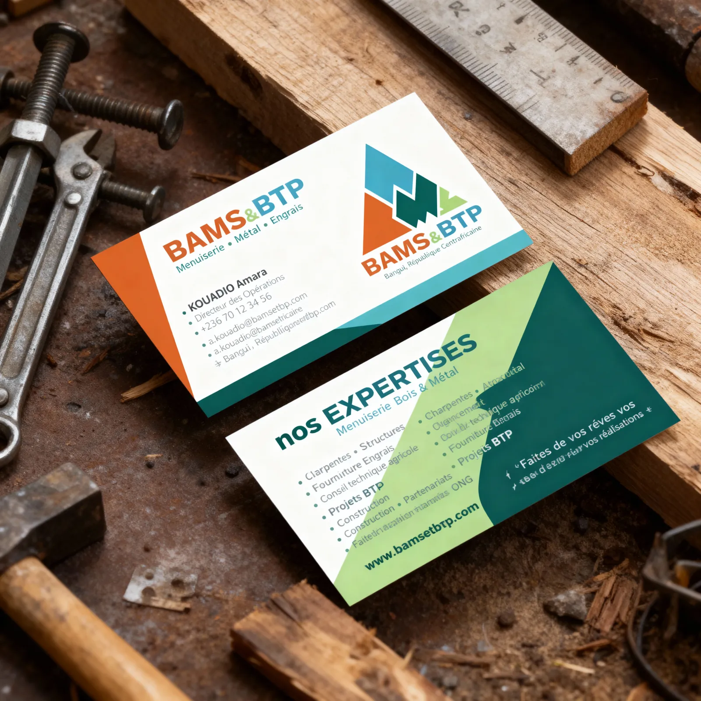

# BAMS & BTP — Identité corporate

<!-- wiki:infobox -->

| BAMS & BTP — Identité corporate | |
| --- | --- |
| Client | [BAMS & BTP](../organisations/bams-btp.md) |
| Via | [MATANGA Agency](../organisations/matanga-agency.md) |
| Période | 2025 |
| Casquette | Direction créative & artistique |
| Catégorie | Campagne |
| Disciplines | branding · packaging |
| Folio | [Étude de cas ↗](https://xtincell.powerupgraders.com/work/bams-btp) |
| État de la fiche | Ébauche |
<!-- /wiki:infobox -->

**BAMS & BTP — Identité corporate** est une campagne réalisée pour [BAMS & BTP](../organisations/bams-btp.md) (2025).

## Contexte

Identité de marque et déclinaisons (cartes de visite, pin's émaillé) pour BAMS & BTP, entreprise centrafricaine (Bangui) de menuiserie, métal, construction et intrants agricoles, logo en chaîne de montagnes multicolore.

## Galerie

<!-- wiki:galerie -->

<!-- /wiki:galerie -->

## Preuves et médias

- Visuels : `public/work/cases/bams-btp/` (7 fichiers)

## Sources

- Archives de travail rangées sous « MATANGA — EXPORT DU TRAVAIL » sur les disques (relevé du 2026-11-09)
- Folio — `scripts/cases.spec.json`, entrée `bams-btp`

<!-- wiki:liens-entrants -->
<!-- /wiki:liens-entrants -->
