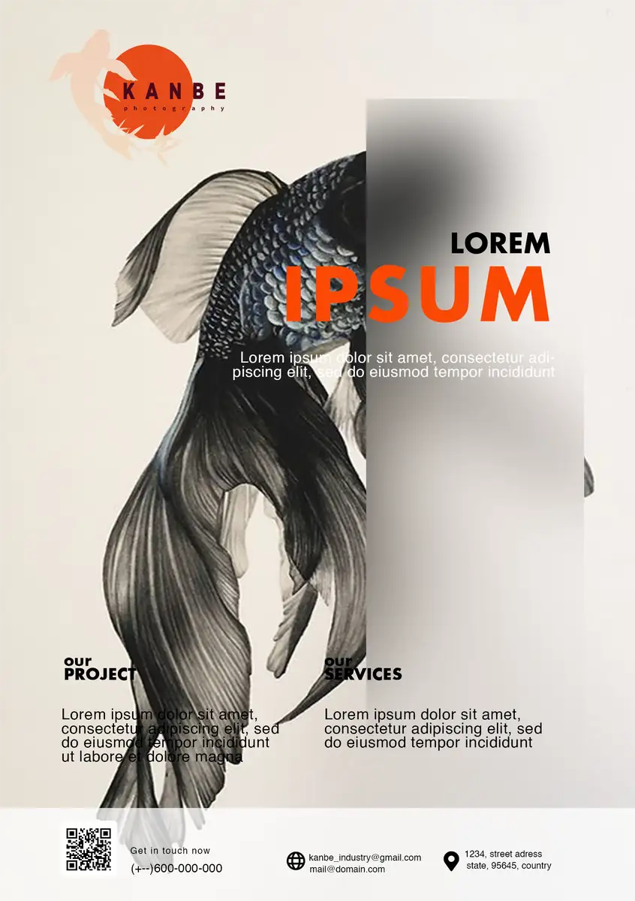
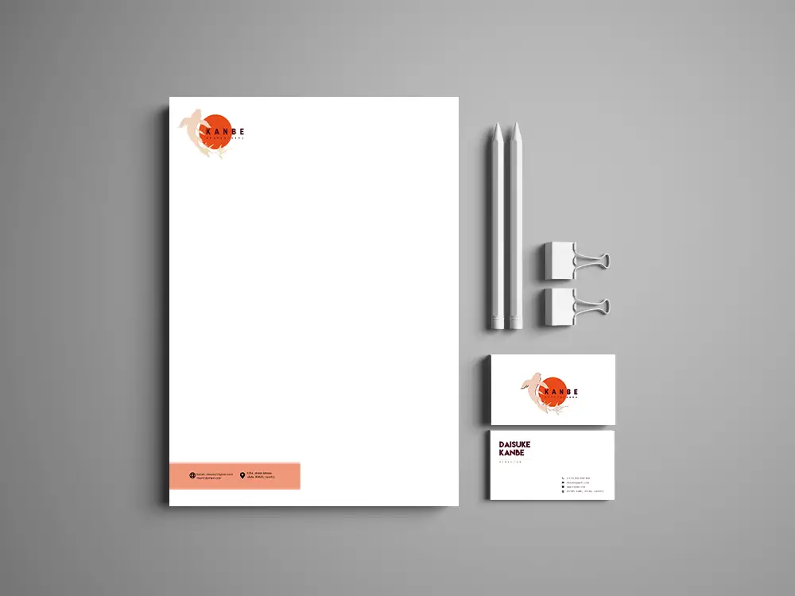
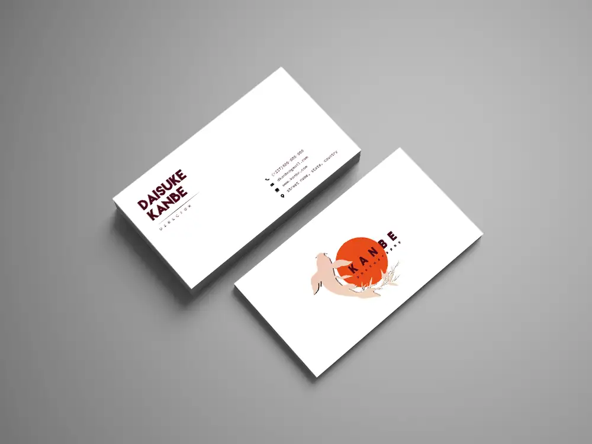
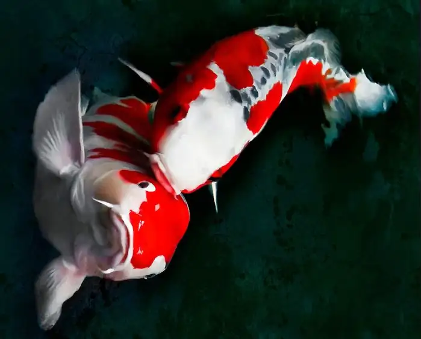

# Kanbe — branding

<!-- wiki:infobox -->

| Kanbe — branding | |
| --- | --- |
| Client | Projet personnel |
| Période | 2020 |
| Casquette | Direction créative & artistique |
| Catégorie | Identité |
| Folio | _pas encore sur le site_ |
| État de la fiche | Ébauche |
<!-- /wiki:infobox -->

**Kanbe — branding** est un projet personnel d’Alexandre « Xtincell » Djengue (2020).

## Description

_À documenter._

## Galerie

<!-- wiki:galerie -->

<!-- /wiki:galerie -->

## Archives

- 18 fichiers dans les dossiers « Xtincell » des disques de travail (12 photos · 4 autres · 1 fichiers de création · 1 documents).

## Sources

- Archives personnelles rangées sur les disques (2026-11-09), dossier « Créations graphiques/Branding « Kanbe » (2020) »

<!-- wiki:liens-entrants -->
<!-- /wiki:liens-entrants -->
