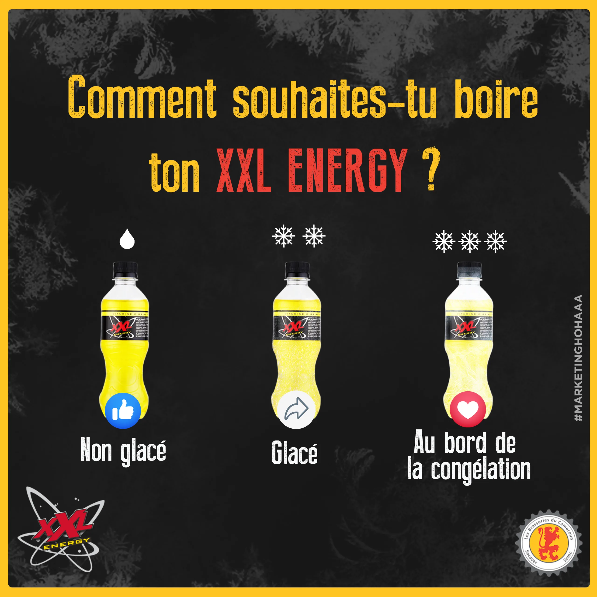
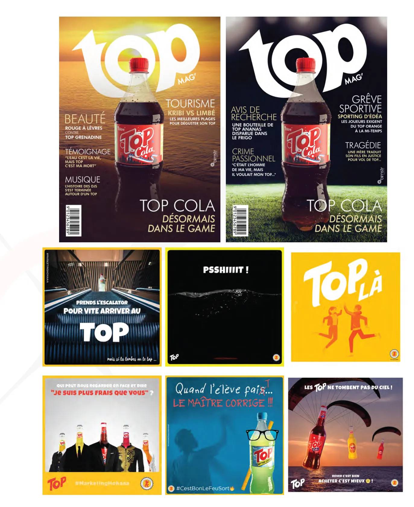
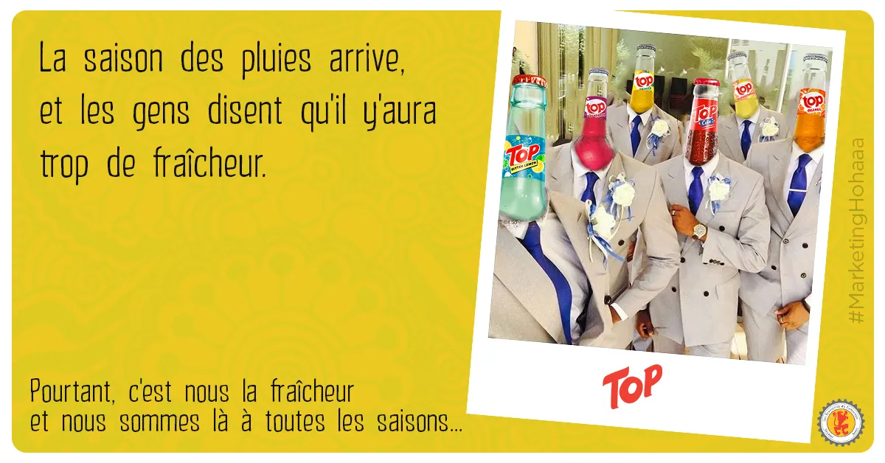

# Brasseries du Cameroun — XXL & Top

<!-- wiki:infobox -->

| Brasseries du Cameroun — XXL & Top | |
| --- | --- |
| Client | [Les Brasseries du Cameroun (SABC)](../organisations/brasseries-du-cameroun.md) |
| Période | 2024–2025 |
| Casquette | Direction créative & artistique |
| Catégorie | Campagne |
| Disciplines | social · KV-OOH |
| Folio | [Étude de cas ↗](https://xtincell.powerupgraders.com/work/brasseries-du-cameroun) |
| État de la fiche | Ébauche |
<!-- /wiki:infobox -->

**Brasseries du Cameroun — XXL & Top** est une campagne réalisée pour [Les Brasseries du Cameroun (SABC)](../organisations/brasseries-du-cameroun.md) (2024–2025).

## Contexte

Contenus social media pour la brasserie nationale, sur les marques XXL Energy et Top (soda), incluant posts d'engagement et concept de faux magazine « top MAG ».

## Galerie

<!-- wiki:galerie -->

<!-- /wiki:galerie -->

## Preuves et médias

- Visuels : `public/work/cases/brasseries-du-cameroun/` (4 fichiers)

## Sources

- Folio — `scripts/cases.spec.json`, entrée `brasseries-du-cameroun`

<!-- wiki:liens-entrants -->
<!-- /wiki:liens-entrants -->
