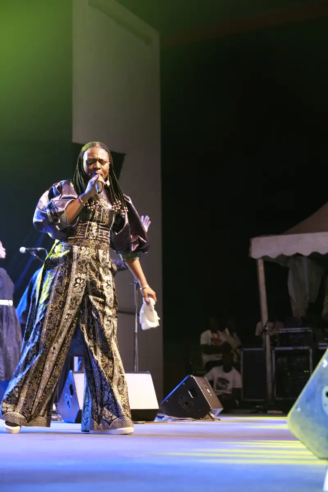
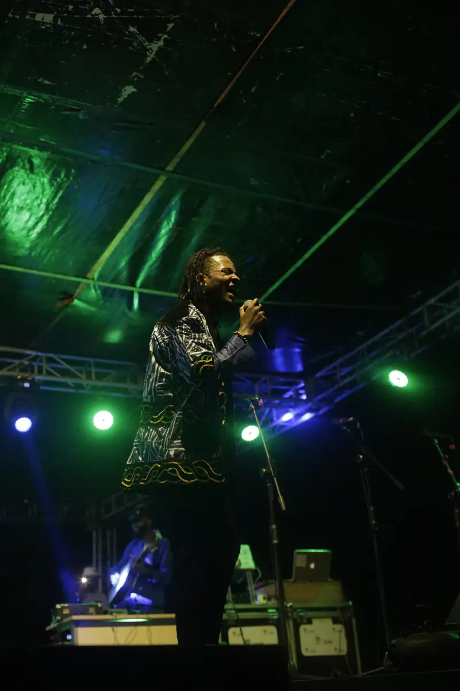
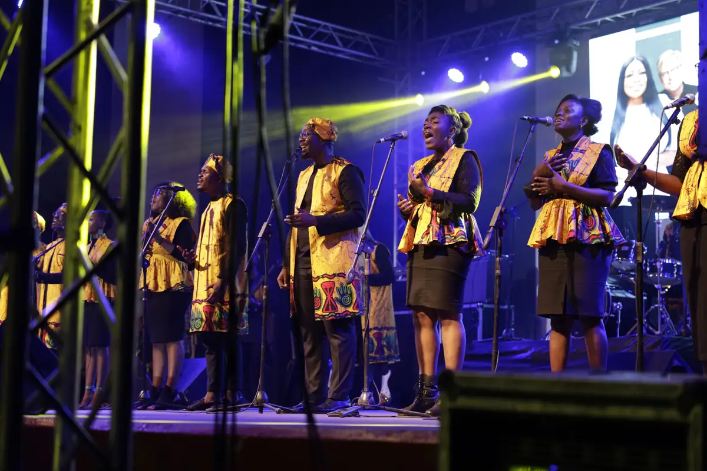
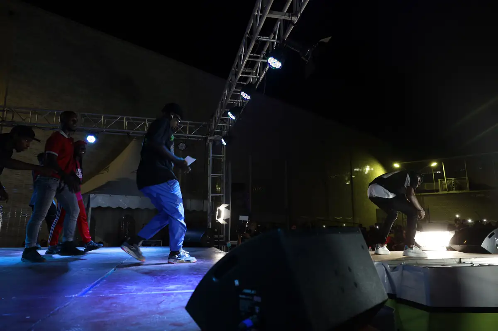
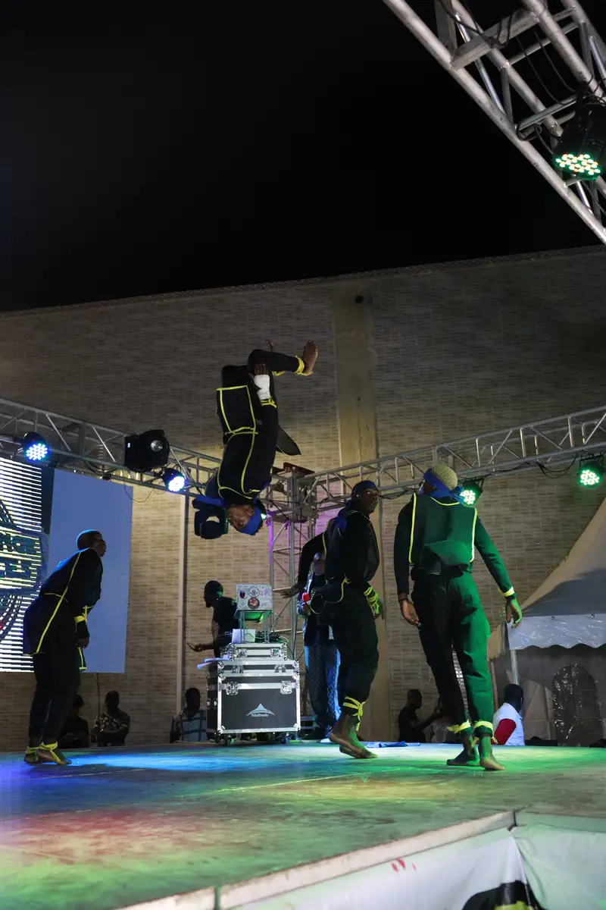
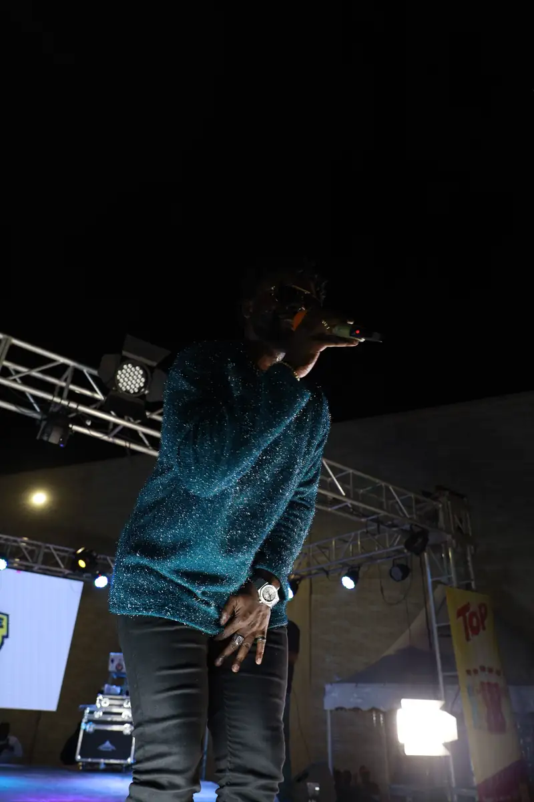

# CanalOlympia (Canal+) — travaux

<!-- wiki:infobox -->

| CanalOlympia (Canal+) — travaux | |
| --- | --- |
| Client | [CanalOlympia (Canal+)](../organisations/canalolympia-canal.md) |
| Via | [UPgraders](../organisations/upgraders.md) |
| Période | 2021 |
| Casquette | Exécution |
| Catégorie | Production |
| Sous-projets | [CanalOlympia — programmation de fin d'année 2021](evt-2021-12-22-canalolympia-programmation-de-fin-d-annee-2021.md) |
| Folio | _pas encore sur le site_ |
| État de la fiche | Ébauche |
<!-- /wiki:infobox -->

**CanalOlympia (Canal+) — travaux** regroupe le travail réalisé pour [CanalOlympia (Canal+)](../organisations/canalolympia-canal.md) avec [UPgraders](../organisations/upgraders.md) (2021).

## Description

_À documenter : demande, rôle, livrables._ Les dossiers et opérations retrouvés sur les disques sont détaillés sur la fiche [CanalOlympia (Canal+)](../organisations/canalolympia-canal.md#archives-de-travail).

## Galerie

<!-- wiki:galerie -->

<!-- /wiki:galerie -->

## Sources

- Archives de travail rangées sur les disques (2026-11-09)

<!-- wiki:liens-entrants -->
---
**Pages liées** : [CanalOlympia — programmation de fin d'année 2021](evt-2021-12-22-canalolympia-programmation-de-fin-d-annee-2021.md)
<!-- /wiki:liens-entrants -->
