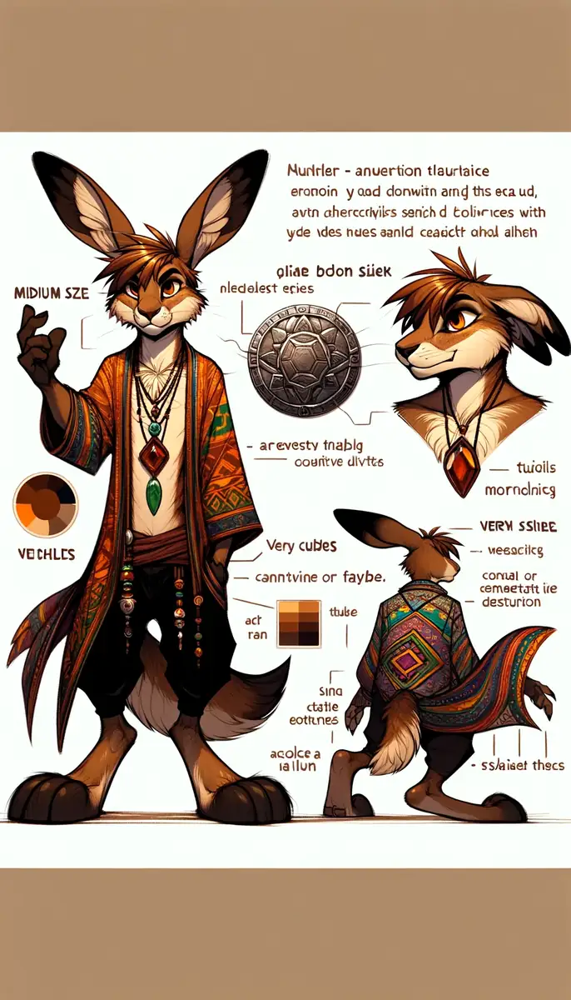
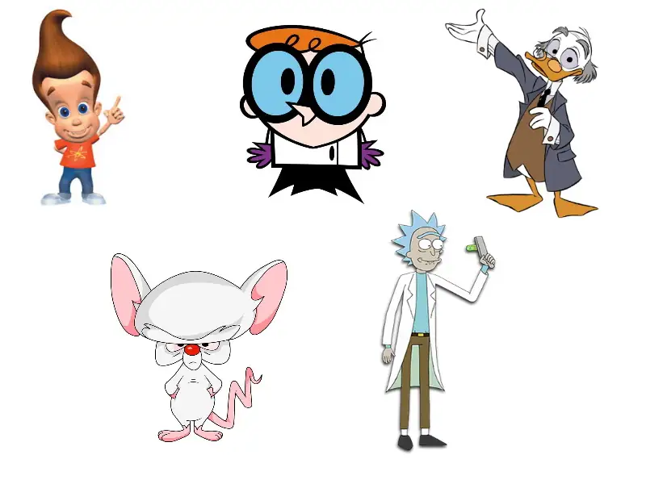
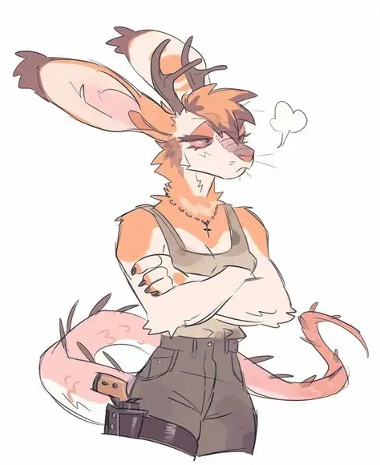
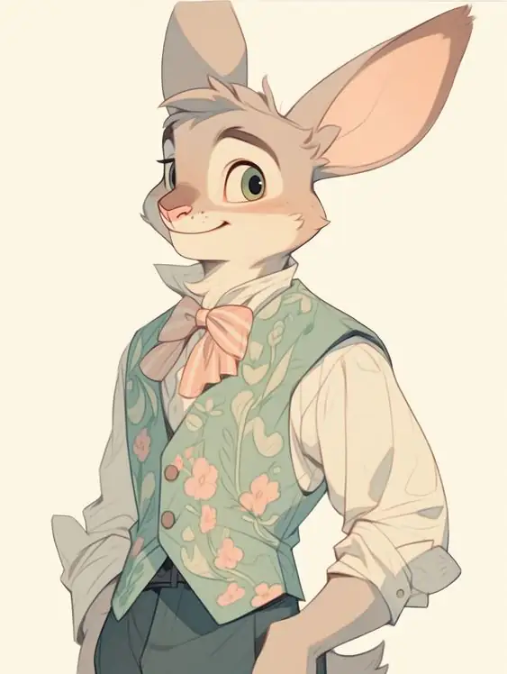

# Charadesign Challenge (2024)

<!-- wiki:infobox -->

| Charadesign Challenge (2024) | |
| --- | --- |
| Client | Projet personnel |
| Période | 2024 |
| Casquette | Direction créative & artistique |
| Catégorie | Collection |
| Folio | _pas encore sur le site_ |
| État de la fiche | Ébauche |
<!-- /wiki:infobox -->

**Charadesign Challenge (2024)** est un projet personnel d’Alexandre « Xtincell » Djengue (2024).

## Description

_À documenter._

## Galerie

<!-- wiki:galerie -->

<!-- /wiki:galerie -->

## Archives

- 26 fichiers dans les dossiers « Xtincell » des disques de travail (25 photos · 1 documents).

## Sources

- Archives personnelles rangées sur les disques (2026-11-09), dossier « Créations graphiques/Charadesign challenge (2024) »

<!-- wiki:liens-entrants -->
---
**Pages liées** : [Alexandre « Xtincell » Djengue](../personnes/alexandre-djengue.md)
<!-- /wiki:liens-entrants -->
