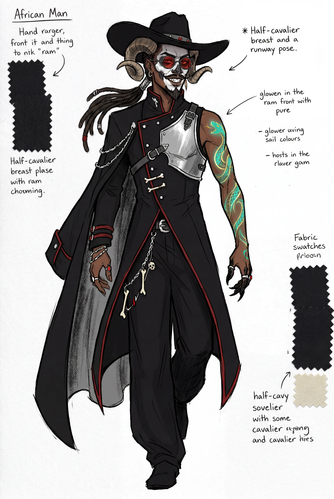
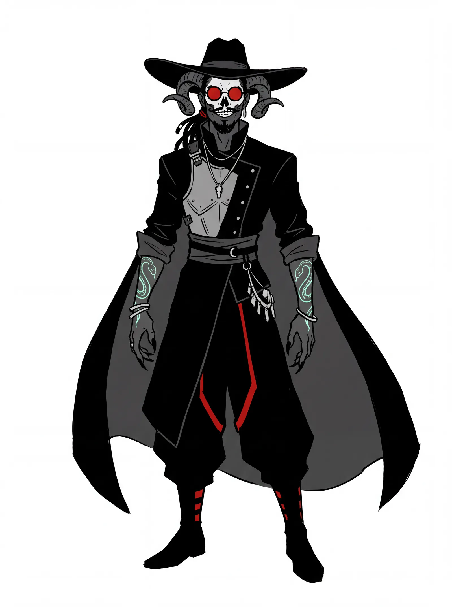
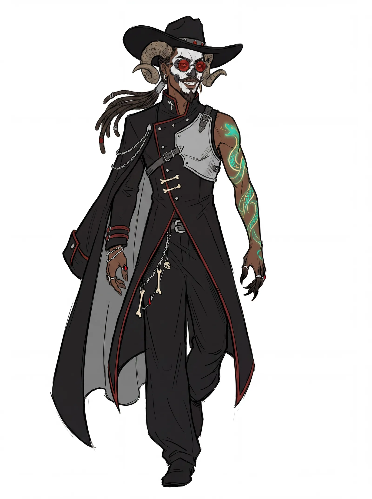
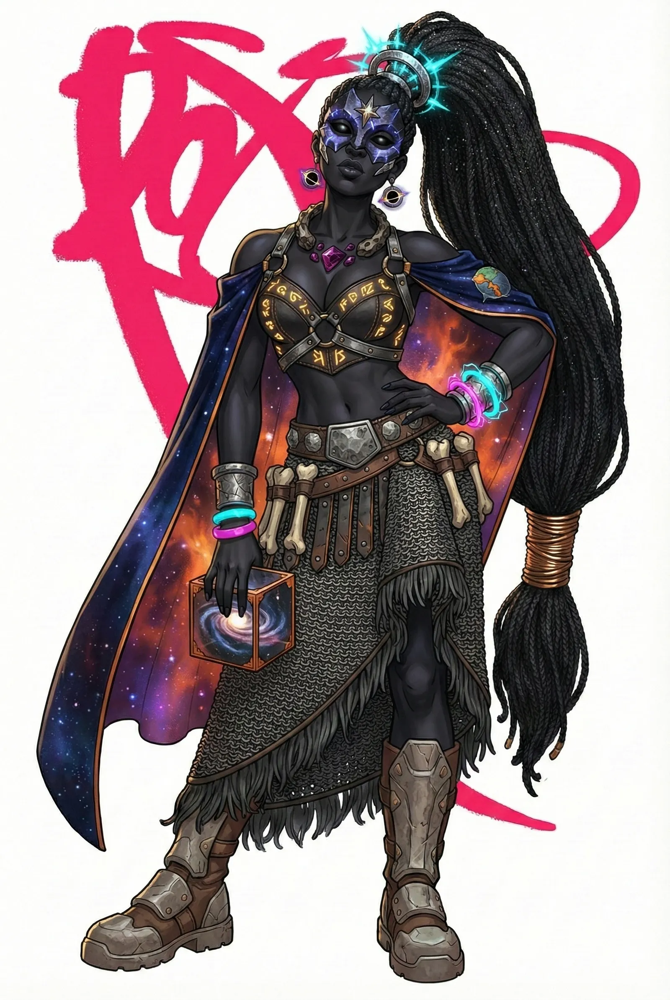
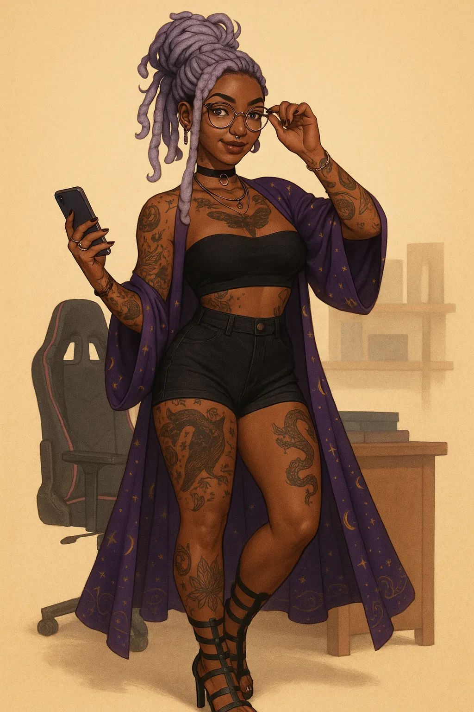
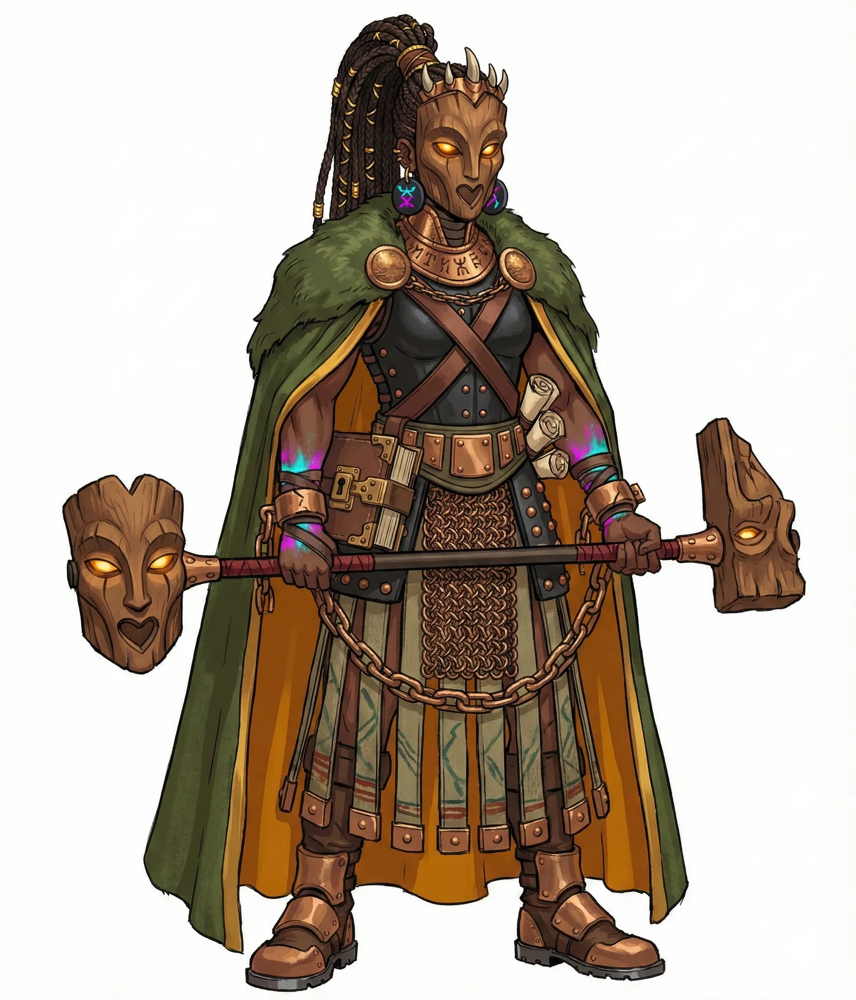
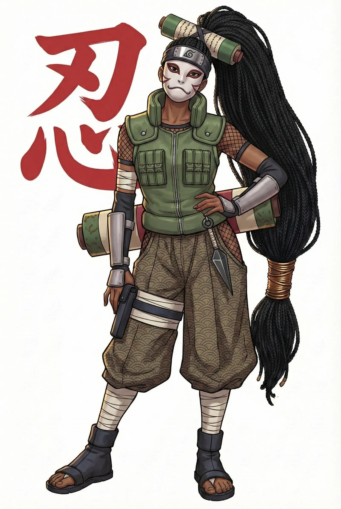
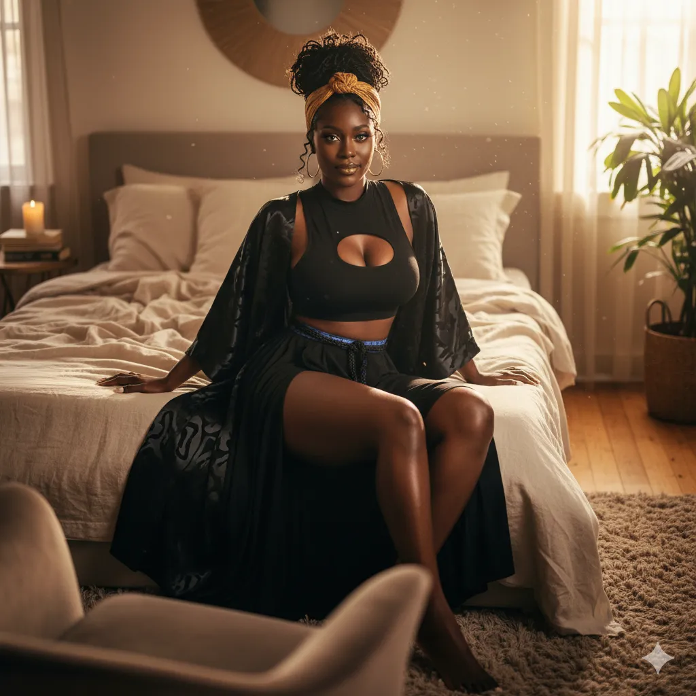
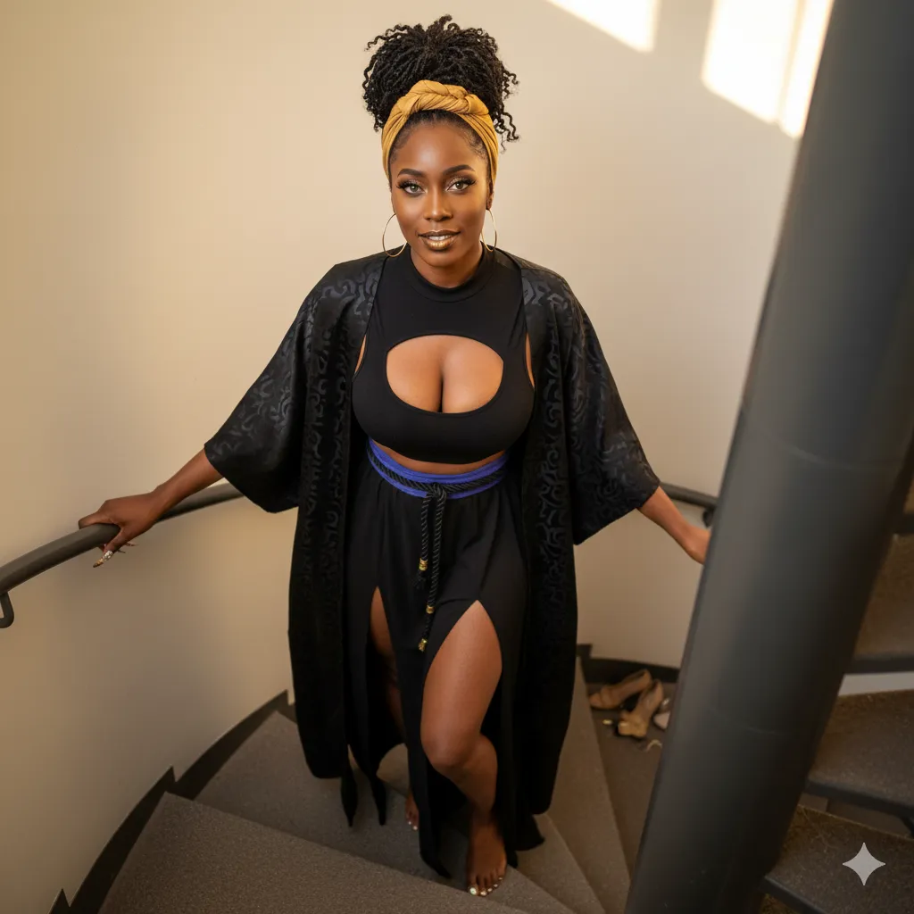
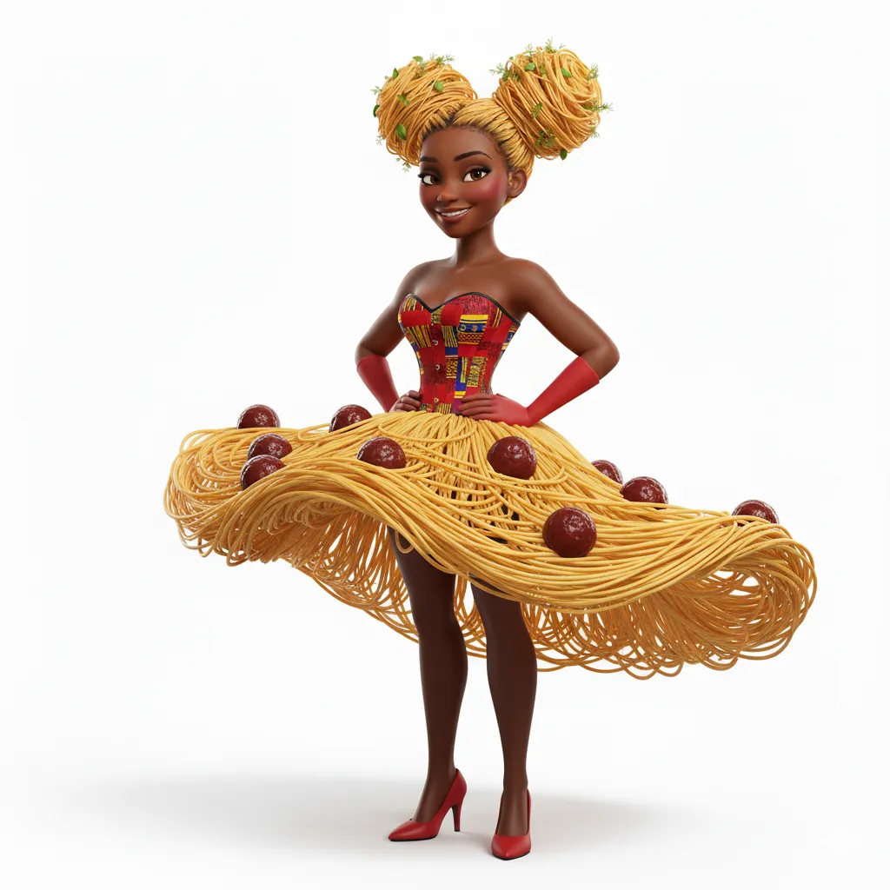

# Charadesign — Personnages afro-fantastiques

<!-- wiki:infobox -->

| Charadesign — Personnages afro-fantastiques | |
| --- | --- |
| Client | Projet personnel |
| Période | 2025 |
| Casquette | Direction créative & artistique |
| Catégorie | Collection |
| Disciplines | illustration |
| Folio | [Étude de cas ↗](https://xtincell.powerupgraders.com/work/charadesign) |
| État de la fiche | Ébauche |
<!-- /wiki:infobox -->

**Charadesign — Personnages afro-fantastiques** est une collection personnelle d’Alexandre « Xtincell » Djengue (2025).

## Contexte

Bibliothèque de character design afro-fantasy / afrofuturiste : héros et héroïnes à locs, tresses et cornes de bélier mêlant streetwear, regalia tribale et motifs cosmiques, en planches modèles et splash arts.

## Galerie

<!-- wiki:galerie -->

<!-- /wiki:galerie -->

## Preuves et médias

- Visuels : `public/work/cases/charadesign/` (11 fichiers)

## Sources

- Folio — `scripts/cases.spec.json`, entrée `charadesign`

<!-- wiki:liens-entrants -->
---
**Pages liées** : [Moteurs de character design (LSI-CD, Character Engine)](moteur-charadesign.md)
<!-- /wiki:liens-entrants -->
