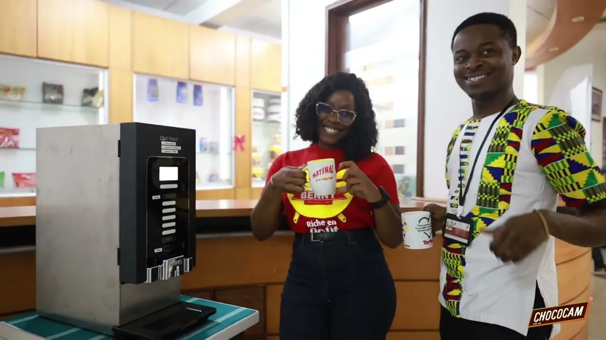

# Chococam — photo, vidéo et reportage

<!-- wiki:infobox -->

| Chococam — photo, vidéo et reportage | |
| --- | --- |
| Client | [Chococam](../organisations/chococam.md) |
| Via | [UPgraders](../organisations/upgraders.md) |
| Période | 2020–2023 |
| Casquette | Exécution |
| Catégorie | Production |
| Rôle | Photo · Vidéo · Reportage |
| Disciplines | Benny · Big Gum · Tartina · Matinal · Mambo · Tiger Brand |
| Folio | [Folio ↗](https://xtincell.powerupgraders.com/work) _(cité, sans page dédiée)_ |
| Liens | [Tartina · Fête des Mères](https://www.facebook.com/TartinaSpreads/videos/1085336389065869/) · [Chococam · capsule](https://www.youtube.com/watch?v=kVdl0igH3ws) · [Chococam · capsule](https://www.youtube.com/watch?v=EcWcME1xddY) · [Benny · Défilé 8 mars](https://www.facebook.com/BennySeasoning/videos/1501074026953556/) |
| État de la fiche | Standard |
<!-- /wiki:infobox -->

**Chococam — photo, vidéo et reportage** est une production réalisée pour [Chococam](../organisations/chococam.md), via [UPgraders](../organisations/upgraders.md) (2020–2023).

## Description

Couverture Défilé 8 mars (Benny), interviews vox pop, 2 épisodes pilotes & reportage journée fun (Big Gum), Fête des Mères (Tartina, Matinal), capsules santé Chococam, 1ᵉʳ Mai (Tiger Brand), Saint-Valentin & shooting produit (Mambo).

## Rôle

Photo · Vidéo · Reportage. Repère d’origine : « multi-projets ».

## Dates

Alexandre travaille pour Chococam à partir de 2020, d’abord avec l’agence [Bimstr](../organisations/bimstr.md) (dossier « Chococam × Bimstr »), puis avec [UPgraders](../organisations/upgraders.md) jusqu’en 2023. Le CV de 2026 et les données du site font remonter cette collaboration à 2014 ; aucune preuve antérieure à 2020 n’a été trouvée. Le wiki retient 2020–2023 ([confrontation des sources](../sources.md#confrontation-élément-par-élément)). _Sources : [disques](../sources.md#disques), [cv-2023-05](../sources.md#cv-2023-05), [cv-2026](../sources.md#cv-2026)._

## Galerie

<!-- wiki:galerie -->

<!-- /wiki:galerie -->

## Preuves et médias

- [Tartina · Fête des Mères](https://www.facebook.com/TartinaSpreads/videos/1085336389065869/)
- [Chococam · capsule](https://www.youtube.com/watch?v=kVdl0igH3ws)
- [Chococam · capsule](https://www.youtube.com/watch?v=EcWcME1xddY)
- [Benny · Défilé 8 mars](https://www.facebook.com/BennySeasoning/videos/1501074026953556/)
- Visuels : `public/work/chococam/` (6 fichiers)

## Sources

- Folio — `src/components/folio/data/practices.ts`, entrée « CHOCOCAM »
- Archives de travail rangées sur les disques — voir [disques](../sources.md#disques)
- CV « Dircom », 16 mai 2023 — voir [cv-2023-05](../sources.md#cv-2023-05)

<!-- wiki:liens-entrants -->
---
**Pages liées** : [Alexandre « Xtincell » Djengue](../personnes/alexandre-djengue.md)
<!-- /wiki:liens-entrants -->
