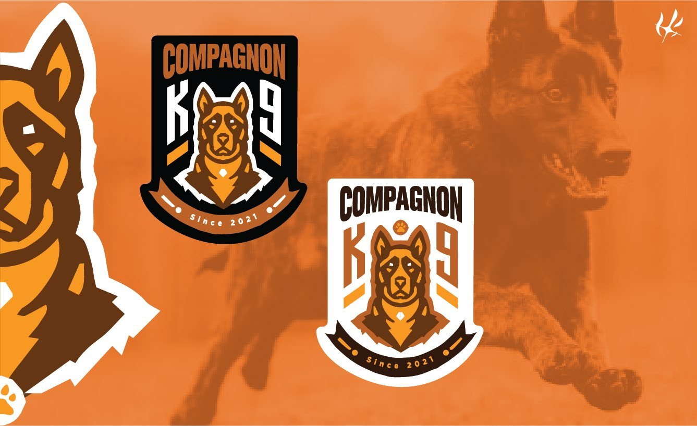
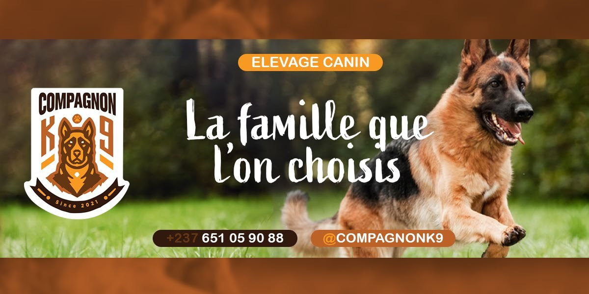
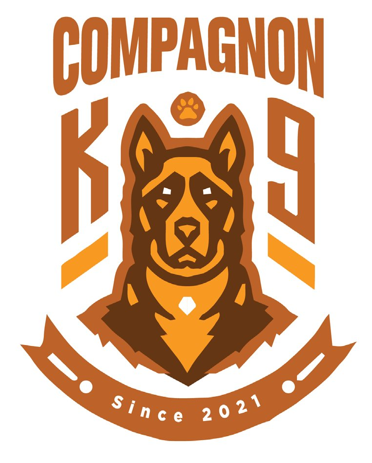

# Compagnon K9 — chenil

<!-- wiki:infobox -->

| Compagnon K9 — chenil | |
| --- | --- |
| Casquette | Direction créative & artistique |
| Catégorie | Projet |
| Folio | _pas encore sur le site_ |
| État de la fiche | Ébauche |
<!-- /wiki:infobox -->

**Compagnon K9 — chenil** est un projet.

## Description

_À documenter : contexte, demande, rôle, résultat._

## Galerie

<!-- wiki:galerie -->

<!-- /wiki:galerie -->

## Preuves et médias

- Visuels : `public/work/historique/04-compagnon-k9-chenil/` (3 fichiers)

## Sources

- Dossier de visuels du folio (`public/work/`)

<!-- wiki:liens-entrants -->
<!-- /wiki:liens-entrants -->
