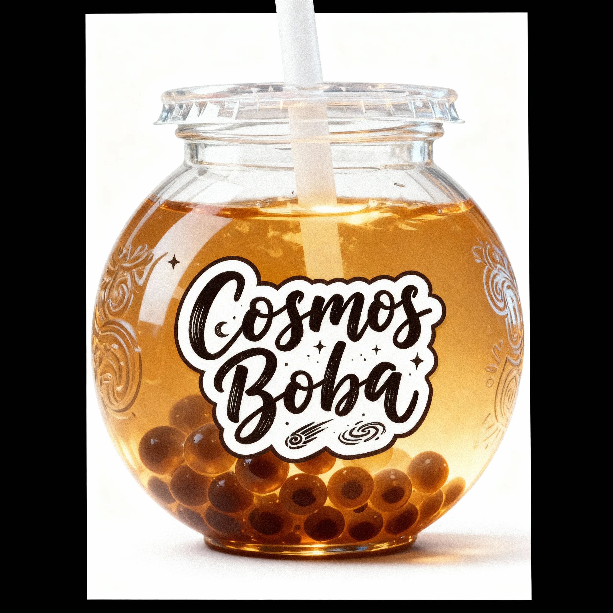
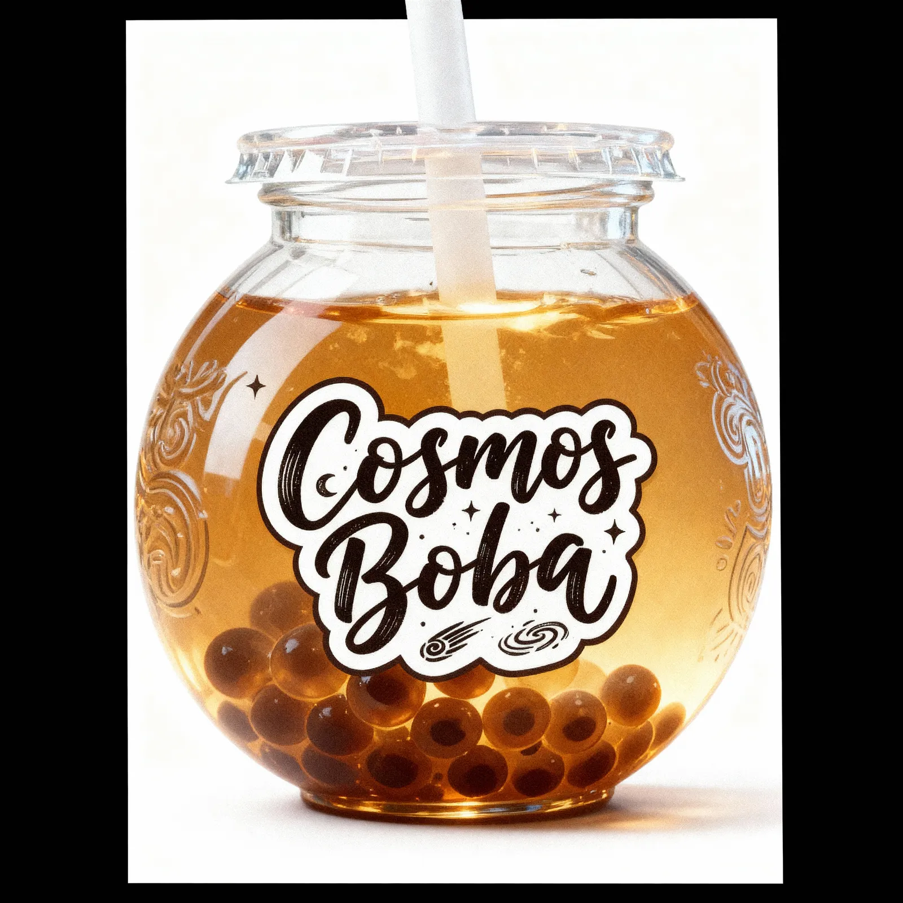
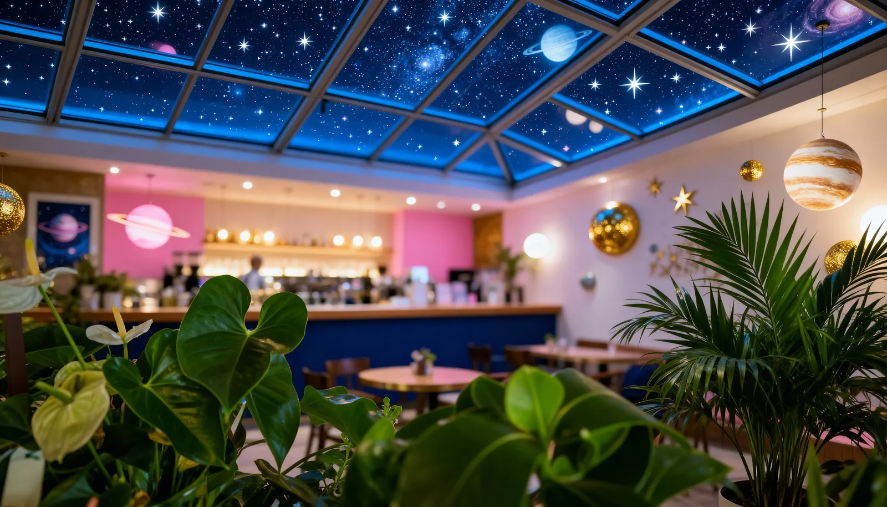
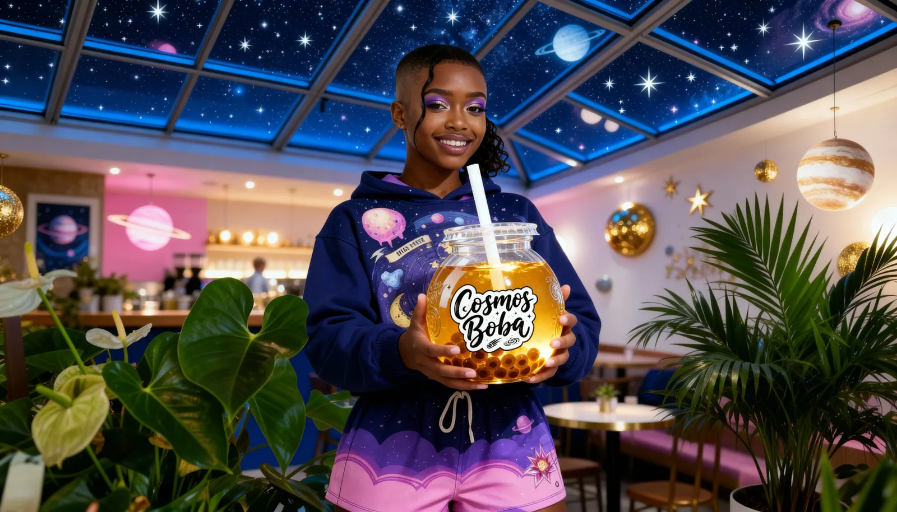
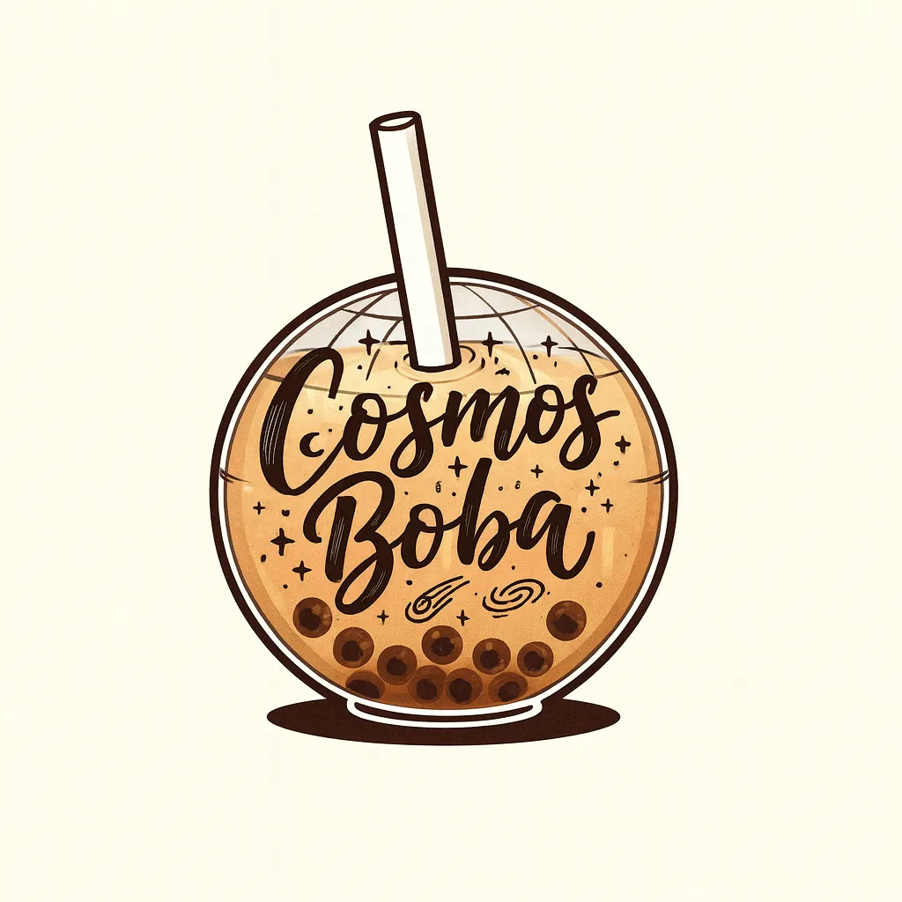
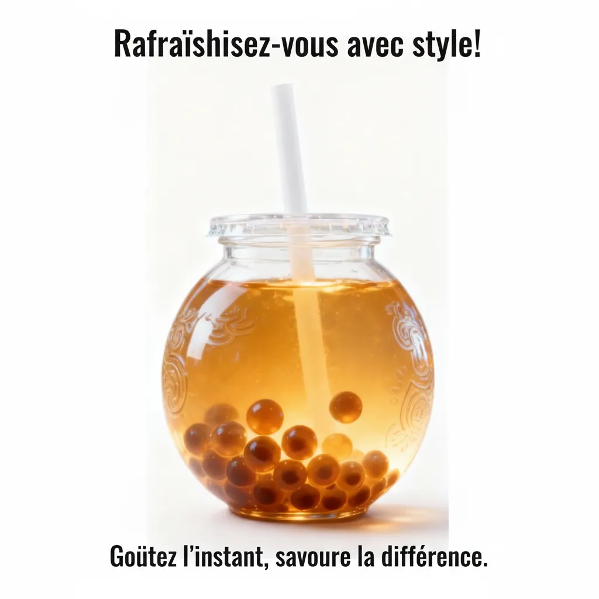
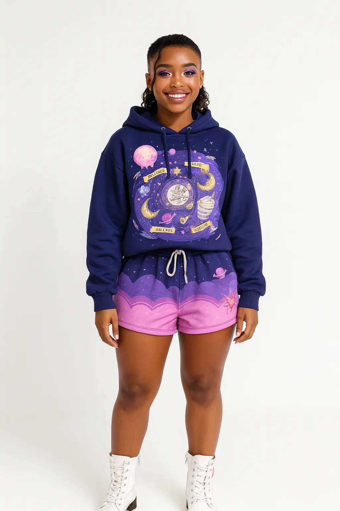

# Cosmos Boba — Bubble tea

<!-- wiki:infobox -->

| Cosmos Boba — Bubble tea | |
| --- | --- |
| Client | [Cosmos Boba](../organisations/cosmos-boba.md) |
| Période | 2025 |
| Casquette | Direction créative & artistique |
| Catégorie | Campagne |
| Disciplines | branding · packaging · social |
| Folio | [Étude de cas ↗](https://xtincell.powerupgraders.com/work/cosmo-boba) |
| État de la fiche | Ébauche |
<!-- /wiki:infobox -->

**Cosmos Boba — Bubble tea** est une campagne réalisée pour [Cosmos Boba](../organisations/cosmos-boba.md) (2025).

## Contexte

Identité et visuels produit pour la marque de bubble tea Cosmos Boba à univers cosmique : logo manuscrit, packaging et flyers social autour de la boisson en cup ronde.

## Galerie

<!-- wiki:galerie -->

<!-- /wiki:galerie -->

## Preuves et médias

- Visuels : `public/work/cases/cosmo-boba/` (7 fichiers)

## Sources

- Folio — `scripts/cases.spec.json`, entrée `cosmo-boba`

<!-- wiki:liens-entrants -->
<!-- /wiki:liens-entrants -->
