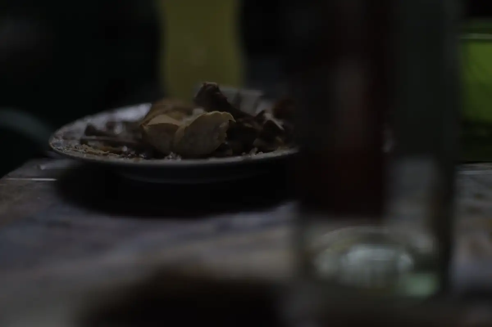
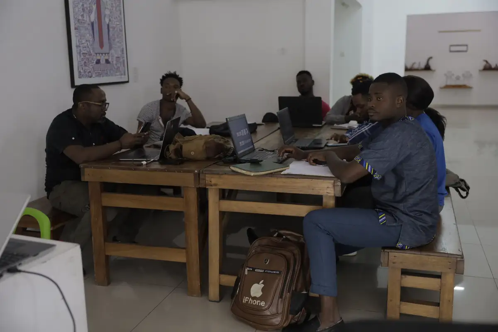
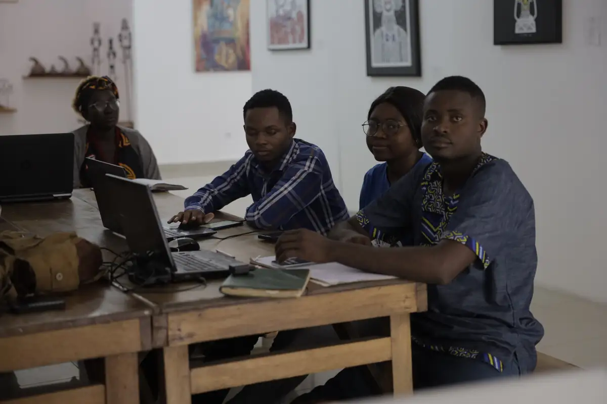
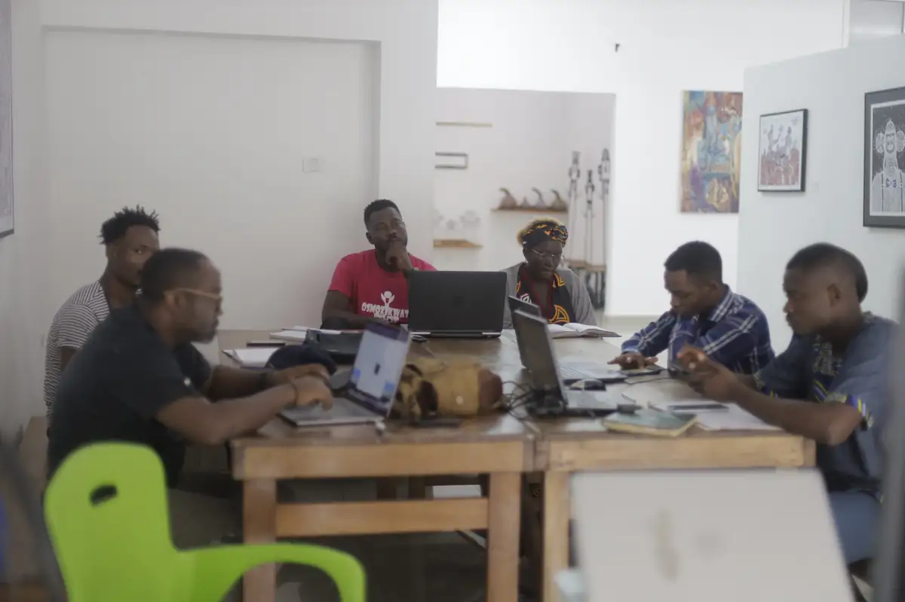

# Créapreneur (podcast)

<!-- wiki:infobox -->

| Créapreneur (podcast) | |
| --- | --- |
| Client | Projet personnel |
| Période | 2018–2021 |
| Casquette | Stratégie |
| Catégorie | Podcast |
| Sous-projets | [Créapreneur V2 — épisode 6 « Droit d'auteur » (atelier) puis dîner](evt-2022-08-02-creapreneur-v2-episode-6-droit-d-auteur-atelier-puis-dine.md) |
| Folio | _pas encore sur le site_ |
| Liens | [Archives (Apple Podcasts)](https://podcasts.apple.com/us/podcast/creapreneur/id1440424290) |
| État de la fiche | Standard |
<!-- /wiki:infobox -->

**Créapreneur (podcast)** est un podcast personnel d’Alexandre « Xtincell » Djengue (2018–2021).

## Description

Podcast présenté par Xtincell sur l'entrepreneuriat créatif en Afrique francophone : quotidien de créateur, gestion de clients, tarifs, droits d'auteur.

## Galerie

<!-- wiki:galerie -->

<!-- /wiki:galerie -->

## Liens

- [Archives (Apple Podcasts)](https://podcasts.apple.com/us/podcast/creapreneur/id1440424290)

## Sources

- Folio — `src/components/folio/data/press.ts`

<!-- wiki:liens-entrants -->
---
**Pages liées** : [Alexandre « Xtincell » Djengue](../personnes/alexandre-djengue.md) · [Créapreneur V2 — épisode 6 « Droit d'auteur » (atelier) puis dîner](evt-2022-08-02-creapreneur-v2-episode-6-droit-d-auteur-atelier-puis-dine.md)
<!-- /wiki:liens-entrants -->
