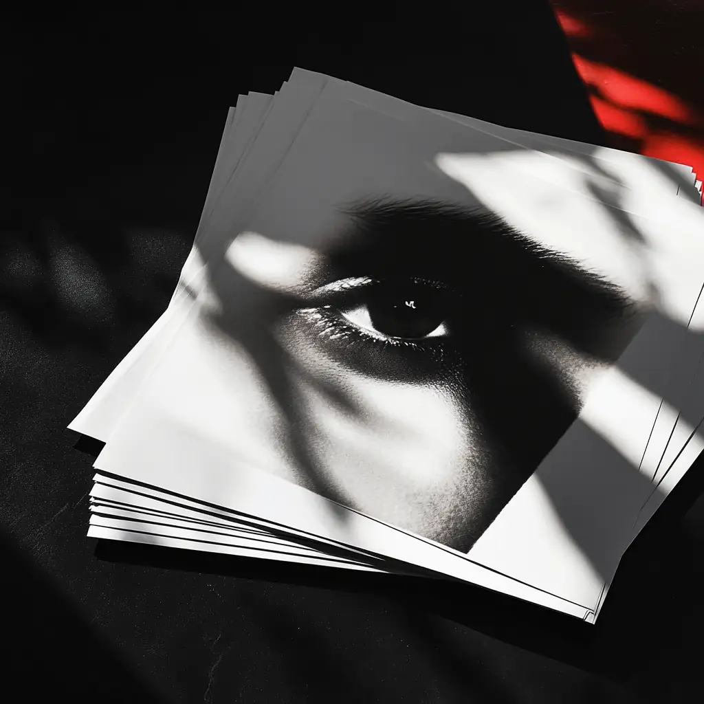
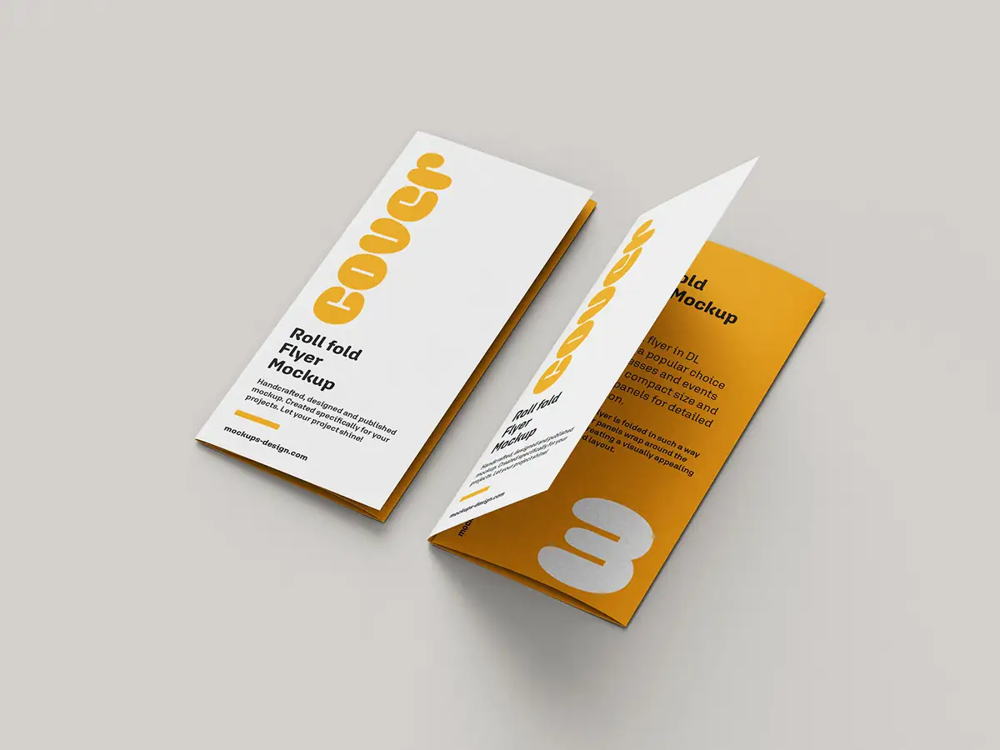
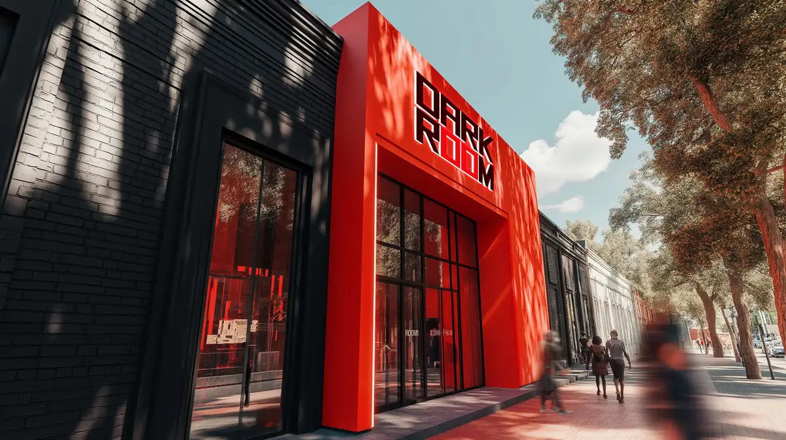
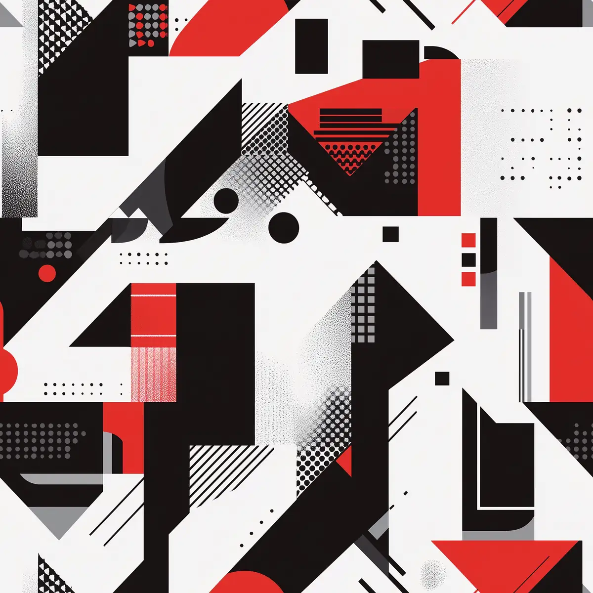

# Darkroom

<!-- wiki:infobox -->

| Darkroom | |
| --- | --- |
| Client | Projet personnel |
| Période | 2025 |
| Casquette | Direction créative & artistique |
| Catégorie | Projet |
| Folio | _pas encore sur le site_ |
| État de la fiche | Ébauche |
<!-- /wiki:infobox -->

**Darkroom** est un projet personnel d’Alexandre « Xtincell » Djengue (2025).

## Description

_À documenter._

## Galerie

<!-- wiki:galerie -->

<!-- /wiki:galerie -->

## Archives

- 193 fichiers dans les dossiers « Xtincell » des disques de travail (158 photos · 14 fichiers de création · 11 documents · 10 autres).

## Sources

- Archives personnelles rangées sur les disques (2026-11-09), dossier « Darkroom »

<!-- wiki:liens-entrants -->
---
**Pages liées** : [Alexandre « Xtincell » Djengue](../personnes/alexandre-djengue.md)
<!-- /wiki:liens-entrants -->
