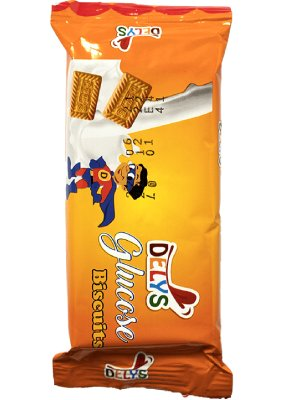
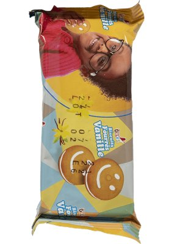
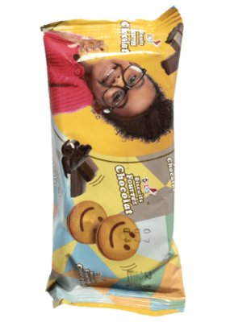
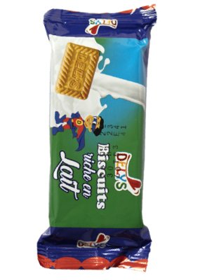
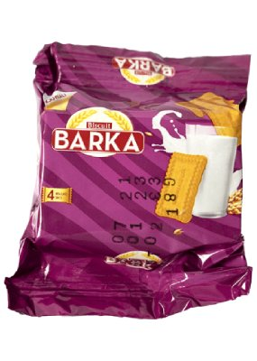
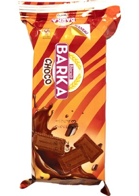

# Delys — Saint-Valentin

<!-- wiki:infobox -->

| Delys — Saint-Valentin | |
| --- | --- |
| Client | [Groupe Cadyst](../organisations/groupe-cadyst.md) |
| Via | [MATANGA Agency](../organisations/matanga-agency.md) |
| Période | 2026 |
| Casquette | Direction créative & artistique |
| Catégorie | Campagne |
| Disciplines | social · KV-OOH · photography |
| Folio | [Étude de cas ↗](https://xtincell.powerupgraders.com/work/delys) |
| État de la fiche | Standard |
<!-- /wiki:infobox -->

**Delys — Saint-Valentin** est une campagne réalisée pour [Groupe Cadyst](../organisations/groupe-cadyst.md), via [MATANGA Agency](../organisations/matanga-agency.md) (2026).

## Contexte

Visuel publicitaire Saint-Valentin pour la marque de snacks Delys : dîner romantique aux chandelles d'un couple, panier de produits Delys et doodles manuscrits « AMOUR / FOREVER ».

## Galerie

<!-- wiki:galerie -->

<!-- /wiki:galerie -->

## Preuves et médias

- Visuels : `public/work/cases/delys/` (2 fichiers)
- Visuels complémentaires : `public/work/tier23/cadyst-delys-barka-biscuits/` (6 fichiers)

## Sources

- Archives de travail rangées sous « MATANGA — EXPORT DU TRAVAIL » sur les disques (relevé du 2026-11-09)
- Folio — `scripts/cases.spec.json`, entrée `delys`

<!-- wiki:liens-entrants -->
---
**Pages liées** : [Alexandre « Xtincell » Djengue](../personnes/alexandre-djengue.md)
<!-- /wiki:liens-entrants -->
