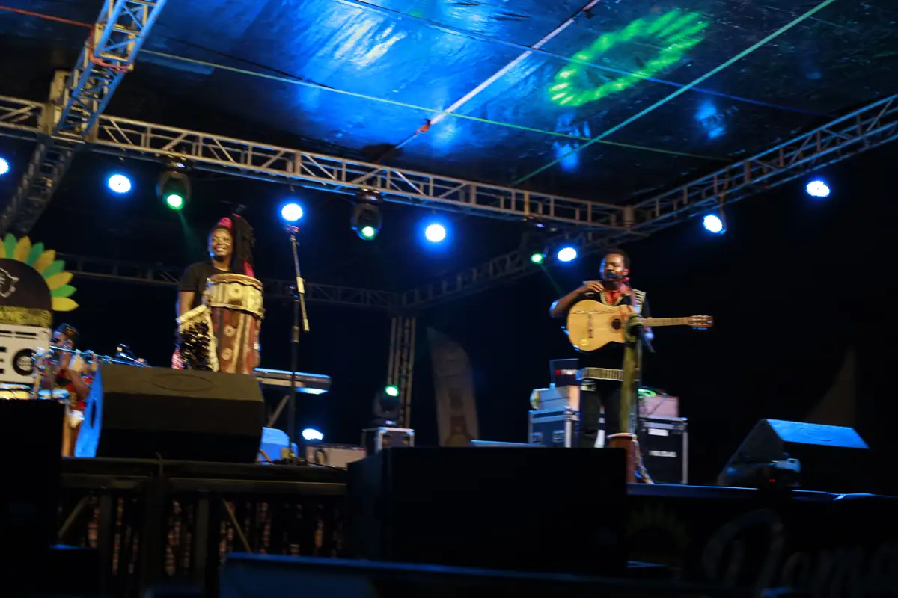
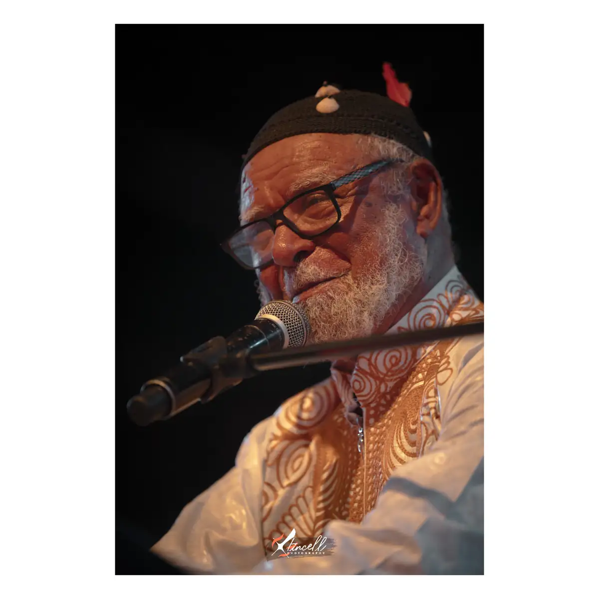
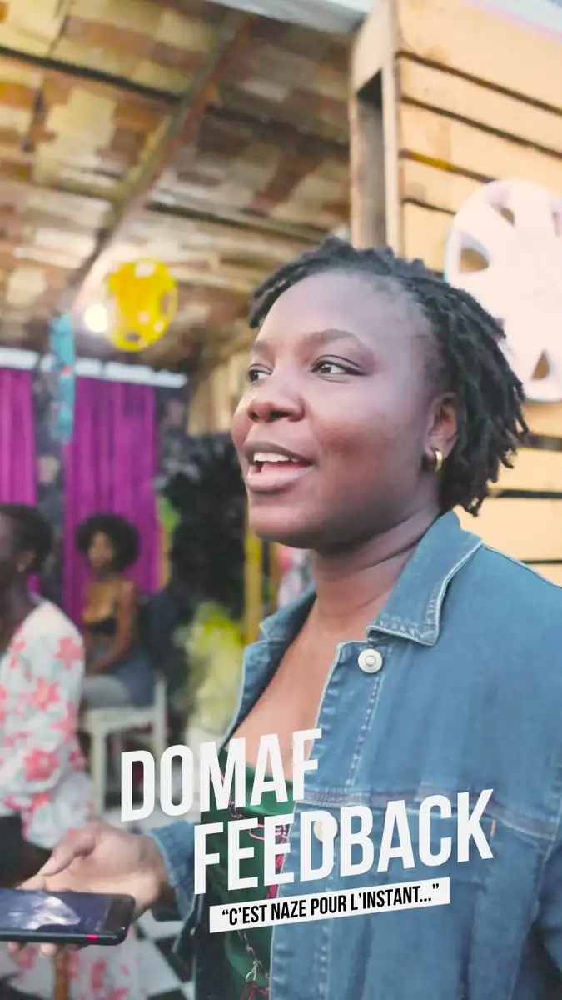
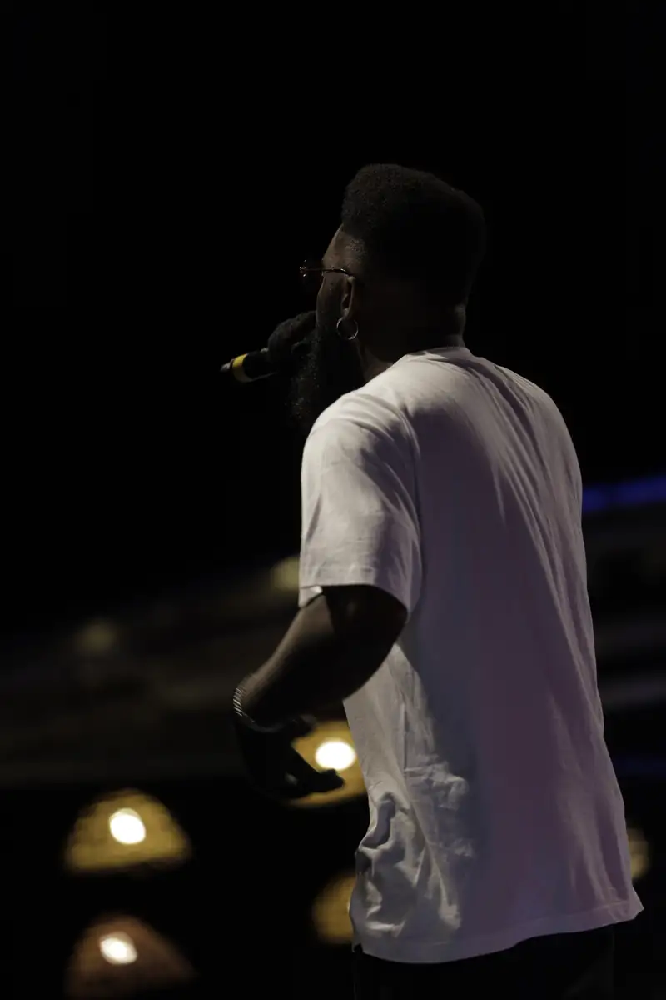
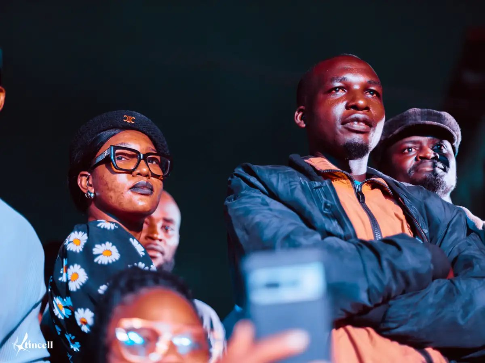

# DOMAF — Conseil Camerounais de la Musique — travaux

<!-- wiki:infobox -->

| DOMAF — Conseil Camerounais de la Musique — travaux | |
| --- | --- |
| Client | [DOMAF — Conseil Camerounais de la Musique](../organisations/domaf-conseil-camerounais-de-la-musique.md) |
| Via | [UPgraders](../organisations/upgraders.md) |
| Période | 2013–2025 |
| Casquette | Exécution |
| Catégorie | Production |
| Sous-projets | [DOMAF 2024 — concerts et battles](evt-2024-11-15-domaf-2024-concerts-et-battles.md) · [DOMAF 2022 — concerts](evt-2022-11-13-domaf-2022-concerts.md) · [DOMAF 2021 — 10e édition](evt-2021-11-25-domaf-2021-10e-edition.md) |
| Folio | _pas encore sur le site_ |
| État de la fiche | Ébauche |
<!-- /wiki:infobox -->

**DOMAF — Conseil Camerounais de la Musique — travaux** regroupe le travail réalisé pour [DOMAF — Conseil Camerounais de la Musique](../organisations/domaf-conseil-camerounais-de-la-musique.md) avec [UPgraders](../organisations/upgraders.md) (2013–2025).

## Description

_À documenter : demande, rôle, livrables._ Les dossiers et opérations retrouvés sur les disques sont détaillés sur la fiche [DOMAF — Conseil Camerounais de la Musique](../organisations/domaf-conseil-camerounais-de-la-musique.md#archives-de-travail).

## Galerie

<!-- wiki:galerie -->

<!-- /wiki:galerie -->

## Sources

- Archives de travail rangées sur les disques (2026-11-09)

<!-- wiki:liens-entrants -->
---
**Pages liées** : [DOMAF 2021 — 10e édition](evt-2021-11-25-domaf-2021-10e-edition.md) · [DOMAF 2022 — concerts](evt-2022-11-13-domaf-2022-concerts.md) · [DOMAF 2024 — concerts et battles](evt-2024-11-15-domaf-2024-concerts-et-battles.md)
<!-- /wiki:liens-entrants -->
