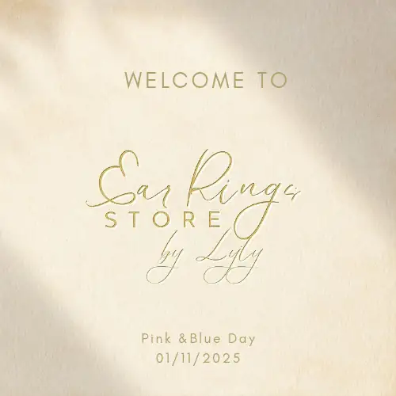

# Ear Rings Store by Lyly — travaux

<!-- wiki:infobox -->

| Ear Rings Store by Lyly — travaux | |
| --- | --- |
| Client | [Ear Rings Store by Lyly](../organisations/ear-rings-store-by-lyly.md) |
| Via | [UPgraders](../organisations/upgraders.md) |
| Période | 2025 |
| Casquette | Exécution |
| Catégorie | Production |
| Folio | _pas encore sur le site_ |
| État de la fiche | Ébauche |
<!-- /wiki:infobox -->

**Ear Rings Store by Lyly — travaux** regroupe le travail réalisé pour [Ear Rings Store by Lyly](../organisations/ear-rings-store-by-lyly.md) avec [UPgraders](../organisations/upgraders.md) (2025).

## Description

_À documenter : demande, rôle, livrables._ Les dossiers et opérations retrouvés sur les disques sont détaillés sur la fiche [Ear Rings Store by Lyly](../organisations/ear-rings-store-by-lyly.md#archives-de-travail).

## Galerie

<!-- wiki:galerie -->

<!-- /wiki:galerie -->

## Sources

- Archives de travail rangées sur les disques (2026-11-09)

<!-- wiki:liens-entrants -->
<!-- /wiki:liens-entrants -->
